# Dossier de conception V1 — sprint 1

**Le fil conducteur.** Un artisan dicte son chantier ; l'application lui prépare un devis qu'il corrige, puis chiffre sans jamais inventer un prix. Le dossier suit ce fil : à qui ça sert (§1), ce qu'on construit en six jours et ce qu'on laisse de côté (§2, §3), comment l'agent raisonne (§4), avec quels outils (§5), comment tout s'assemble et arrive en production (§6), comment on saura que c'est fini (§7) et dans quel ordre on avance (§8).

## 1. Le besoin

> 🧭 Le point de départ : un artisan, un problème de temps, une promesse.

### A. Pour qui

**Des artisans** ou petites entreprises du bâtiment : peinture, sols, plomberie, électricité.
Plusieurs artisans utilisent l'application en même temps, **chacun avec ses propres projets de
devis**, isolés de ceux des autres. Leur client final n'a ni compte ni écran.

### B. Le problème

Sur le chantier, l'artisan prend ses mesures et ses notes. Le soir, il doit en
tirer un devis : quantités, consommables qu'on oublie toujours, taux de TVA (taxe sur la valeur
ajoutée), mentions obligatoires du BTP (bâtiment et travaux publics). C'est long, et une erreur
de prix ou de mention coûte cher.

### C. Le parcours promis

> 💡 **En bref** : L'agent prépare, l'artisan décide : il corrige et valide, il ne saisit jamais tout.

L'application est un **copilote** : l'agent pré-remplit le devis en suggestions grisées, l'artisan
garde la main — il accepte, modifie, supprime ou ajoute des blocs, au clic ou à la voix. Le
bouton **« Générer »** complète les vides et calcule les prix : aucun prix n'apparaît avant.

```mermaid
%%{init: {"flowchart": {"wrappingWidth": 420}}}%%
flowchart TB
  e1["🗣️ <b>1. Dicter</b><br/>Sur le chantier, mains occupées :<br/>pièces, surfaces, travaux, contraintes"]
  e2["🔄 <b>2. L'agent reformule et comprend</b><br/>Automatique, sans relecture de l'artisan"]
  e3["✨ <b>3. L'agent pré-remplit le devis</b><br/>Lots, ouvrages, quantités, consommables<br/>en <b>suggestions grisées</b> ; une question ciblée si un manque bloque"]
  e4["✍️ <b>4. L'artisan édite, comme avec un copilote</b><br/>Accepte, modifie, supprime, ajoute un bloc<br/>au clic ou à la voix"]
  e5["⚙️ <b>5. Bouton « Générer »</b><br/>Complète les vides, résout les prix,<br/>calcule conditionnements, TVA, totaux"]
  e6["📄 <b>6. Ajuster, puis exporter</b><br/>L'artisan a le dernier mot sur chaque ligne<br/>Fichier Word avec les mentions obligatoires"]

  e1 --> e2 --> e3 --> e4
  e4 -- "🎙️ dicte encore : l'agent complète" --> e3
  e4 -- "⚙️ Générer" --> e5 --> e6
  e6 -. "modifie encore, puis regénère" .-> e4

  classDef etape fill:#eef4fb,stroke:#1168bd,color:#0b2e52
  classDef cle fill:#1168bd,stroke:#0b4884,color:#ffffff
  class e1,e2,e3,e6 etape
  class e4,e5 cle
```

### D. Le principe : le modèle décrit, le code calcule

> 💡 **En bref** : Un modèle de langage peut se tromper sur un chiffre ; on ne lui confie donc jamais un prix. Il décrit les travaux, le code fait les calculs.

Le LLM (grand modèle de langage) ne produit jamais un montant.

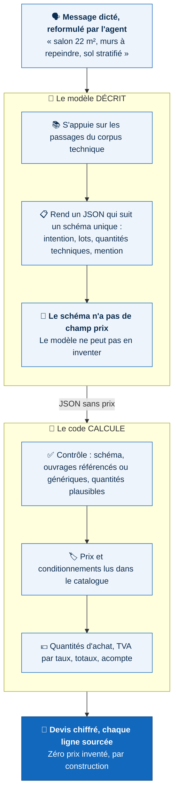

## 2. Périmètre V1 — six jours de développement

> 🧭 De la promesse au chantier : ce qu'on construit concrètement, jour par jour.

### A. Les six jours

> 💡 **En bref** : Six jours, un objectif par jour, et une carte verte qui dit simplement « ce jour est fini ».

Le code du parcours existe déjà et il est couvert par les tests ; les six jours servent à
**choisir le modèle sur des mesures, mettre en production, ancrer sur un corpus technique et
mesurer le prompt**. Une rangée de cartes par jour : les tâches, puis la carte verte 🏁 qui dit quand le jour est
fini. Les jours sont alignés sur les sprints de la série.

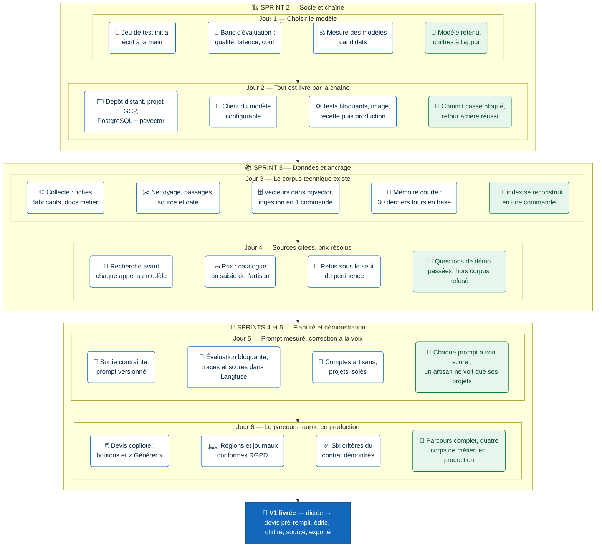

### B. Améliorer le modèle sans l'entraîner

> 💡 **En bref** : Plutôt que de réentraîner le modèle, ce qui coûte cher, on améliore ses consignes et on mesure chaque amélioration.

Sortie contrainte au schéma, prompt versionné et
évalué sur un jeu de test écrit à la main. Le fine-tuning est une V2 potentielle, engagée
seulement si l'évaluation montre que le prompt plafonne.

## 3. Ce que la V1 ne fera pas

> 🧭 Ce qu'on ne fait pas compte autant que ce qu'on fait : c'est ce qui rend les six jours tenables.

Quatre cercles, du plus proche au plus lointain : la **V1.1**, déjà conçue et livrée juste après
les six jours ; ce qui viendra en V2 si une mesure le justifie ; puis deux familles de pistes —
faire évoluer le produit, l'étendre au-delà du devis.

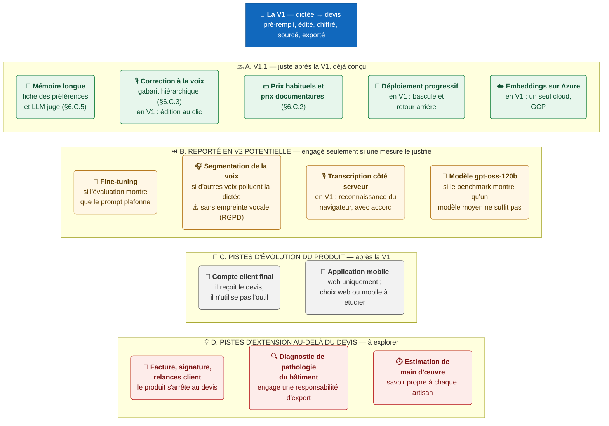

**Réserve sur la segmentation de la voix** : reconnaître l'artisan par son empreinte vocale est une
donnée biométrique (RGPD, article 9) ; une séparation des voix sans identification est à
privilégier.

## 4. La composante agentique

> 🧭 Le cœur intelligent du produit : comment l'agent réfléchit, et quand il rend la main à l'artisan.

### A. La composante retenue

> 💡 **En bref** : Un « workflow » : l'agent suit un chemin balisé, étape par étape, au lieu d'improviser ; l'artisan intervient aux moments clés.

Un **workflow agentique orchestré, avec humain dans la boucle** (HITL, *human in the loop*).
*À valider : son intitulé exact dans le menu du dispositif.*

### B. Ce que fait l'agent

> 💡 **En bref** : À chaque message, l'agent comprend, cherche dans sa documentation, propose, puis vérifie sa propre réponse avant de la montrer.

L'agent prend la dictée telle quelle, en reformule lui-même l'intention et le message, découpe le
chantier en **lots** — un par corps de métier — puis **itère sur chaque lot** autant que
nécessaire : il s'ancre sur le corpus, interroge le modèle, contrôle la réponse, pose les
questions qui manquent et pré-remplit le lot en suggestions grisées, que l'artisan accepte,
modifie, supprime ou complète. Puis il
passe au lot suivant.

Trois règles :

- **L'outil est un copilote, et il est ouvert.** L'agent pré-remplit, l'artisan édite. Un
  ouvrage absent du référentiel n'est pas rejeté : l'agent en fait une **proposition générique
  grisée**, que l'artisan modifie ou affine avec un produit référencé. Toute demande qui relève d'un devis est acceptée, même hors des quatre corps de
  métier pilotes.
- **La session ne s'arrête jamais sur un échec.** L'agent dit ce qu'il n'a pas compris et
  redemande ; l'échec est compté dans `/metriques`, sans interrompre l'artisan.
- **Les questions vérifient ou confirment ce que l'agent a produit**, jamais le point de départ.

**Vocabulaire.** Un **lot** est un corps de métier du devis (peinture, sols…). Un **ouvrage** est
une prestation élémentaire, par exemple « peinture de finition, 2 couches, au m² » ; le
référentiel en connaît les rendements, la chute et les consommables. Une **ligne** est un ouvrage
posé dans le devis, avec sa quantité.

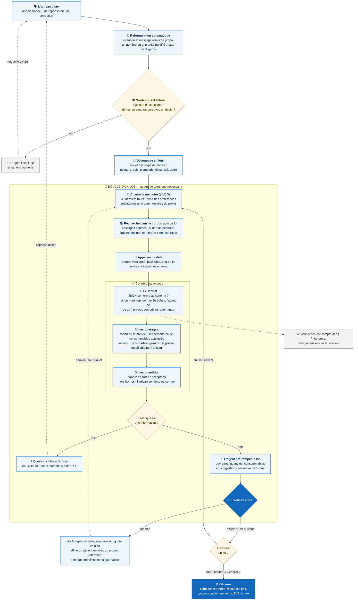

### C. Pourquoi cette composante sert ce besoin

Le devis engage la responsabilité de l'artisan :
la fiabilité compte plus que l'autonomie. Un agent qui appellerait librement des outils de
calcul ferait du modèle l'auteur des montants, ce que le principe du projet interdit. Le besoin
est un parcours séquentiel avec des validations, pas une exploration ouverte : un workflow
contrôlé y répond mieux qu'un agent autonome ou plusieurs agents.

## 5. La stack

> 🧭 Les briques techniques choisies pour construire tout cela, et pourquoi celles-là.

### A. Les choix

> 💡 **En bref** : Chaque ligne dit quel outil on prend et pourquoi ; tout tourne chez Google Cloud, en Europe.

| Couche | Choix | Pourquoi |
|---|---|---|
| Langage, environnement | Python 3.14, uv | Environnement reproductible depuis `uv.lock` |
| API | FastAPI, Pydantic | Contrat OpenAPI typé, erreurs déclarées |
| Interface | Une page HTML sans compilation | Aucune étape de build |
| Modèle | **Choisi au jour 1 par le benchmark** (§6.C.1). Référence : `gpt-oss-20b`, auto-hébergé par Ollama sur un service Cloud Run privé avec GPU L4 | Le choix se fait sur la qualité, la latence et le coût mesurés, données en Europe exigées |
| Hébergement | Cloud Run, région `europe-west1`, plusieurs instances : l'état vit dans PostgreSQL | Pas de serveur à administrer ; retour arrière natif par révision ; GPU payé à la seconde d'activité |
| Images, secrets | Artifact Registry, Secret Manager | Les clés et secrets d'authentification restent hors du dépôt |
| Authentification | **Un compte par artisan**, mode d'identification à choisir ; chaque requête ne voit que les projets de l'artisan connecté | Plusieurs artisans en même temps : l'isolation des données se vérifie à chaque accès, pas seulement à l'écran |
| Base de données | **PostgreSQL avec pgvector, une seule base** (Cloud SQL, `europe-west1`) : catalogue, ouvrages, projets, devis, profil, corpus et ses vecteurs | Une base pour le relationnel et la recherche vectorielle : jointures entre un passage, sa source et un ouvrage ; plus de fichiers sur un disque que Cloud Run efface |
| Corpus et recherche (RAG) | Vecteurs dans pgvector ; **modèle d'embeddings multilingue servi sur GCP**, région UE (Vertex AI, modèle précis à confirmer). Azure AI Foundry en V1.1 | Un seul cloud en V1 : un seul contrat de sous-traitance, une seule région à tenir |
| Mémoire | Même base PostgreSQL + pgvector que le RAG : en V1, **mémoire courte de 30 tours** ; la mémoire longue (fiche des préférences, LLM juge) arrive en V1.1 | Le contexte de la conversation sans un second appel au modèle |
| Prompts | Fichiers versionnés dans le dépôt, publiés dans Langfuse, chacun avec son rapport d'évaluation | Une version de prompt se compare, se livre et se retire comme du code |
| Observabilité | **Langfuse** pour le modèle : traces de chaque tour, version de prompt, latence, coût, scores d'évaluation ; Cloud Logging pour l'infrastructure | Relier chaque comportement observé à la version de prompt et au modèle qui l'ont produit |
| Export | `python-docx` | Le format que l'artisan sait modifier |
| Chaîne | GitHub Actions, authentifié auprès de GCP sans clé stockée (fédération d'identité) | Aucun secret longue durée dans GitHub |

### B. L'élément exotique

> 💡 **En bref** : La formation n'autorise qu'une technologie hors du socle commun ; ici, héberger soi-même le modèle, et seulement si le benchmark le retient.

Il dépend du benchmark. Si le modèle retenu est auto-hébergé sur GPU, c'est
l'unique dérogation au socle ; s'il est servi par une API européenne, la stack n'en a aucune.

## 6. Les schémas

> 🧭 Comment ces briques s'assemblent (A), comment le code arrive en production sans rien casser (B), et les mécanismes qui font la valeur du produit (C).

### A. Architecture — modèle C4

> 💡 **En bref** : Trois zooms successifs sur la même application, comme une carte : le pays, la ville, puis le quartier.

Les schémas suivent le **modèle C4** : on zoome par niveaux, du système vu de l'extérieur jusqu'à
ses composants. Le déroulé dans le temps est porté par la boucle de l'agent (§4.B).

**Légende commune.** Chaque boîte donne son nom, son type C4 et sa technologie entre crochets.
Chaque flèche porte ce qui circule et son protocole. **[DP]** marque ce qui manipule des données
personnelles. Une boîte à **bord pointillé** est une cible de la V1 pas encore présente dans le
code ; son libellé le dit aussi : **(à faire)**. Tout ce qui est dans GCP tourne en région
`europe-west1`.

#### Niveau 1 — Contexte

> 💡 **En bref** : Qui utilise le système, et avec quels services extérieurs il échange.

Le système, la seule personne qui l'utilise, et les systèmes extérieurs dont il dépend. Les
flèches sont numérotées dans l'ordre du parcours ; chaque système externe dit ce qu'il reçoit,
ce qu'il rend, à quelle fréquence, et **ce que fait le produit s'il est en panne**. Le client
final ne touche pas le système : il reçoit le devis exporté, envoyé par l'artisan.

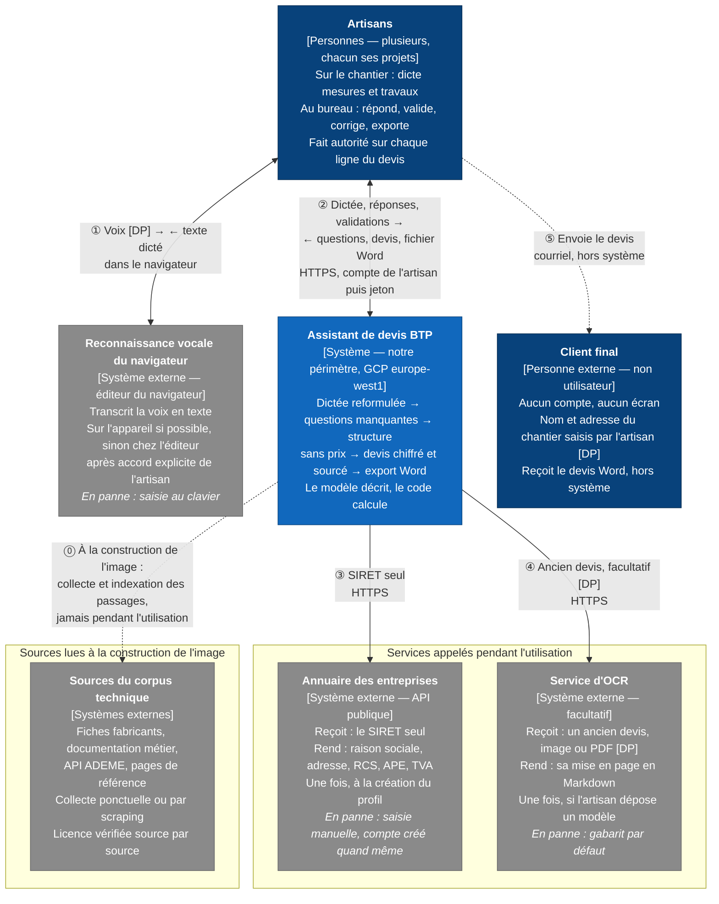

#### Niveau 2 — Conteneurs

> 💡 **En bref** : Les grandes pièces qui tournent en production, et comment elles se parlent.

Les unités déployées, leurs magasins de données et leurs protocoles. Deux frontières de
confiance : l'API n'est joignable qu'avec le jeton de session d'un artisan, qui ne voit que ses
propres projets ; le
service de modèle n'est joignable que par l'identité de service de l'API.

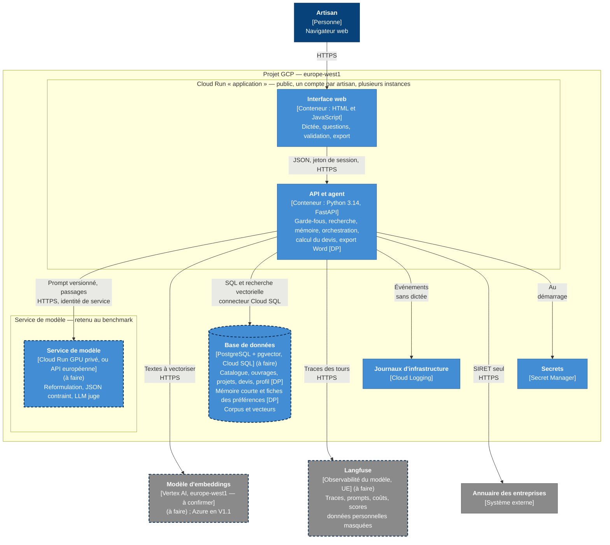

#### Niveau 3 — Composants de l'API

> 💡 **En bref** : À l'intérieur de l'application : quel fichier de code fait quoi.

Où vit chaque responsabilité dans le conteneur « API et agent ». Le point clé : **le modèle n'est
appelé qu'entre deux couches de code**, une qui prépare, une qui contrôle et calcule. Le
comportement pas à pas est au §4.B.

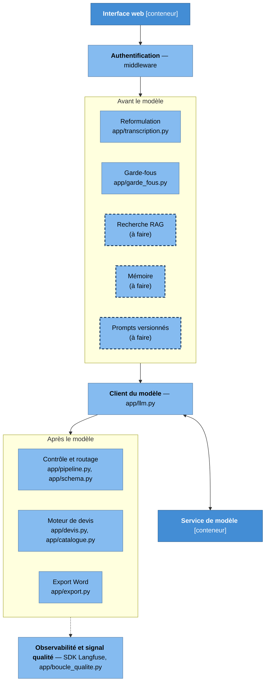

### B. Pilotage : stratégie Git, chaînes, environnements, signaux

> 💡 **En bref** : Comment une modification passe de mon poste à la production sans rien casser, et comment on revient en arrière si besoin.

#### La stratégie : GitHub Flow, avec des versions étiquetées

> 💡 **En bref** : Chaque changement se fait sur une branche à part, puis rejoint la branche principale après vérification ; une étiquette de version marque ce qui part en production.

`main` est toujours livrable. Tout changement part d'une **branche courte** et revient par une
**pull request** ; une version de production est une **étiquette** posée sur `main`.

| Règle | Détail |
|---|---|
| `main` protégée | Aucun push direct ; fusion seulement par pull request, contrôles verts exigés ; historique linéaire (fusion par squash) |
| Branches courtes | Durée de vie de quelques jours au plus, nommées par leur nature : `feat/US-xx-…`, `fix/…`, `prompt/…`, `docs/…`, `hotfix/…` |
| Branche `prompt/…` | Une nouvelle version de prompt est une branche à part entière : elle déclenche l'évaluation sur le vrai modèle |
| Versions | Étiquettes `vX.Y.Z` sur `main` : majeur si le contrat de l'API change, mineur pour une fonctionnalité, correctif pour un défaut |
| Correctif urgent | Branche `hotfix/…` depuis `main`, mêmes contrôles, puis étiquette de correctif |
| Une décision, un commit | Une décision de conception s'écrit dans `docs/DECISIONS.md` dans le même commit que le code qu'elle change |

Le graphe suivant montre un cycle complet : une fonctionnalité et une nouvelle version de prompt
développées en parallèle, une version mineure, puis un correctif.

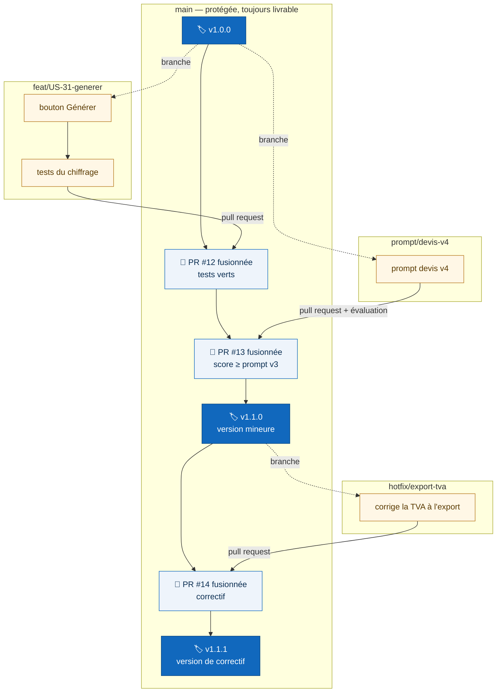

#### Deux chemins vers la production

> 💡 **En bref** : Le code et les données n'évoluent ni au même rythme ni avec les mêmes risques : chacun a son chemin et ses propres contrôles. Le premier chemin sépare aussi « vérifier vite et gratuitement », avant de fusionner, de « mesurer la qualité du modèle, lentement et en payant », avant la production.

**Chemin 1 — code et prompt.** Deux portes distinctes : la fusion dans `main` n'exige que des
contrôles rapides, gratuits et déterministes ; l'évaluation sur le vrai modèle, lente et payante,
ne bloque que la **promotion** en production. Pour limiter le coût, elle ne tourne que si ce
qu'elle mesure a changé, et commence par une évaluation éclair qui arrête tout au premier échec.

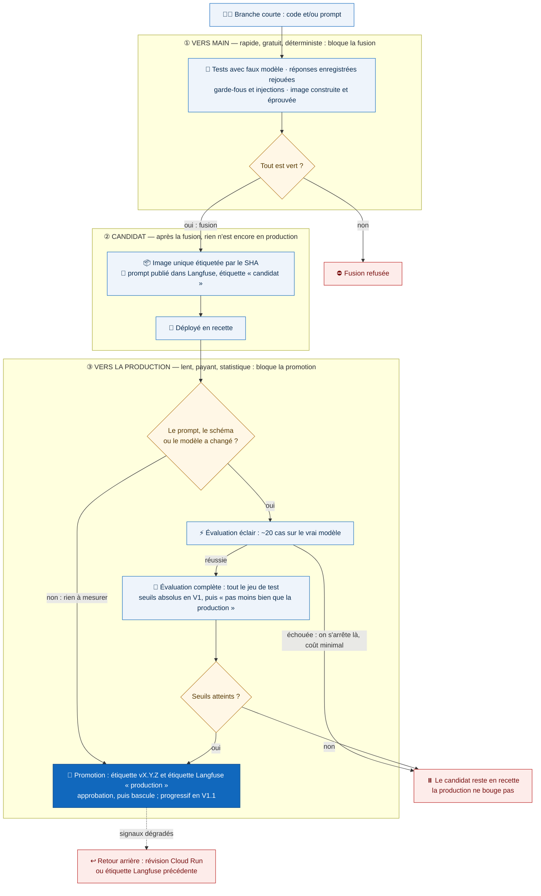

**Chemin 2 — données et pipeline.** Une nouvelle version du corpus s'écrit à côté de l'active,
est évaluée sur des questions de référence, et ne la remplace que si elle fait au moins aussi
bien. L'ancienne version reste en base pour un retour arrière immédiat.

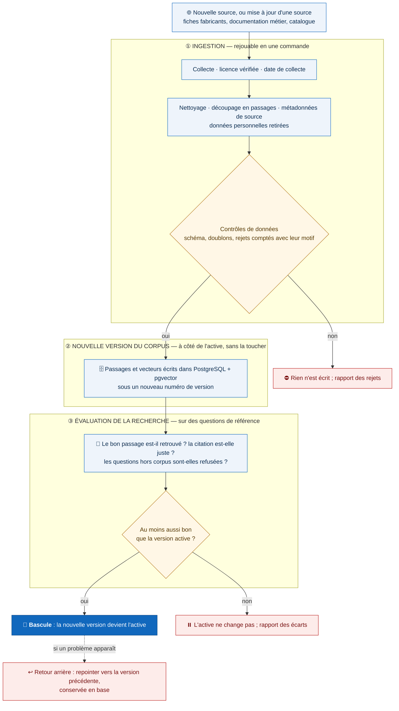

#### Les environnements

> 💡 **En bref** : Trois copies de l'application : une pour essayer, une pour tester, une pour les vrais utilisateurs.

| Environnement | Déclencheur | Base de données | Langfuse | Trafic |
|---|---|---|---|---|
| Prévisualisation | Pull request | Base de recette | Environnement `preview` | Aucun : URL propre à la PR |
| Recette | Fusion sur `main` | Base de recette | Environnement `recette` | Testeurs |
| Production | Étiquette `vX.Y.Z` et approbation | Base de production | Environnement `production` | Artisans |

#### Pourquoi cette stratégie, et pas une autre

> 💡 **En bref** : Il existe plusieurs façons d'organiser ses branches ; celle-ci est la plus simple qui garde un contrôle avant chaque fusion.

| Stratégie | Ce qu'elle apporte | Pourquoi elle n'est pas retenue |
|---|---|---|
| GitFlow (`develop`, `release/…`, `hotfix/…`) | Des versions planifiées, plusieurs versions maintenues en parallèle | Lourde pour une seule personne et un seul produit déployé : deux branches longues à synchroniser, sans bénéfice |
| Trunk-based pur (push direct sur `main`) | La vitesse maximale | Plus de point de contrôle : ni relecture, ni évaluation bloquante avant `main` |
| **GitHub Flow + étiquettes** | Une branche longue, un contrôle par PR, des versions explicites | **Retenue** : la relecture et l'évaluation bloquent avant `main`, l'étiquette sépare « fusionné » de « en production » |

#### Les signaux

> 💡 **En bref** : Les indicateurs qui disent, après une mise en production, si tout va bien, et qui déclenchent un retour arrière sinon.

| Signal | Source | Seuil d'alerte | Effet |
|---|---|---|---|
| Taux d'erreurs serveur | Cloud Monitoring | Au-dessus du niveau de la version précédente | Retour arrière automatique après la bascule (déploiement progressif |
| Latence p95 d'un tour | Langfuse | Au-delà de 30 s | Retour arrière ; incident |
| Coût par devis | Langfuse | Au-delà du budget fixé au benchmark | Alerte |
| Scores d'évaluation | Langfuse | Sous le score de la version précédente | PR bloquée, ou retour arrière |
| Disponibilité | Sonde Cloud Monitoring | Deux échecs consécutifs | Alerte |

Les fichiers existants s'y raccordent : `tests.yml` devient la chaîne ①, `livraison.yml` est
étendu aux chaînes ② et ③, `modele.yml` porte l'évaluation sur le vrai modèle.

### C. Mécanismes clés

> 💡 **En bref** : Les cinq mécanismes qui font la différence pour l'artisan, chacun avec son schéma.

#### 1. Choisir le modèle : benchmark de qualité, latence et coût

> 💡 **En bref** : Avant de choisir un modèle, on le met à l'épreuve sur nos propres cas, en comparant qualité, rapidité et prix.

**Le modèle n'est pas fixé à ce stade.** Il est choisi au jour 1, sur le jeu de test initial, par
une règle écrite à l'avance : deux filtres éliminatoires, trois mesures, une règle de décision.
`gpt-oss-20b`, dont le taux de JSON conforme brut est connu (71,4 %), sert de référence.

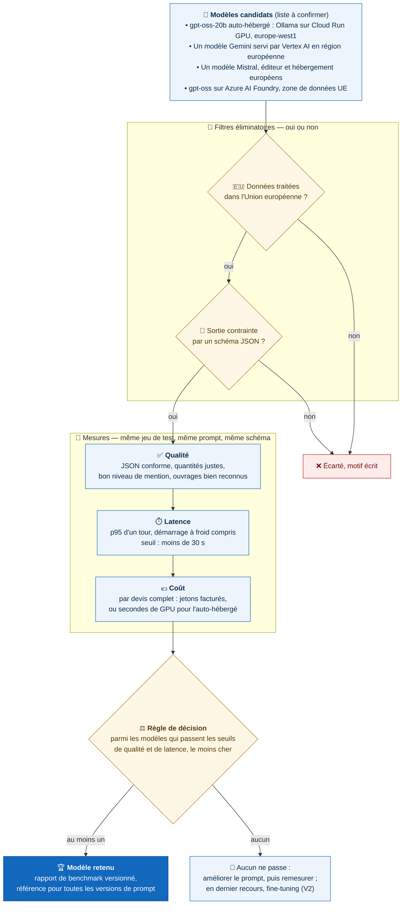

#### 2. D'où vient le prix

> 💡 **En bref** : Un prix vient toujours d'une source qu'on peut montrer, l'artisan ou le catalogue, jamais du modèle.

**Périmètre** : en V1, catalogue et saisie de l'artisan ; prix habituels et prix documentaires
en V1.1.

Le modèle ne produit **jamais** un prix. Chaque prix vient d'une source nommée, dans un ordre de
priorité fixe, et chaque ligne du devis affiche la sienne. **À valider : l'ordre de priorité
proposé.**

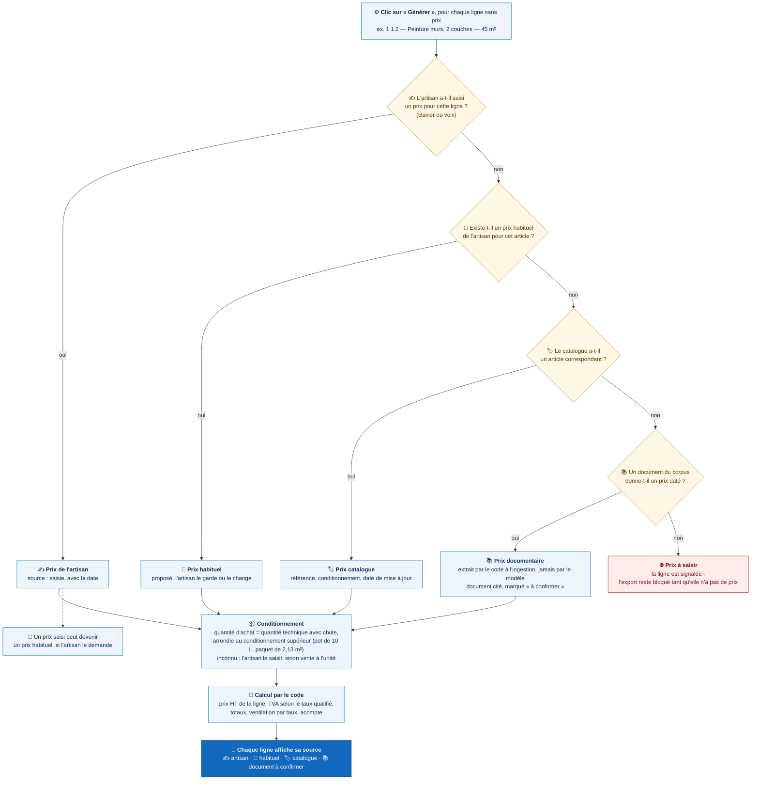

#### 3. Corriger à la voix : le gabarit hiérarchique — V1.1

> 💡 **En bref** : Chaque ligne du devis a un numéro ; l'artisan peut dire « ligne 1.1.2, 48 mètres carrés » et la bonne case change.

**Périmètre** : V1.1. En V1, la numérotation des lignes est affichée et l'artisan corrige au clic.

Pour corriger une case sans toucher à la souris, l'artisan doit pouvoir **la désigner à la
voix**. Le devis suit donc un gabarit à cinq niveaux, numérotés comme un devis BTP classique ;
ces numéros s'affichent à l'écran et dans l'export, et servent d'adresse.

| Niveau | Ce qu'il désigne | Exemple | Ce qu'on dit à la voix |
|---|---|---|---|
| 0 | Le devis | DEV-20261013-xxxx | — |
| 1 | Une pièce ou une zone | **1** Salon | « Salon » |
| 2 | Un lot, c'est-à-dire un corps de métier | **1.1** Peinture | « peinture » |
| 3 | Une ligne : un ouvrage et sa quantité | **1.1.2** Peinture murs, 2 couches | « ligne deux » |
| 4 | Une case de la ligne | quantité, unité, article, prix unitaire, TVA | « quarante-huit mètres carrés » |

Les numéros sont visibles sur l'écran du devis (§6.C.4).

Une correction dictée devient une **adresse** (pièce, lot, ligne, case) et une **valeur**. Le
modèle traduit la phrase ; le code vérifie l'adresse, relit la modification à l'artisan, puis
l'applique et recalcule.

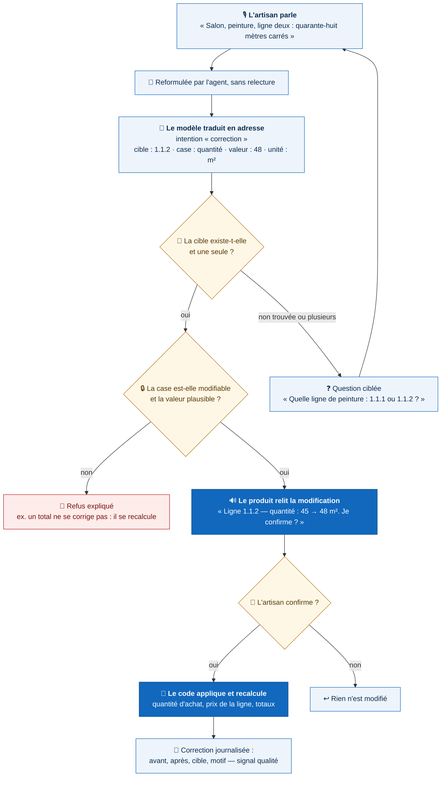

#### 4. Le devis copilote : l'agent pré-remplit, l'artisan édite, « Générer » complète

> 💡 **En bref** : L'écran fonctionne comme un traitement de texte avec suggestions : l'agent propose en gris, l'artisan accepte, modifie ou supprime.

L'écran du devis est un document éditable bloc par bloc. Chaque ligne affiche son état et ses
boutons ; la barre du haut porte les actions globales. Les numéros du gabarit (§6.C.3) sont
visibles : ils servent aussi d'adresse pour corriger à la voix.

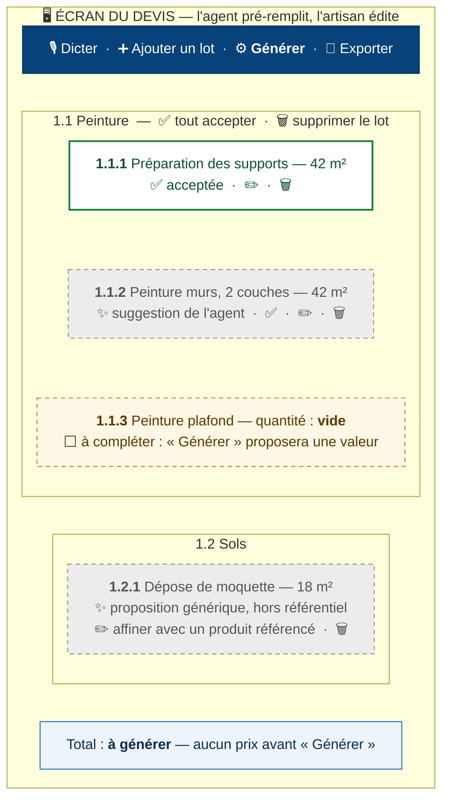

Chaque ligne passe par des états explicites. Une suggestion que l'artisan n'a pas revue peut être
chiffrée par « Générer », mais elle reste signalée et **bloque l'export** tant qu'il ne l'a pas
acceptée : l'agent propose, l'artisan décide.

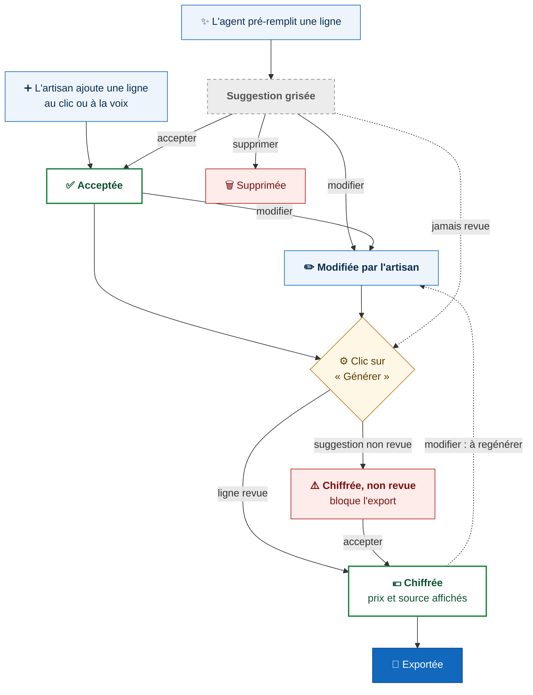

#### 5. La mémoire de l'agent

> 💡 **En bref** : L'agent se souvient de la conversation en cours ; en V1.1, il retiendra aussi les habitudes de chaque artisan.

L'agent se souvient à deux échelles : la conversation en cours (mémoire courte) et l'artisan
lui-même (mémoire longue, sa fiche des préférences). Chaque projet de devis garde en plus son
propre état. Tout vit dans la même base PostgreSQL + pgvector que le corpus, portée par le même
module que la recherche (RAG). **Périmètre** : la mémoire courte est en V1 ; la mémoire longue
(fiche des préférences et LLM juge) en V1.1.

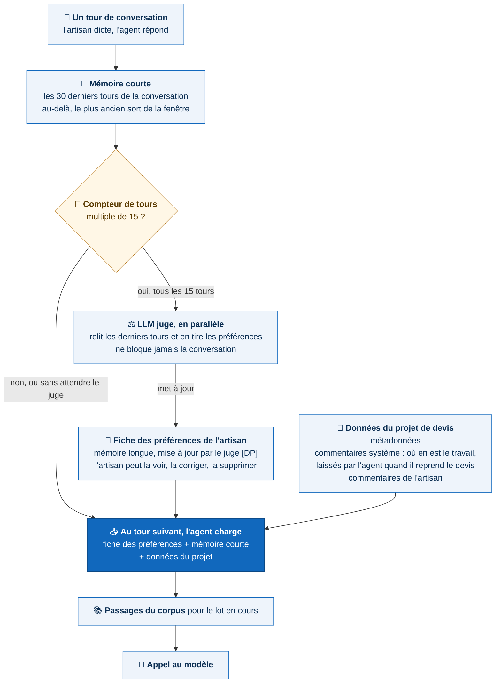

Ce que contient chaque mémoire :

| Mémoire | Contenu | Durée de vie | Qui écrit |
|---|---|---|---|
| Courte | Les 30 derniers tours de la conversation en cours | Glissante : le 31ᵉ tour fait sortir le plus ancien | Le code, à chaque tour |
| Longue — fiche des préférences | Les habitudes de l'artisan : gammes, façons de découper et de rédiger ses devis | Tant que le compte existe ; conservation à fixer (Q-21) | Le LLM juge, tous les 15 tours ; l'artisan la corrige ou la supprime |
| Projet de devis | Métadonnées, commentaires système, commentaires de l'artisan | Celle du projet | Le code, l'agent quand il reprend le devis, l'artisan |

## 7. Le contrat — critères d'acceptance

> 🧭 Comment on saura que la V1 est finie : six phrases auxquelles on répond par oui ou par non.

| # | Étant donné… | quand… | alors… |
|---|---|---|---|
| 1 | une sortie du modèle non conforme au schéma | l'artisan envoie un message | l'agent relance une seule fois, puis dit ce qu'il n'a pas compris et redemande — jamais la sortie brute, jamais d'arrêt de session — et le motif est compté dans `/metriques` |
| 2 | deux artisans A et B, chacun avec ses projets | A demande un projet de B, même en connaissant son identifiant | l'accès est refusé, sans rien révéler du projet de B |
| 3 | un devis pré-rempli par l'agent | l'artisan n'a pas encore cliqué « Générer » | aucun prix ni montant n'y figure, et les suggestions de l'agent sont visibles comme telles (grisées) |
| 4 | un devis édité par l'artisan | il clique « Générer » | chaque ligne se recalcule (quantité × prix unitaire) et cite sa référence et sa source catalogue |
| 5 | un ouvrage absent du référentiel, par exemple une réfection de toiture | l'artisan le dicte | une proposition générique grisée est ajoutée, sans rendement inventé, et l'artisan peut la modifier ou l'affiner avec un produit référencé |
| 6 | un devis validé, profil artisan complet | l'artisan l'exporte | un fichier Word est produit avec SIRET, assurance décennale, TVA ventilée par taux et date de validité |

Chaque critère se démontre sur l'URL de production et se vérifie par un test automatisé ou une
étape du parcours de bout en bout (`tools/parcours_bout_en_bout.py`).

## 8. Plan des sprints 2 à 5 et risques

> 🧭 Dans quel ordre on avance, et ce qui peut faire dérailler chaque étape.

### A. Risques par sprint

> 💡 **En bref** : Pour chaque étape, ce qui peut mal tourner et ce qui est prévu pour l'éviter.

Le contenu de chaque jour est au §2. Ce tableau dit ce qui peut faire dérailler chaque étape, et
la parade prévue.

| Sprint | Jours | Risque principal | Parade |
|---|---|---|---|
| 2 — Socle et chaîne | 1 et 2 | Quota GPU refusé ou tardif ; démarrage à froid du modèle au-delà de 30 s | Demander le quota dès le jour 1 ; mesurer le démarrage à froid et, si besoin, garder une instance chaude pendant les démonstrations |
| 3 — Données et ancrage | 3 et 4 | Corpus pauvre ou sous licence restrictive ; seuil de refus mal réglé | Vérifier la licence source par source ; régler le seuil sur les questions de démonstration, refus hors corpus compris |
| 4 et 5 — Fiabilité et démonstration | 5 et 6 | Jeu de test trop petit pour départager deux prompts | Démarrer avec un jeu initial, l'enrichir à chaque correction de l'artisan (signal qualité) |
| V2 potentielle | — | Le prompt plafonne sous l'objectif ; des voix parasites polluent la dictée | Fine-tuning du modèle retenu ; segmentation de la voix pour isoler l'artisan |

### B. Risque transverse : le RGPD

> 💡 **En bref** : Les données des artisans et de leurs clients restent en Europe, chez des prestataires encadrés par contrat.

Le RGPD (règlement général sur la protection des données) s'applique : les dictées
et les coordonnées des clients sont désormais chez Google Cloud. Il faut la région
`europe-west1` partout, journaux compris, et le contrat de sous-traitance de Google Cloud
(`docs/donnees/RGPD.md`, point 8). Langfuse est un sous-traitant de plus : région européenne, et
masquage des noms, adresses et coordonnées avant l'envoi des traces. Le modèle d'embeddings, sur
Azure AI Foundry, en ajoute un autre, Microsoft Azure : région UE à exiger au déploiement, contrat
de sous-traitance, et aucune coordonnée de client dans les textes envoyés à vectoriser. La fiche
des préférences de l'artisan (§6.C.5) est une donnée personnelle : l'artisan peut la voir, la
corriger et la supprimer ; sa durée de conservation et ce qui est envoyé au LLM juge restent à
fixer (Q-21).

## 9. Ce qui reste à valider

> 🧭 Les décisions qui restent ouvertes, et qui doit les prendre.

| Point | Proposition | Qui tranche |
|---|---|---|
| Intitulé de la composante agentique dans le menu | Workflow orchestré avec humain dans la boucle | Formateur |
| Modèle d'embeddings | Fournisseur tranché : Azure AI Foundry (D-36). Reste le modèle précis, multilingue, mesuré sur les questions de démonstration, et sa région UE | Auteur du projet |
| Mémoire longue | Durée de conservation de la fiche des préférences, droit de regard de l'artisan, ce qui est envoyé au LLM juge (Q-21) | Auteur du projet |
| Langfuse hébergé ou auto-hébergé | Langfuse Cloud, région UE, pour la V1 : rien à administrer ; auto-hébergé sur GCP si les données ne doivent pas sortir du projet | Auteur du projet |
| Liste des modèles candidats au benchmark | Voir §6.C.1 : un auto-hébergé, trois servis en Europe par API | Auteur du projet |
| Ordre de priorité des prix | Artisan, prix habituel, catalogue, document du corpus (§6.C.2) | Auteur du projet |
| Sources du corpus technique | Fiches fabricants et documentation métier, collectées en une fois ou par scraping ; licence de chacune à vérifier | Auteur du projet |
| Anciens devis et factures de l'artisan, y compris papier, comme source | À compléter : volume, numérisation, pseudonymisation | Auteur du projet |

## 10. Ce que les projets précédents apportent

> 🧭 Ce que mes projets agentiques précédents m'ont appris, et que je reprends ici.

Six projets agentiques antérieurs ont été relus et comparés (`docs/ancrages - anciens projets/`,
synthèse dans `SYNTHESE.md`). Leur constat d'ensemble : **l'ingénierie est solide partout, mais la
qualité du vrai modèle n'est mesurée nulle part de façon reproductible**, et aucun projet ne
contraint la sortie du modèle tout en versionnant ses prompts. C'est exactement ce que la V1
corrige. Les pratiques reprises, et où elles entrent :

### A. Les pratiques reprises

| Pratique éprouvée | Projet d'origine | Où elle entre dans la V1 |
|---|---|---|
| Sortie contrainte par un schéma JSON strict, au lieu d'extraire le JSON du texte | Version de travail de Mardik LLMOps | Client du modèle (§6.A, niveau 3) |
| Prompts versionnés, empreinte de version portée par chaque mesure | Mardik LLMOps, Sorabel | Prompts versionnés ; chaque rapport d'évaluation cite sa version |
| Évaluation qui **bloque** la chaîne par construction (`needs:`), pas par convention | Mardik LLMOps, Velmo2 | Chaîne CI/CD, sprints 4 ou 5 |
| CI gratuite et déterministe à chaque push ; CI payante sur le vrai modèle, déclenchée à part | Velmo2 | Chaîne CI/CD : tests avec faux modèle, évaluation sur le service GPU |
| RAG avec seuil de refus sur la note brute, et citations reconstruites par le code, jamais écrites par le modèle | Sorabel | Recherche dans le corpus (sprint 3) |
| Une panne n'est jamais déguisée en résultat métier (« corpus indisponible » ≠ « hors corpus ») | Sorabel | Recherche dans le corpus, typologie d'échecs du pipeline |
| Rejouer des sessions enregistrées à travers la vraie pile | mARDIK, Kaldera | Jeu de test rejoué sur la production |
| Pseudonymiser avant d'écrire sur disque, puis relecture humaine avant d'entrer au jeu de test | Mardik LLMOps | Anciens devis (Q-14), signal qualité |
| Journaux et traces corrélés, sans données personnelles dans les métriques | mARDIK | Langfuse et Cloud Logging |
| Retour arrière tracé, déclenché sur un seuil | Mardik LLMOps | Pilotage (§6.B), sprint 2 |

### B. Ce que ce projet apporte en propre

À préserver : « le modèle décrit, le code
calcule », poussé jusqu'au schéma (aucun champ prix) ; la reformulation jetée si un nombre change ;
aucun prix avant « Générer » ; l'authentification fermée par défaut.

### C. Les erreurs vues ailleurs à ne pas reproduire

Des surfaces annexes sans authentification à
côté d'un cœur protégé ; des données personnelles envoyées au modèle ou aux traces ; un appel au
modèle sans délai ni plafond ; une documentation qui ment sur le code.

## 11. La présentation à l'atelier croisé

> 🧭 Comment ce dossier se présente en vingt minutes.

Vingt minutes de présentation, sans code, puis quinze minutes de questions guidées par la grille
du §12, et dix minutes de conseils. Ensuite, les rôles s'inversent.

### A. Le déroulé

| Temps | Section | Le message à faire passer |
|---|---|---|
| 3 min | §1 Besoin | L'artisan dicte, l'agent pré-remplit, l'artisan édite puis génère ; aucun prix inventé, par construction |
| 3 min | §2 et §3 Périmètre | Six jours : choisir le modèle, livrer par la chaîne, ancrer sur un corpus, mesurer le prompt ; le fine-tuning est une V2 potentielle |
| 4 min | §4 Composante agentique | Pourquoi un workflow contrôlé, avec l'artisan dans la boucle, plutôt qu'un agent autonome |
| 2 min | §5 Stack | Deux services dans GCP, une base PostgreSQL, un seul élément exotique |
| 3 min | §6.A et §6.B Architecture et pilotage | Trois niveaux C4 ; deux chemins vers la production : la fusion ne paie rien, la promotion se mérite |
| 2 min | §6.C Mécanismes clés | Le modèle se choisit sur des mesures ; le prix a toujours une source ; l'artisan corrige une case à la voix ; l'agent se souvient de la conversation et de l'artisan |
| 2 min | §7 Contrat | Lire deux critères à voix haute et montrer qu'on répond oui ou non |
| 1 min | §9 Points à valider | Ce que le formateur doit trancher |

### B. À montrer en direct

Si on le souhaite : l'application lancée sur le poste de développement,
et son cas dégradé — une phrase dictée, et la réponse « le moteur d'analyse ne répond pas » avec
le devis conservé. C'est la preuve du constat du §2.

## 12. Grille d'évaluation — atelier croisé n°1

> 🧭 La grille que remplit l'évaluateur.

À remplir par l'évaluateur pendant la présentation. Cotation : **démontré**, **partiel** ou
**absent**, chaque cotation appuyée sur une preuve observée. L'évaluateur lit ce dossier en se
mettant à la place d'un futur repreneur du projet.

### A. Identification

| Présenté | Évaluateur | Date | Projet |
|---|---|---|---|
| Mehdi Chadli | Steeve | | Assistant devis BTP vocal |

### B. Les six critères

| # | Critère | Cotation | Preuve observée, remarque |
|---|---|---|---|
| 1 | **Besoin clair.** En une page, je comprends à qui sert le projet et ce que promet le parcours principal. | | |
| 2 | **Périmètre tenable.** La V1 me paraît réalisable en six jours par une personne. Sinon, qu'est-ce que je couperais ? | | |
| 3 | **Hors-périmètre assumé.** Ce que la V1 ne fera pas est écrit noir sur blanc. | | |
| 4 | **Composante agentique à la hauteur.** Elle figure au menu, au bon niveau, et la justification me convainc. | | |
| 5 | **Stack justifiée.** Socle du parcours, ou dérogation argumentée (un seul élément exotique). | | |
| 6 | **Critères vérifiables.** Pour chaque critère du contrat, je peux répondre oui ou non en le lisant. | | |

### C. Conseils

**Le point fort du dossier :**

**Le conseil prioritaire pour le sprint 2** (actionnable avant la fin du sprint 2) :

**Avis sur le périmètre** (le formateur tranche) — tenable en l'état, ou à resserrer, et sur
quoi :

## 13. Journal des retours

> 🧭 Ce que je fais de chaque retour reçu.

Le sprint 2 demande que chaque retour de l'atelier n°1 soit **traité, reporté ou écarté**. Une
ligne par retour, remplie après l'atelier.

| # | Retour reçu | De qui | Suite donnée | Où c'est visible |
|---|---|---|---|---|
| 1 | Au lieu d'entraîner, versionner le prompt et les données | Steeve | **Traité** : prompt versionné et évalué en V1 ; fine-tuning en V2 potentielle | §2, §3, `docs/DECISIONS.md` D-23 |
| 2 | RAG | Steeve | **Traité** : la connaissance métier vient d'un corpus technique interrogé | §2, §4, §8, D-24 |
| 3 | Anciennes factures et devis, y compris papier, pour entraîner | Steeve | **Reporté** : source à compléter (volume, numérisation, pseudonymisation) | §9, Q-14 |
| 4 | Travailler le schéma complet | Steeve | **Traité** : architecture au modèle C4, trois niveaux | §6.A |
| 5 | Analyse application web contre application mobile | Steeve | **En cours** : à étudier et documenter | — |
| 6 | RGPD | Steeve | **En cours** : stratégie complète avec son propre schéma | — |
| 7 | Stratégie Git | Steeve | **Traité** : GitHub Flow avec versions étiquetées, comparée à GitFlow et au trunk-based | §6.B |
| 8 | Les différents pipelines CI/CD (release, correctif…) et pourquoi ces stratégies | Steeve | **Traité** : trois chaînes (PR, fusion, étiquette), environnements, signaux, justification | §6.B |
| 9 | Résumer les anciens projets agentiques et en faire la synthèse | Steeve | **Traité** : synthèse et pratiques reprises dans la V1 | §10 |
