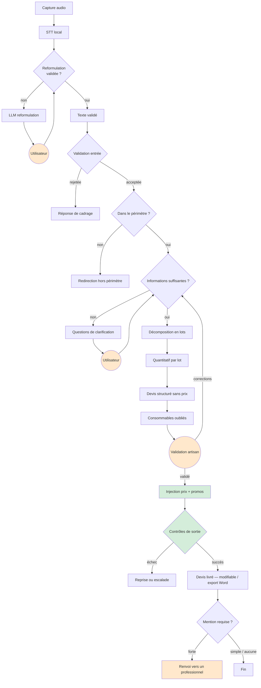
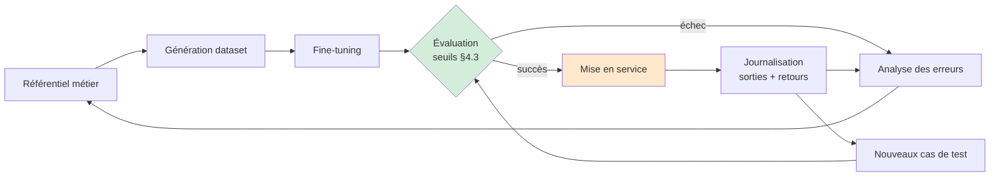

# Dispositif de l'agent — workflow, mémoire, garde-fous, évaluation

> Livrable de conception. Aucun code — modélisation uniquement.
> S'appuie sur les décisions actées dans `CADRAGE_MODELE.md`.

---

## 0. Rôle de l'agent

**Ce qu'il est.** Un assistant de préparation de chantier pour prestataires BTP. Il aide un
artisan à passer d'un chantier décrit **à la voix** à un devis matériaux structuré et chiffré,
qu'il valide et corrige seul.

**Ce qu'il n'est pas.** Ni un bureau d'études, ni un diagnostiqueur, ni un professionnel
certifié à la place de l'artisan. Il **informe toujours, ne certifie jamais**.

Cette frontière n'est pas une précaution rédactionnelle : elle est encodée dans le périmètre de
rôle (§3.3) et vérifiée par l'évaluation (§4).

---

## 1. Flux de travail

### 1.1 Vue d'ensemble



En vert : les étapes exécutées par du **code déterministe**, jamais par le modèle. En orange :
les **points d'intervention humaine**, désormais précédés de deux nouvelles étapes de pipeline
en amont (capture audio, reformulation) qui alimentent un nouveau point d'intervention humaine,
HITL-0, en plus des points déjà connus.

### 1.2 Étapes détaillées

| # | Étape | Acteur | Entrée | Sortie |
|---|---|---|---|---|
| 0a | Capture audio | Utilisateur | Voix | Enregistrement(s) |
| 0b | STT | Code (modèle local type Whisper) | Audio | Texte brut transcrit |
| 0c | Reformulation | **Modèle prompté** | Texte brut | Texte reformulé, à valider |
| 1 | Validation de l'entrée | Code | Texte validé | Texte assaini ou rejet |
| 2 | Classification d'intention | **Modèle fine-tuné** | Texte + état projet | `intent` |
| 3 | Clarification | **Modèle fine-tuné** | État partiel | Questions ciblées |
| 4 | Décomposition en lots | **Modèle fine-tuné** | Projet complété | Lots ordonnés + prérequis |
| 5 | Quantitatif | **Modèle fine-tuné** | Lots + dimensions | Formules + opérandes |
| 6 | Évaluation des formules | Code | Formules | Quantités numériques |
| 7 | Devis sans prix | **Modèle fine-tuné** | Lots + quantités | Lignes + catégories catalogue |
| 8 | Consommables | **Modèle fine-tuné** | Devis | Lignes complémentaires |
| 9 | Résolution catalogue | Code | Catégories + critères | Références produits réelles |
| 10 | Injection prix + promos | Code | Références | Devis chiffré |
| 11 | Contrôles de sortie | Code | Devis complet | Validé ou rejeté |

**Les étapes 0b, 6, 9, 10 et 11 ne passent jamais par un modèle génératif** (0b utilise un modèle
de transcription, pas un LLM). C'est la frontière structurante du projet : le modèle décrit, le
code calcule et vérifie.

### 1.3 Points de décision

| Décision | Porté par | Critère | Sinon |
|---|---|---|---|
| Transcription fidèle ? | Utilisateur, via reformulation | Relecture du texte reformulé | Nouvel enregistrement ou correction manuelle |
| Entrée recevable ? | Code | Longueur, langue, injection | Réponse de cadrage |
| Dans le périmètre ? | Modèle + code | Sujet BTP / aménagement | Redirection explicite |
| Infos suffisantes ? | Modèle | Champs obligatoires du projet | Boucle de clarification |
| Domaine réglementé ? | Modèle | Gaz, électricité, structure | Mention forte |
| Sortie conforme ? | Code | Schéma + bornes + catalogue | Reprise (1 fois) puis escalade |
| Confiance suffisante ? | Code | Nb de reprises, champs nuls | Escalade humaine |

### 1.4 Points d'intervention humaine

Cinq, de nature différente — un nouveau venu par rapport à l'ancien cadrage (HITL-0, lié à la
voix) :

**HITL-0 — Validation de la transcription (systématique, nouveau).** L'utilisateur relit et
corrige le texte reformulé par le LLM de reformulation avant qu'il n'entre dans le pipeline
fine-tuné. C'est le **premier des deux points de capture du signal qualité** introduits par ce
pivot (le second est HITL-2). Une correction de transcription est journalisée au même titre
qu'une correction de devis (§4.2).

**HITL-1 — Clarification (systématique).** L'utilisateur répond aux questions manquantes. C'est
la boucle normale, pas une exception. Plafonnée à **3 tours** : au-delà, l'agent propose des
hypothèses par défaut explicites plutôt que d'interroger indéfiniment.

**HITL-2 — Validation du devis avant chiffrage (systématique, un seul intervenant).** La
structure et les quantités sont confirmées avant que les prix soient injectés. Position
délibérée : on fait valider ce qui est stable, avant d'y accrocher ce qui est volatil.

Contrairement à l'ancien cadrage, ce point ne réunit plus deux humains : **l'artisan valide
seul.** Le client n'a plus de rôle actif à cette étape — sa participation s'arrête à ses
coordonnées, saisies en amont.

**Règle : l'artisan fait autorité, toujours.** Sa correction est appliquée sans discussion et
**journalisée comme signal qualité** — le **second des deux points de capture** introduits par ce
pivot. Elle alimente directement la boucle qualité (§5.2). Un professionnel qui corrige le modèle
en production est une source de données d'expert, gratuite et qualifiée.

**HITL-3 — Renvoi vers un professionnel (conditionnel).** Déclenché par une mention forte.
L'agent ne bloque pas et ne tronque pas sa réponse : il répond complètement puis signale.
Cohérent avec la posture actée au cadrage — d'autant plus fréquent que plomberie et électricité
sont désormais dans le périmètre pilote (`CADRAGE_MODELE.md` §5).

**HITL-4 — Escalade vers un conseiller (exception).** Déclenchée par échec répété des contrôles
de sortie, périmètre ambigu, ou demande explicite. C'est la soupape : un agent qui n'a pas de
sortie de secours produit des réponses dégradées plutôt que d'admettre sa limite.

---

## 2. Mémoire

### 2.1 Principe

La conversation est **transitoire**, l'état du projet est **structuré et persistant**. On ne
rejoue pas l'historique pour reconstituer l'état : on tient une fiche projet que chaque tour met
à jour.

Conséquence : le contexte envoyé au modèle reste court et stable, quelle que soit la longueur de
la conversation. C'est aussi ce qui rend le comportement reproductible — donc évaluable.

### 2.2 Les quatre mémoires

| Mémoire | Contenu | Forme | Durée | Portée |
|---|---|---|---|---|
| **Tour** | Derniers échanges bruts (transcriptions + texte) | Texte | 3-5 tours glissants | Session |
| **Projet** | Chantier, corps de métier, budget, lots validés, devis en cours | Structuré (fiche) | Jusqu'à complétion + 30 j | Utilisateur |
| **Utilisateur** | Profil artisan (SIRET, gabarit de devis), préférences, chantiers passés | Structuré | Consentement explicite, révocable | Utilisateur |
| **Métier** | Rendements, taux de chute, ordre des lots | Référentiel versionné | Permanente | Globale |

### 2.3 La fiche projet

C'est l'objet central. Elle porte, pour chaque champ, **sa valeur, son origine et sa
confiance** :

- valeur fournie par l'artisan (à la voix ou au clavier) → certaine
- valeur déduite par le modèle → à confirmer
- valeur par défaut appliquée → signalée dans le devis

Cette distinction permet à l'agent de savoir quoi redemander, et à l'artisan de voir sur quoi
repose son chiffrage. Un devis fondé sur trois hypothèses par défaut n'a pas le même statut qu'un
devis entièrement renseigné.

**Un seul utilisateur de statut fort, le client réduit aux coordonnées.** Contrairement à
l'ancien cadrage, la fiche ne porte plus deux intervenants de statuts différents à HITL-2 : c'est
l'artisan qui valide, seul.

| Origine | Statut | Peut être écrasée par |
|---|---|---|
| Artisan | Fait technique | Rien (sauf l'artisan lui-même) |
| Modèle | À confirmer | L'artisan |
| Défaut | Signalée dans le devis | L'artisan |

Chaque modification est **horodatée et attribuée**. Ce n'est pas de la traçabilité décorative :
sans l'auteur, une correction d'artisan est indiscernable d'une valeur par défaut acceptée sans
relecture, et le signal qualité de §5.2 devient inexploitable.

**Gabarit de devis de l'artisan.** Stocké en mémoire utilisateur : mise en page reprise de son
devis existant (converti par une API OCR externe), SIRET, RCS, APE/NAF, TVA intracom. (auto-
remplis via l'API Pappers), assurance décennale, conditions habituelles. Renseigné une fois à
l'inscription, jamais produit par le modèle.

### 2.4 Ce qu'on ne retient pas — délibérément

**Les prix.** Volatils par conception. Ils ne sont jamais mémorisés ni dans le modèle ni dans la
fiche projet : ils sont réinjectés à chaque affichage depuis le catalogue. Un devis rouvert trois
semaines plus tard se rechiffre automatiquement.

**Les données personnelles au-delà du nécessaire.** Le client n'apparaît en mémoire agent que par
ses coordonnées, saisies pour le devis — pas de profil, pas d'historique client. La surface d'un
chantier suffit à quantifier ; savoir à qui il appartient au-delà des coordonnées n'apporte rien
au raisonnement.

**Les sorties du modèle non validées.** Ce qui échoue aux contrôles n'entre pas dans la fiche
projet — mais est journalisé pour la boucle qualité (§5).

**L'audio brut, au-delà de la session.** L'enregistrement sert à la transcription (HITL-0) puis
n'est pas conservé au-delà de la session — seul le texte validé entre en mémoire projet, cohérent
avec le principe 100 % local (`CADRAGE_MODELE.md` §1).

### 2.5 Cycle de vie

| Événement | Effet |
|---|---|
| Fin de session | Mémoire de tour purgée (y compris l'audio brut) |
| Devis validé | Fiche projet figée, versionnée |
| 30 j sans activité | Fiche projet archivée puis supprimée |
| Retrait du consentement | Mémoire utilisateur supprimée, fiches anonymisées |
| Nouvelle version du référentiel | Fiches non figées recalculées |

---

## 3. Garde-fous

Quatre couches, de la plus faible à la plus forte :

```
prompt système  <  fine-tuning  <  validation par le code  <  intervention humaine
     (oriente)      (fiabilise)      (seule garantie dure)      (dernier recours)
```

Le fine-tuning **réduit** la fréquence des sorties non conformes ; il ne la ramène jamais à zéro.
Seule la validation par le code constitue une garantie. Tout garde-fou critique doit donc exister
côté code, jamais uniquement dans le prompt.

### 3.1 Validation des entrées

| Contrôle | Rejet ou traitement |
|---|---|
| Qualité de transcription insuffisante | Renvoi vers HITL-0 (nouvel enregistrement ou correction manuelle) |
| Longueur, encodage, langue | Rejet avec message de cadrage |
| Tentative d'injection de prompt | Neutralisation, journalisation |
| Sujet hors BTP / aménagement | Redirection explicite |
| Données personnelles non sollicitées | Non stockées, non répétées en sortie |
| Valeurs physiquement improbables | Demande de confirmation |

Sur le dernier point : un chantier de 400 m² n'est pas impossible, il est improbable.
L'agent ne rejette pas, il demande confirmation — la différence entre un garde-fou et une
entrave.

### 3.2 Contraintes de sortie

| Contrôle | Seuil | Action si échec |
|---|---|---|
| Conformité au schéma JSON | strict | Reprise, puis escalade |
| Quantités dans des bornes plausibles | par matériau | Reprise |
| Catégorie catalogue existante | strict | Reprise |
| Référence produit inventée | **interdit** | Rejet — impossible par conception |
| Prix produit par le modèle | **interdit** | Rejet — impossible par conception |
| Mention présente quand requise | strict | Ajout forcé par le code |
| Cohérence des lots (ordre, prérequis) | pas de cycle | Reprise |

Les deux interdits absolus sont garantis **structurellement**, pas par vigilance : le schéma de
sortie ne comporte aucun champ prix ni aucun champ référence. Le modèle ne peut pas halluciner ce
qu'il n'a pas la possibilité d'exprimer.

### 3.3 Périmètre de rôle

**L'agent traite :** décomposition de projet, quantitatif matériaux (peinture, sols, plomberie,
électricité), devis structuré, consommables et outillage, conseil de mise en œuvre, orientation
catalogue.

**L'agent ne traite pas :** diagnostic de pathologie du bâti, estimation de main d'œuvre,
dimensionnement structurel, conseil médical, juridique ou financier, validation de conformité
réglementaire, facture, signature électronique, relances client (hors produit, cf.
`CADRAGE_MODELE.md` §4).

**Comportement sur les sujets réglementés** (gaz, tableau électrique, structure porteuse) :

| Niveau | Domaines | Comportement |
|---|---|---|
| Aucun | Peinture, carrelage, pose de meuble | Réponse seule |
| Simple | Perçage porteur, étanchéité, découpe | Réponse + point de vigilance |
| Forte | Gaz, tableau électrique, structure | Réponse + renvoi vers un professionnel |

L'agent **répond toujours**. Il ne tronque pas, ne refuse pas, ne moralise pas. Il ajoute une
mention. C'est une posture assumée et défendable — contrairement à un refus, elle est
argumentable devant un jury.

**Risque technique associé.** Le modèle de base embarque des refus de sécurité pré-entraînés.
Sans exemples explicites de ce comportement dans le dataset, il refusera de façon imprévisible —
typiquement pendant la démonstration. Les cas sensibles doivent donc figurer au dataset avec le
comportement voulu.

---

## 4. Plan d'évaluation

### 4.1 Principe

**Le protocole est arrêté avant le premier entraînement.** Décidé après coup, il ne prouve rien :
on choisit toujours, inconsciemment, les métriques que l'on passe.

Le jeu de test est **écrit à la main, gelé, et jamais utilisé à l'entraînement**. C'est la seule
mesure honnête — plus encore depuis que le référentiel d'entraînement est comblé par le LLM
(`CADRAGE_MODELE.md` §6).

### 4.2 Jeu de test

**150 à 200 cas**, rédigés ou corrigés manuellement, avec réponse attendue.

| Famille | Part | Ce qu'elle vérifie |
|---|---|---|
| Nominal | 40 % | Le parcours normal, toutes fonctions |
| Incomplet | 20 % | Déclenchement de la clarification |
| Limite | 15 % | Valeurs extrêmes, chantiers atypiques |
| Réglementé | 15 % | Niveau de mention correct — plomberie/électricité y contribuent réellement |
| Hors périmètre | 10 % | Détection et redirection |

Le jeu de test **ne rétrécit jamais**. Chaque défaut constaté en production y entre comme cas de
non-régression (§5).

### 4.3 Métriques et seuils

| # | Métrique | Mesure | Seuil | Baseline attendue |
|---|---|---|---|---|
| 1 | **Taux de JSON valide** | Conformité au schéma | **≥ 98 %** | ~70 % |
| 2 | Exactitude des quantités | Écart ≤ 5 % vs. attendu | ≥ 90 % | — |
| 3 | Complétude des lots | Lots présents et ordonnés | ≥ 85 % | — |
| 4 | Rappel des consommables | Consommables attendus retrouvés | ≥ 80 % | — |
| 5 | **Justesse de la mention** | Niveau correct | **≥ 95 %** | — |
| 6 | Détection hors périmètre | Redirection correcte | ≥ 95 % | — |
| 7 | Prix ou référence inventés | Occurrences | **0** | 0 (structurel) |
| 8 | Latence d'un devis | p95 | < 30 s | — |

La **métrique nº 1 est la mesure directe de l'apport du fine-tuning** ; le pivot ne change pas le
tableau, mais change ce qu'elle démontre — voir `CADRAGE_MODELE.md` §7 pour l'argumentaire à tenir
en soutenance.

Les métriques 5 et 7 relèvent de la sécurité : leurs seuils ne sont pas négociables à la baisse.

### 4.4 Protocole de comparaison

Trois configurations, **même jeu de test, mêmes conditions** :

| Configuration | Rôle | Statut |
|---|---|---|
| gpt-oss-20b brut + prompt élaboré | Baseline honnête | **La preuve** |
| gpt-oss-20b fine-tuné | Mesure de l'apport du fine-tuning | **La preuve** |
| gpt-oss-120b fine-tuné | Mesure de l'apport de la taille | Démo, optionnel |

**Décision : la preuve repose sur le seul couple 20b brut / 20b fine-tuné.** Même modèle de base,
même jeu de test, même prompt système — la seule variable est le fine-tuning, donc tout écart lui
est imputable.

Le 120b répond à une autre question (« est-ce que ça passe à l'échelle ») et sert de modèle de
démonstration. S'il manque du temps, il saute sans affaiblir la démonstration.

Comparer le modèle fine-tuné à un modèle brut *mal promptté* serait une victoire truquée. La
baseline doit être le meilleur résultat atteignable sans fine-tuning.

### 4.5 Modes d'évaluation

| Mode | Portée | Coût |
|---|---|---|
| Automatique | Métriques 1, 6, 7, 8 — vérifiables par le code | Nul, à chaque run |
| LLM-juge | Métriques 3, 4 — jugement sur barème | Faible, à chaque run |
| Revue humaine | Échantillon de 30 cas, dont tous les réglementés | Élevé, à chaque version |

Le LLM-juge est calibré sur un sous-ensemble noté à la main : sans cette calibration, on mesure
l'accord avec un juge dont on ignore la fiabilité.

---

## 5. Boucle qualité

### 5.1 Le cycle



### 5.2 Ce qui alimente la boucle

| Source | Signal | Destination |
|---|---|---|
| Contrôles de sortie en échec | Sortie non conforme | Cas de non-régression + analyse |
| Escalades humaines | Limite de l'agent atteinte | Périmètre ou dataset |
| **Corrections de transcription (HITL-0)** | **Erreur de reformulation** | **Modèle de reformulation, en priorité** |
| **Corrections d'artisan (HITL-2)** | **Erreur métier attestée par un professionnel** | **Référentiel en priorité** |
| Dérive du catalogue | Catégorie disparue | Résolution catalogue |
| Correction du référentiel | Valeur métier erronée | Régénération du dataset |

Deux points de capture du signal qualité, pas un seul : c'est le principe nouveau introduit par
le pivot (`CADRAGE_MODELE.md` §1).

### 5.3 Règles de la boucle

**Une valeur métier fausse se corrige dans le référentiel, jamais dans les exemples.** Puis on
régénère. C'est ce qui justifie l'existence du référentiel comme livrable distinct : corriger
2000 exemples un par un est impossible, corriger une ligne de référentiel est trivial.

**Le jeu de test ne rétrécit jamais.** Tout défaut constaté y entre définitivement.

**Une correction d'artisan est un signal fort, pas un vote.** Elle ne modifie pas le référentiel
automatiquement — elle ouvre une revue. Deux artisans peuvent se contredire, et un usage local
n'est pas une prescription fabricant. Ce qui tranche reste la documentation technique ou, à
défaut puisque le référentiel n'est plus systématiquement sourcé (`CADRAGE_MODELE.md` §6), un
arbitrage humain explicite.

**Aucune mise en service sans franchissement des seuils.** L'évaluation est une barrière, pas un
rapport d'information.

**Quatre artefacts sont versionnés conjointement** : référentiel, dataset, modèle, jeu de test.
Un résultat n'est interprétable que si l'on sait quelle version de chacun l'a produit.

### 5.4 Rythme

| Déclencheur | Action |
|---|---|
| Modification du référentiel | Régénération partielle + évaluation complète |
| +50 cas de non-régression | Nouveau cycle de fine-tuning |
| Trimestriel | Revue humaine du référentiel |
| Changement de version du catalogue | Vérification de la résolution catalogue |

---

## 6. Points ouverts

- [x] ~~Canal de la démonstration~~ — web uniquement, interface unique artisan
      (`CADRAGE_MODELE.md` §4)
- [x] ~~Rôle du client à la validation~~ — coordonnées uniquement, HITL-2 devient un point à un
      seul intervenant (§1.4)
- [ ] **Validation des seuils du §4.3** par l'encadrant — ils conditionnent la barrière de mise
      en service
- [ ] Barème détaillé du LLM-juge pour les métriques 3 et 4
- [ ] Bornes de plausibilité par matériau (garde-fou §3.2)
- [ ] Champs obligatoires de la fiche projet, par corps de métier
- [ ] Modalité concrète de l'escalade HITL-4 (vers qui, par quel canal)
- [ ] Modèle de reformulation (HITL-0) : quel modèle prompté, quelle latence — non tranché,
      cf. `CADRAGE_MODELE.md` §8
