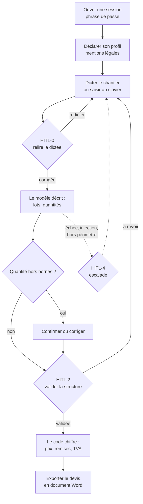

# Parcours utilisateur et maquettes

> **Ces maquettes ont été dessinées après l'interface, pas avant.** L'aveu vaut
> mieux qu'une reconstitution : le front a été écrit directement en HTML, et ce
> document en fixe l'état pour que la suite s'y raccroche. Ce qui change à
> partir d'ici, c'est le sens de lecture — les écrans qui restent à faire
> seront dessinés **avant** d'être codés, et cette page est l'endroit où ils le
> seront. **Cette règle n'a pas tenu pour US-03 ni US-17** : les deux ont été
> codées dans la nuit du 08 au 09/09/2026 sans passer par la maquette. Le
> tableau de fin le consigne plutôt que de faire comme si.
>
> Chaque maquette porte ses **annotations d'accessibilité** et, quand il en
> existe un, le test qui les tient. Une maquette sans ces annotations décrirait
> une intention ; avec elles, elle décrit un contrat vérifiable.

## Le parcours, d'un bout à l'autre

Un seul interlocuteur du début à la fin : **l'artisan**. Le client final n'a ni
compte ni écran — seules ses coordonnées sont saisies, parce que les mentions
obligatoires du bâtiment et des travaux publics (BTP) les exigent.

Le schéma ci-dessous se lit de haut en bas : chaque étape mène à la suivante,
et les trois points marqués **HITL** (*human in the loop*, l'humain dans la
boucle) sont ceux où rien n'avance sans une action de l'artisan.



Trois propriétés de ce parcours se voient mieux sur le schéma que dans le code.

- **Aucun prix n'existe avant HITL-2.** Ce n'est pas un choix d'affichage :
  tant que la structure n'est pas validée, les clés de prix sont absentes de ce
  qui part au navigateur. Une étape du parcours de bout en bout le vérifie
  contre le serveur réel.
- **La relecture précède tout traitement.** La dictée ne déclenche rien tant
  que l'artisan ne l'a pas relue — c'est HITL-0, et le devis ne bouge pas d'un
  millimètre pendant ce temps.
- **L'escalade ne détruit rien.** Après un échec, le devis en cours est intact ;
  l'artisan reprend là où il en était.

## Maquette 1 — Ouverture de session

Un formulaire centré, seul à l'écran. Rien d'autre n'est servi tant qu'il n'est
pas franchi : sans jeton, même la documentation de l'interface de
programmation applicative répond 401.

```text
┌──────────────────────────────────────────────────────────┐
│                                                          │
│        ┌────────────────────────────────────────┐        │
│        │ 🔒 Ouvrir une session                  │  h1    │
│        │                                        │        │
│        │ [ ⚠ Phrase de passe incorrecte ]       │ alerte │
│        │                                        │ (role  │
│        │ Phrase de passe                        │ =alert)│
│        │ [••••••••••••••••••••••••••••••••]     │        │
│        │ Une seule phrase, définie au démarrage │  aide  │
│        │                                        │        │
│        │                          [  Entrer  ]  │        │
│        └────────────────────────────────────────┘        │
│                                                          │
└──────────────────────────────────────────────────────────┘
```

| Annotation | Règle | Ce qui la tient |
|---|---|---|
| Vrai élément `form`, pas un `div` avec un bouton | La touche Entrée soumet, comme partout ailleurs | Structure du document |
| Erreur annoncée par `role="alert"`, jamais par la seule couleur | RGAA 4.1, critère 3.1 | Test du front |
| Libellé lié au champ par `for` / `id` | RGAA 4.1, critère 11.1 | Test du front |
| `autocomplete="current-password"` | Le gestionnaire de mots de passe fait son travail | Structure du document |
| Le message d'erreur ne dit jamais **quelle** phrase a été essayée | Traitement T4 du registre des traitements | Test d'authentification |

## Maquette 2 — Écran principal, sur ordinateur

Deux panneaux côte à côte : la conversation à gauche, le devis en construction
à droite. Le devis se met à jour à chaque tour, sous les yeux de l'artisan.

```text
┌─ [lien d'évitement, visible au clavier] ──────────────────────────────────┐
├────────────────────────────────────┬──────────────────────────────────────┤
│ 🎙️ Assistant chantier          h1 │ 📋 Devis en cours               h1   │
│                                    │                                      │
│ [🎤 Dicter (sur l'appareil)]       │ [ ⚠ Mentions manquantes : SIRET,     │
│ [↺ Nouveau chantier]               │   assurance décennale ]  role=status │
│                                    │                                      │
│ ┌────────────────────────────────┐ │ [▸ Mes mentions légales] aria-       │
│ │                    Je refais   │ │                          expanded    │
│ │                    le salon ▸  │ │                                      │
│ │                                │ │ ┌──────────────────────────────────┐ │
│ │ ◂ Deux lots retenus :          │ │ │ Poste    Qté   PU    Rem.  Total │ │
│ │   peinture murs, sol stratifié │ │ ├──────────────────────────────────┤ │
│ │                                │ │ │ Peinture  3 u  34,90  10%  94,23 │ │
│ │ ◂ ⚠ Mention : l'installation   │ │ │ Stratifié 23 m² 16,90  20% 310,90│ │
│ │   électrique existante...      │ │ └──────────────────────────────────┘ │
│ │                       (fil,    │ │                                      │
│ │              aria-live=polite) │ │ Total HT              405,13 €       │
│ └────────────────────────────────┘ │ TVA 10 %               40,51 €       │
│                                    │ Total TTC             445,64 €       │
│ Entrée texte du chantier  (sr-only)│ Acompte 30 %          133,69 €       │
│ [Je refais le salon...] [ Envoyer ]│                                      │
│                                    │ [⬇️ Exporter en Word]                │
└────────────────────────────────────┴──────────────────────────────────────┘
```

| Annotation | Règle | Ce qui la tient |
|---|---|---|
| Lien d'évitement en première position, révélé à la prise de focus | RGAA 4.1, critère 12.7 | Test du front |
| Fil de conversation en `aria-live="polite"` | Les réponses arrivent après coup : sans cela, elles ne sont jamais annoncées | Test du front |
| Le champ de saisie a un libellé, masqué visuellement mais lu | RGAA 4.1, critère 11.1 | Classe `sr-only`, test du front |
| Colonne *Remise* affichée **seulement** si une remise existe | Une colonne vide dans chaque ligne fatigue la lecture ; c'est le correctif de l'incident INC-08 | Test du front, étape du parcours réel |
| Tableau avec `th scope="col"` | RGAA 4.1, critère 5.7 | Test du front |
| Sévérité des mentions portée par une **donnée**, pas par un emoji | Un lecteur d'écran ne classe pas sur un caractère ; c'est l'incident INC-09 | Test du front, étape du parcours réel |
| Contour de focus visible à 3 px | RGAA 4.1, critère 10.7 | Feuille de style, règle `:focus-visible` |
| Cibles tactiles de 44 px minimum | RGAA 4.1, critère 10.11 — se rate avec des gants en dessous | Test du front |

## Maquette 3 — Le même écran sur un téléphone

L'entrée du produit est la voix, dictée sur chantier : l'écran probable est un
téléphone tenu d'une main. Sous 45 rem de large, les deux panneaux **s'empilent**
au lieu de se serrer — la conversation d'abord, le devis dessous.

```text
┌──────────────────────────┐
│ 🎙️ Assistant chantier    │
│ [🎤 Dicter] [↺ Nouveau]  │
│ ┌──────────────────────┐ │
│ │        Je refais   ▸ │ │
│ │ ◂ Deux lots retenus  │ │  ← le fil garde 40 % de la hauteur
│ └──────────────────────┘ │
│ [Je refais...] [Envoyer] │
├──────────────────────────┤
│ 📋 Devis en cours        │
│ Poste     Qté     Total  │
│ Peinture  3 u    94,23 € │
│ ...                      │
│ [⬇️ Exporter en Word]    │
└──────────────────────────┘
   défilement vertical seul
```

Cette maquette a précédé son code de quelques minutes : le comportement n'existait
pas quand la maquette a été dessinée. À 320 px de large, les deux panneaux se
serraient et imposaient un défilement horizontal, ce que le critère 1.4.10 des
règles pour l'accessibilité des contenus web (WCAG 2.1), dit « Reflow »,
interdit. Deux tests tiennent désormais la propriété.

## Maquette 4 — Relecture de la dictée, HITL-0

Ce bloc remplace la zone de saisie tant que la dictée n'est pas relue. Il occupe
la place du champ pour une raison : on ne peut pas continuer à parler pendant
qu'on relit.

```text
│ ┌──────────────────────────────────────────────────────┐ │
│ │ Relis ta dictée avant que je la traite          h2   │ │
│ │                                                      │ │
│ │ [ ℹ 3 corrections proposées ]           role=status  │ │
│ │                                                      │ │
│ │ Texte de ta dictée — corrige-le si besoin            │ │
│ │ ┌──────────────────────────────────────────────────┐ │ │
│ │ │ Je refais le salon de M. Benali. Il fait 22 m²   │ │ │
│ │ │ au sol et les murs font 55 m². Peinture sur les  │ │ │
│ │ │ murs, parquet stratifié au sol.                  │ │ │
│ │ └──────────────────────────────────────────────────┘ │ │
│ │                                                      │ │
│ │ [Valider ce texte et lancer l'analyse] [Redicter]    │ │
│ └──────────────────────────────────────────────────────┘ │
```

| Annotation | Règle | Ce qui la tient |
|---|---|---|
| Le texte proposé est **modifiable**, pas seulement acceptable | L'artisan fait autorité : il corrige avant, pas après | Story US-05, tests du pipeline |
| Le bouton dit ce qu'il déclenche, pas « OK » | RGAA 4.1, critère 11.9 : intitulé pertinent | Test du front |
| « Redicter » annonce qu'il abandonne le texte | Une action destructrice se nomme | Test du front |
| Rien ne part au modèle tant que ce bloc est ouvert | Étape « HITL-0 ne déclenche aucune étape aval » | Parcours de bout en bout |

## Maquette 5 — Quantités à confirmer, et correction de ligne

Quand une quantité sort des bornes du référentiel, elle n'est **pas rejetée** :
l'artisan peut avoir raison contre le référentiel. Elle est mise en attente,
dans un bloc annoncé sans délai.

```text
│ ┌──────────────────────────────────────────────────────┐ │
│ │ Quantités à confirmer                    role=alert  │ │
│ │  • Peinture murs : 550 m² — au-delà des bornes       │ │
│ │    habituelles (2 à 200 m²)                          │ │
│ │        [Confirmer] [Corriger]                        │ │
│ └──────────────────────────────────────────────────────┘ │

        ┌────────────────────────────────────────┐
        │ Correction de ligne              h2    │  ← modale
        │ Peinture murs — 3 seaux                │  aria-modal
        │ [ex : quantité surestimée...        ]  │  =true
        │                  [Annuler] [Valider]   │
        └────────────────────────────────────────┘
```

| Annotation | Règle | Ce qui la tient |
|---|---|---|
| `role="alert"` sur le bloc de confirmation | L'attente bloque la suite : elle doit être annoncée tout de suite | Test du front |
| La modale piège le focus et le rend à l'élément d'origine | RGAA 4.1, critère 7.3 | Test du front |
| Échappement ferme la modale | RGAA 4.1, critère 7.3 | Test du front |
| La borne dépassée est **écrite** avec sa valeur attendue | Un message qui dit seulement « valeur inhabituelle » n'aide pas à trancher | Story US-11 |
| La correction est journalisée avec son triplet réutilisable | Signal qualité, story US-25 | Tests de la boucle qualité |

## Maquette 6 — Tableau de bord d'exploitation

Page distincte, servie sur `/metriques`. Elle lit le journal et reste
consultable **modèle arrêté** — c'est précisément quand on en a besoin.

```text
┌──────────────────────────────────────────────────────────────────────────┐
│ Métriques d'exploitation                                            h1   │
│ Journal du 2026-09-01 au 2026-09-08. Modèle observé : gpt-oss:20b.       │
│                                                       role=status        │
│ Nº  Métrique                    Seuil       Mesure    État               │
│ ────────────────────────────────────────────────────────────────────────  │
│ 1   Taux de JSON valide         ≥ 98 %      97,3 %    sous le seuil      │
│ 2   Exactitude des quantités    ≥ 90 %        —       non mesurée —      │
│                                                       demande le jeu     │
│                                                       d'essai annoté     │
│                                                       à la main          │
│ 7   Prix ou référence inventés  ≤ 0 occ.      0       conforme           │
│ 8   Latence d'un devis (p95)    ≤ 30 s      11,2 s    conforme           │
│                                                                          │
│ Compteur                                     Valeur                      │
│ ────────────────────────────────────────────────────────────────────────  │
│ Tours joués                                     128                      │
│ Tentatives d'injection neutralisées               3                      │
│ Corrections de l'artisan (signal qualité)         7                      │
└──────────────────────────────────────────────────────────────────────────┘
```

| Annotation | Règle | Ce qui la tient |
|---|---|---|
| Un **tableau**, pas un graphique | Un graphique sans alternative textuelle est une information perdue ; un tableau se lit en synthèse vocale | Structure du document |
| L'état est **écrit** (« conforme », « dépassé »), pas seulement coloré | RGAA 4.1, critère 3.1 | Test du front |
| En-tête de ligne en `th scope="row"` | RGAA 4.1, critère 5.7 | Structure du document |
| Une métrique non mesurée s'affiche « non mesurée » **et dit ce qui lui manque**, jamais zéro | Un zéro se lit comme une mesure ; c'est un mensonge par arrondi | Tests d'observabilité |
| Cinq des huit métriques sont dans cet état | Elles demandent le jeu d'essai annoté à la main, qui n'existe pas encore. La page le dit au lieu de le masquer. | `NON_MESUREE`, `app/observabilite.py` |

## Ce qui reste à dessiner, avant d'être codé

| Écran | Story | Ce qu'il faudra trancher sur la maquette |
|---|---|---|
| Saisie assistée du SIRET | US-01 | Ce qui s'affiche pendant l'appel au service externe, et ce qui s'affiche quand il ne répond pas |

Un point de méthode pour la suite : cette maquette-là sera dessinée **avec ses
annotations d'accessibilité dès le premier jet**. Rattraper l'accessibilité
après coup coûte plus cher que de la poser dans la maquette, et le rattrapage
se voit — il produit des interfaces où l'accessibilité est une couche, pas une
structure.

### Ce qui a été codé sans être dessiné

| Écran | Story | Ce que la maquette aurait tranché, et ce qui a été décidé sans elle |
|---|---|---|
| Dépôt d'un ancien devis | US-03 | Le rendu du doute de la reconnaissance de caractères. **Décidé dans le code** : il n'y a pas de rendu du doute, parce qu'il n'y a pas de restitution — rien du document déposé n'atteint l'écran, seulement le nom des blocs reconnus. L'écran montre l'avertissement de sortie de fichier, puis le bilan. |
| Repartir d'un devis | US-17 | Un historique des chantiers, dont la question de fond n'était pas graphique : une liste par client suppose un fichier de personnes que le cadrage refuse (`docs/MODELE_DONNEES.md`). **Contournée, pas tranchée** : la duplication part du projet *courant*, jamais d'une liste, donc aucun fichier de personnes n'est requis. L'écran est un bouton et une zone de bilan. |

Ces deux lignes ne sont pas un rattrapage : elles disent ce que le code a
décidé à la place de la maquette, pour que la décision reste lisible. Si l'un
des deux écrans se retravaille, il repassera par ici **avant**.

---

*Établi le 08/09/2026 à partir de `app/static/index.html` (828 lignes) et
`app/static/metriques.html`. Les maquettes 1, 2, 4, 5 et 6 décrivent l'écran
tel qu'il est ; la maquette 3 a précédé son implémentation de quelques minutes.*
