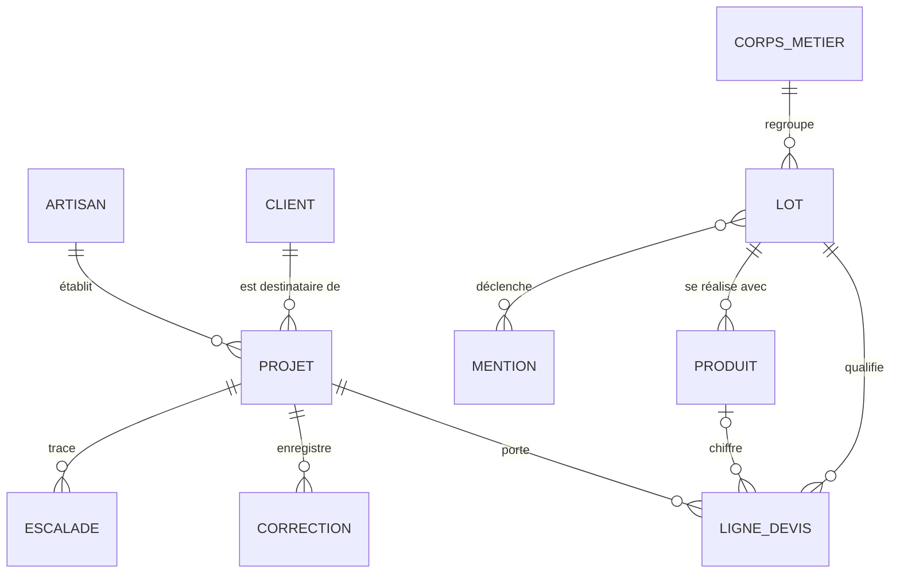

# Modèle de données

> **Ce que ce document est, et ce qu'il n'est pas.** Il décrit les données que
> l'application manipule aujourd'hui — nommées, typées, reliées — puis le
> schéma relationnel vers lequel elles iront quand le catalogue quittera le
> fichier Python. Il suit la méthode **Merise** (méthode d'étude et de
> réalisation informatique pour les systèmes d'entreprise) : un modèle
> conceptuel, un dictionnaire, un modèle logique.
>
> **Il n'y a pas de base de données à ce jour.** Le dire d'emblée évite de
> lire un modèle logique comme un état des lieux : le niveau conceptuel décrit
> le réel, le niveau logique décrit la cible. Chaque section porte son statut.

## Pourquoi modéliser un projet qui tient dans des fichiers JSON

Le produit stocke aujourd'hui deux choses, de natures opposées.

Les **données de référence** — treize lots de travaux répartis sur quatre corps
de métier, leurs rendements, leurs taux de chute, leurs consommables, et un
catalogue de treize produits avec prix et promotions — vivent dans des
littéraux Python (`app/referentiel.py`, `app/catalogue.py`). Elles ne changent
qu'au commit.

Les **données d'exploitation** — un projet en cours, ses lignes de devis, les
corrections de l'artisan, les mentions légales — vivent dans un fichier JSON
par projet (`app/persistance.py`, format en version 5), écrit de façon
atomique par renommage.

Ça tient, et ça tiendra encore un moment : un artisan travaille sur un projet à
la fois, et le catalogue de démonstration compte treize références. Modéliser
sert malgré tout à trois choses immédiates.

- **Nommer les données une fois pour toutes.** Le dictionnaire ci-dessous est
  la seule liste exhaustive de ce que le produit connaît. C'est ce qui a permis
  d'écrire le registre des traitements (`docs/RGPD.md`) sans rien oublier.
- **Rendre visibles les contraintes que le code porte en silence.** Une ligne
  de devis référence un produit *ou* aucun ; une quantité obéit à des bornes
  par lot ; un prix n'existe qu'après la validation de structure. Ces règles
  sont dans le code ; elles ne sont nulle part écrites ensemble.
- **Préparer la migration sans la précipiter.** Le jour où le catalogue Leroy
  Merlin est versé en base (`docs/SOURCES_DONNEES.md` en décrit la structure),
  le modèle logique existe déjà.

## Modèle conceptuel — statut : décrit le code d'aujourd'hui

Le schéma ci-dessous montre neuf entités et leurs associations. Lu en phrases :
un **projet** appartient à un **artisan** et concerne un **client** ; il porte
des **lignes de devis**, des **corrections** et des **escalades**. Chaque ligne
de devis se rattache à un **lot** du référentiel et, quand elle est chiffrée, à
un **produit** du catalogue. Un lot appartient à un **corps de métier**, peut
déclencher une **mention obligatoire**, et propose des consommables. Un produit
appartient à un seul lot.

### Les cardinalités qui portent une décision

Trois d'entre elles ne sont pas de simples constats de structure.

| Association | Cardinalités | Ce qu'elle acte |
|---|---|---|
| `PRODUIT` — `LIGNE_DEVIS` | (0,n) côté produit, **(0,1)** côté ligne | Une ligne peut n'avoir **aucun** produit : c'est le cas des consommables, facturés au forfait (`PRIX_CONSOMMABLE_FORFAIT`, `app/catalogue.py`). Rendre le produit obligatoire forcerait à inventer une référence catalogue pour un rouleau de ruban de masquage. |
| `CLIENT` — `PROJET` | (1,1) côté projet | Le client final **n'est pas un utilisateur** : ni compte, ni écran, ni identifiant propre. Ses coordonnées existent parce que les mentions obligatoires du bâtiment et des travaux publics (BTP) les exigent, et pour aucune autre raison (`docs/RGPD.md`, traitement T1). Modéliser une entité `CLIENT` autonome, avec sa clé, ouvrirait un historique client que le cadrage ne veut pas. |
| `LOT` — `MENTION` | (0,n) des deux côtés | Un lot peut déclencher plusieurs mentions, une mention couvre plusieurs lots — l'attestation de conformité électrique vaut pour tout ce qui touche au tableau. C'est une association porteuse, d'où une table de liaison au niveau logique. |

### Ce que le modèle conceptuel ne porte pas, volontairement

- **La session d'authentification.** Un seul compte, un jeton signé qui porte sa
  propre expiration, aucun état serveur (`app/authentification.py`). Il n'y a
  rien à stocker, donc rien à modéliser.
- **Le journal technique et le signal qualité.** Ce sont des flux *ajout seul*
  (`append-only`), un événement par ligne au format JSON Lines, pas des
  entités : `donnees/journal.jsonl` (`app/observabilite.py`) et l'export de
  candidats d'entraînement, écrit **hors du dépôt** (`app/boucle_qualite.py`).
  Les mettre en base leur ferait perdre ce qui fait leur valeur — être
  relisibles à l'œil et sans dépendance.
- **L'historique de conversation.** Il est conservé dans le projet pour que le
  modèle garde le fil, mais il n'est pas une entité : c'est une liste de tours,
  sans identité propre ni requête qui le vise.

## Dictionnaire des données — statut : constaté

Chaque donnée est citée avec le module qui la définit. « Obligatoire » signifie
que l'absence bloque une étape, pas que le champ est non nul en mémoire.

### Entité ARTISAN — `app/profil.py`

| Donnée | Type | Contrainte | Obligatoire |
|---|---|---|---|
| `raison_sociale` | texte | — | Oui, mention légale |
| `siret` | texte | 14 chiffres | Oui, mention légale |
| `adresse` | texte | — | Oui, mention légale |
| `rcs` | texte | — | Oui, mention légale |
| `ape_naf` | texte | code d'activité | Oui, mention légale |
| `tva_intracommunautaire` | texte | — | Si assujetti |
| `regime_tva` | énuméré | `reel` ou `franchise_293b` | Oui, détermine la mention de TVA |
| `decennale.assureur` | texte | — | Oui, mention légale |
| `decennale.numero_contrat` | texte | — | Oui, mention légale |
| `decennale.couverture_geographique` | texte | — | Oui, mention légale |
| `decennale.valide_jusqu_au` | date | — | Oui, contrôlée à l'export |

### Entité CLIENT — `app/profil.py`

| Donnée | Type | Contrainte | Obligatoire |
|---|---|---|---|
| `nom` | texte | — | Oui, mention légale |
| `adresse_chantier` | texte | — | Oui, mention légale |

Deux champs, et c'est tout. La liste courte **est** la mesure de minimisation :
elle se relit d'un coup d'œil, et toute ligne ajoutée demandera sa
justification.

### Entité PROJET — `app/pipeline.py`, sérialisé par `app/persistance.py`

| Donnée | Type | Contrainte | Rôle |
|---|---|---|---|
| `projet_id` | texte | 8 à 32 caractères, `[a-z0-9]` | Identifiant, également nom du fichier. Le motif est une **liste blanche** : il interdit qu'un identifiant forgé désigne un autre chemin. |
| `version` | entier | 5 | Version du format. Les relectures dégradées des versions 1 à 4 sont explicites dans le code. |
| `pieces` | liste de textes | — | Pièces du chantier citées par l'artisan |
| `lots_presents` | liste de codes | valeurs du référentiel | Lots retenus pour le projet |
| `structure_validee` | booléen | — | Porte HITL-2 (*human in the loop*, niveau 2) : **tant qu'il est faux, aucun prix n'existe** |
| `tours_clarification` | entier | — | Limite le va-et-vient de clarification |
| `delai_execution` | texte | — | Mention légale du devis |
| `historique` | liste de tours | — | Fil de conversation, non modélisé comme entité |
| `numero_devis` | texte | `DEV-AAAAMMJJ-xxxxxx` | Identité du devis, **fixée à l'ouverture du projet et jamais recalculée** : un devis remis au client engage sur une durée, son numéro et sa date ne peuvent pas changer à un second export. Le suffixe reprend le début de `projet_id`, ce qui rend le numéro unique **sans compteur partagé** (US-17) |
| `date_emission` | texte, ISO 8601 | — | Jour d'ouverture du projet, d'où court la validité du devis. Vide pour les projets antérieurs à la version 5 : le registre leur en attribue une **une seule fois**, à la relecture |

### Entité LIGNE_DEVIS — `app/devis.py`

| Donnée | Type | Contrainte | Rôle |
|---|---|---|---|
| `lot_code` | texte | clé du référentiel | Rattachement au lot ; un code inconnu lève `LotInconnu` plutôt que de produire une ligne vide |
| `nom_lot` | texte | — | Libellé affiché |
| `dimension_type` | texte | `surface`, `longueur`, `unite` | Ce que l'artisan a dicté |
| `dimension_valeur` | décimal | bornes par lot et par unité | Valeur dictée, avant tout calcul |
| `quantite_technique` | décimal | — | Dimension × rendement × (1 + taux de chute) |
| `unite_technique` | texte | `m²`, `ml`, `L`, `u` | Unité du besoin, distincte de l'unité de vente |
| `quantite_achat` | décimal | arrondi au conditionnement supérieur si le produit est emballé | Ce qui est commandé |
| `prix_unitaire_ht` | décimal | — | Vient du catalogue, **jamais du modèle** |
| `remise_pct` | décimal | 0 à 100 | Promotion du catalogue, exposée en pourcentage par l'interface de programmation applicative (`app/main.py`, contrat dans `app/api_schema.py`) à partir de `Produit.promo_pct`, qui est une fraction. Son absence de l'affichage était l'incident INC-08. |
| `prix_ht` | décimal | quantité × prix unitaire × (1 − remise) | Total de ligne, recalculable par le client |
| `taux_tva` | texte | `5.5`, `10`, `20` | Le modèle *qualifie* le taux, le code calcule |
| `origine` | texte | `modèle`, `consommable`, `défaut` | Rend lisible ce que l'artisan a dicté et ce que l'assistant a proposé |
| `chiffree` | booléen | — | Faux avant HITL-2 |

### Entité CORRECTION — `app/pipeline.py`

| Donnée | Type | Rôle |
|---|---|---|
| `horodatage` | texte, ISO 8601 | Datation |
| `auteur` | texte | Toujours `artisan` : lui seul corrige |
| `origine` | texte | `transcription`, `quantite_hors_bornes`, `ligne_devis` |
| `description` | texte | Ce qui s'affiche à l'écran |
| `entree` | texte | Ce que l'artisan avait fourni |
| `sortie_modele` | texte | Ce que la chaîne avait produit |
| `corrige` | texte | Ce que l'artisan a retenu |

Le triplet `entree` / `sortie_modele` / `corrige` est ce qui fait d'une
correction un candidat de réentraînement. Les projets antérieurs à la version 4
n'en ont pas : ils sont comptés **incomplets** plutôt qu'exportés amputés.

### Entité ESCALADE — `app/pipeline.py`

| Donnée | Type | Rôle |
|---|---|---|
| `horodatage` | texte, ISO 8601 | Datation |
| `motif` | code stable | `entree_rejetee`, `json_invalide`, `schema_invalide`, `lot_inconnu`, `intent_inconnu`, `modele_injoignable`, `injection_neutralisee`, `hors_perimetre` |
| `detail` | texte | Sert au débogage, pas à l'agrégat |

Le motif est un **code**, pas une phrase : c'est ce qui rend les escalades
comptables par famille sur le tableau de bord.

### Entités de référence LOT et PRODUIT

| Entité | Donnée | Type | Rôle |
|---|---|---|---|
| `LOT` | `code` | texte | Clé, par exemple `PEINT_FINITION` |
| `LOT` | `nom` | texte | Libellé métier |
| `LOT` | `corps_metier` | texte | Peinture, sols, plomberie, électricité |
| `LOT` | `unite` | texte | Unité dans laquelle le modèle exprime la dimension |
| `LOT` | `consommation_par_unite` | décimal ou vide | Rendement, par exemple 0,2 litre par m² |
| `LOT` | `taux_chute` | décimal | Fraction perdue à la pose, surfaces et longueurs seulement |
| `LOT` | `ordre` | entier | Ordre d'intervention sur le chantier |
| `LOT` | `consommables` | liste de textes | Ce qu'on oublie de compter |
| `PRODUIT` | `reference` | texte | Clé catalogue |
| `PRODUIT` | `designation` | texte | Libellé commercial |
| `PRODUIT` | `categorie` | texte | Clé étrangère vers `LOT.code` |
| `PRODUIT` | `unite_vente` | texte | `u`, `m²`, `ml` — distincte de l'unité technique |
| `PRODUIT` | `prix_unitaire_ht` | décimal | Donnée volatile, injectée après la structure |
| `PRODUIT` | `promo_pct` | décimal | Remise en cours |
| `PRODUIT` | `contenance` | décimal ou vide | Quantité par emballage, ce qui commande l'arrondi |

## Modèle logique — statut : cible, non implémenté

Traduction du modèle conceptuel en tables. Clé primaire notée `PK`, clé
étrangère `FK`. Les entités de référence deviennent des tables ; le projet
reste un agrégat, pour la raison donnée juste après.

| Table | Colonnes |
|---|---|
| `corps_metier` | `code` PK, `libelle` |
| `lot` | `code` PK, `nom`, `corps_metier` FK, `unite`, `consommation_par_unite`, `taux_chute`, `ordre` |
| `lot_consommable` | `lot_code` FK, `libelle`, PK sur le couple |
| `mention` | `code` PK, `niveau` (`simple` ou `forte`), `texte` |
| `lot_mention` | `lot_code` FK, `mention_code` FK, PK sur le couple |
| `produit` | `reference` PK, `designation`, `lot_code` FK, `unite_vente`, `prix_unitaire_ht`, `promo_pct`, `contenance` |
| `artisan` | `siret` PK, `raison_sociale`, `adresse`, `rcs`, `ape_naf`, `tva_intracommunautaire`, `regime_tva`, colonnes de décennale |
| `projet` | `projet_id` PK, `artisan_siret` FK, `client_nom`, `client_adresse_chantier`, `delai_execution`, `structure_validee`, `cree_le`, `clos_le` |
| `ligne_devis` | `id` PK, `projet_id` FK, `lot_code` FK, `produit_reference` FK **nullable**, colonnes de quantité et de prix, `origine` |
| `correction` | `id` PK, `projet_id` FK, `horodatage`, `origine`, `entree`, `sortie_modele`, `corrige` |
| `escalade` | `id` PK, `projet_id` FK, `horodatage`, `motif`, `detail` |

Deux choix méritent d'être défendus devant un jury.

**Le client n'a pas de table.** Ses deux champs sont des colonnes de `projet`.
C'est un choix de minimisation avant d'être un choix technique : une table
`client` avec sa clé inviterait à croiser les projets d'un même particulier,
donc à constituer un fichier de personnes que le produit n'a aucune raison de
tenir. Le jour où un artisan voudra retrouver ses chantiers passés par client,
ce sera une décision à prendre et à écrire, pas un effet de bord du schéma.

**`produit_reference` est nullable.** Une ligne de consommable n'a pas de
produit. L'alternative — inventer des références catalogue fictives — polluerait
la table de référence pour satisfaire une contrainte d'intégrité.

## Contraintes d'intégrité que le schéma ne peut pas porter

Un modèle relationnel exprime des clés et des domaines. Quatre règles de ce
produit lui échappent, et vivent donc dans le code, chacune avec ses tests.

| Règle | Où elle est tenue | Ce qui la vérifie |
|---|---|---|
| Aucune ligne ne porte de prix tant que `structure_validee` est faux | `app/pipeline.py` | La suite de tests et l'étape « aucune clé de prix avant HITL-2 » du parcours de bout en bout |
| Une quantité hors des bornes du lot n'est pas rejetée mais **mise en attente** de confirmation | `app/referentiel.py`, `bornes()` | Tests de plausibilité, story US-11 |
| `prix_ht` égale toujours quantité × prix unitaire × (1 − remise) | `app/devis.py` | Un test de propriété, plus une étape du parcours réel — c'est le correctif de l'incident INC-08 |
| Un même poste ne porte jamais deux quantités pour une même dimension | `app/pipeline.py` | Une étape du parcours réel : deux dictées contradictoires ne s'additionnent pas |

## L'écart entre ce modèle et le code, et quand il se comblera

| Élément | Aujourd'hui | Cible | Déclencheur de la migration |
|---|---|---|---|
| Référentiel des lots | Littéral Python, 13 lots | Tables `lot`, `lot_consommable`, `lot_mention` | Quand un non-développeur devra le modifier |
| Catalogue | Littéral Python, 13 produits | Table `produit`, alimentée par le dump décrit dans `docs/SOURCES_DONNEES.md` | Quand le volume dépassera ce qu'un fichier lisible peut porter |
| Projet | Un fichier JSON par projet, écrit atomiquement | Tables `projet`, `ligne_devis`, `correction`, `escalade` | Quand plusieurs artisans partageront une instance |
| Journal et signal qualité | JSON Lines, ajout seul | **Inchangé** | Aucun : leur valeur tient à leur simplicité |

Tant que le déclencheur n'est pas atteint, migrer coûterait un service à
installer, une dépendance à maintenir et une sauvegarde à organiser, pour aucun
gain d'usage. L'inverse serait de la dette déguisée en modernité.

## Ce qui reste à faire sur ce document

- Le **modèle physique** (types PostgreSQL, index, contraintes nommées) n'a pas
  lieu d'être écrit avant que la migration soit décidée.
- Les **durées de conservation** figurent dans `docs/RGPD.md` avec la mention
  « non implémentée ». Elles deviendront des colonnes `clos_le` et une purge
  planifiée ; la colonne existe déjà dans le modèle logique ci-dessus, pas dans
  le code.

---

*Établi le 08/09/2026 à partir des modules `app/referentiel.py`,
`app/catalogue.py`, `app/devis.py`, `app/profil.py`, `app/pipeline.py` et
`app/persistance.py`. Le niveau conceptuel et le dictionnaire décrivent le code
de ce jour ; le niveau logique décrit une cible.*
