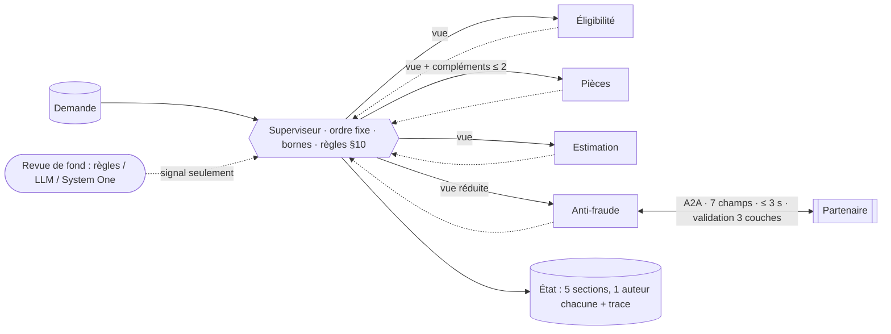

# Fiche projet — Kaldera V2

> Chemin : `02_en_cours/Kaldera V2` · Stack : Python 3.11 (uv), FastAPI/uvicorn, httpx (client A2A JSON-RPC 2.0), LangChain 0.3 + Azure OpenAI gpt-5.4-mini (facultatif), pytest/pytest-cov, ruff, mypy, Docker Compose, Google Cloud Run, GitHub Actions · Taille : ~240 fichiers (dont ~120 PDF/PNG d'exemples), ~8,2 k lignes Python (src ~3,4 k, partenaires ~0,8 k, tests ~3,7 k)

## 1. Objectif et contexte
Traitement automatisé des demandes de remboursement d'assurance habitation : contrôle d'éligibilité, vérification des pièces (avec boucle de compléments auprès de l'assuré), estimation du montant (franchise, plafond) et consultation d'un service anti-fraude partenaire via A2A. Chaque demande doit finir par une **décision ou une escalade motivée**, avec un rapport (version gestionnaire et version assuré), même si le partenaire est lent, menteur ou en panne. Utilisateurs : gestionnaires de sinistres (console web), cellule fraude. Statut : **abouti** — refonte d'un code fourni qui passait 11 tests d'acceptance sur 56 ; il passe désormais les 56, plus 481 tests unitaires, 28 scénarios × 3 rejeux, et il est déployé sur Cloud Run (console + partenaire maison).

## 2. Architecture agentique
- Type : multi-agents à **workflow codé** — 4 spécialistes déterministes (Éligibilité, Pièces, Estimation, Anti-fraude) + 1 superviseur-décideur ; un agent d'extraction de dossier (LLM facultatif) en amont ; un agent externe anti-fraude via A2A.
- Boucle d'exécution et orchestration : le superviseur enchaîne les agents dans un **ordre fixe** et s'arrête dès qu'une règle du §10 conclut (non éligible → arrêt, pièces non conformes → arrêt, montant ≤ 0 → aucun appel partenaire). Pas de routage par LLM. Séquentiel à l'intérieur d'une demande, parallèle entre les demandes d'un lot (8 au plus, `ThreadPoolExecutor`).
- Outils / MCP / A2A : client A2A `message/send` (JSON-RPC 2.0) vers un partenaire simulé (`external_agent/`, routes `/_sim/*` pour forcer panne / lenteur / réponses invalides) ou réel (`partenaire_antifraude/`, sans routes de simulation, jeton Bearer comparé en temps constant). Contrat v2.0 versionné dans `external_agent/contrat.md` : 7 champs en entrée, 6 champs exacts en sortie.
- État et mémoire : `Etat` centralisé par demande, **écrit uniquement par le superviseur** au nom de l'agent auteur ; table `AUTEURS` section → auteur unique ; sections définitives sauf `pieces` (versionnée par complément) ; lectures par copie profonde ; trace en ajout seul. Chaque agent ne reçoit qu'une **vue** réduite (moindre privilège). Mémoire long terme facultative : historique JSONL neutralisé (liste blanche de champs, `id_client` pseudonymisé par HMAC). Registre anti-doublon et disjoncteur partagés au niveau du lot.
- Schéma :

## 3. Prompts et gestion du contexte
- Deux usages du LLM seulement, tous deux hors du chemin de décision : la **revue de fond** (`revue.py`, mode `llm`) et l'**extraction de dossier** (`extraction.py`, modes `llm` / `auto`).
- Prompts en chaînes Python, sans fichier ni version de prompt. La consigne de revue énonce les règles de calcul du métier et un biais explicite (« en cas de doute, réponds conforme ») ; la consigne d'extraction balise le document (`<document>…</document>` = DONNÉE), impose un gabarit JSON **entièrement à `null`** (corrigé après que le modèle recopiait les valeurs d'exemple, journal entrée 12) et interdit de deviner.
- Sorties : pas de `with_structured_output` ni de Pydantic ; JSON extrait entre la première `{` et la dernière `}`, puis **revalidé à la main** (valeurs dans un ensemble fermé, types, format de référence `KAL-\d{2}-\d{4}`, montants nuls écartés). Toute réponse illisible devient `indisponible`.
- Minimisation du contexte : la revue LLM ne reçoit que la section examinée filtrée par une liste blanche (`CHAMPS_TRANSMIS`), jamais de donnée personnelle ; le partenaire ne reçoit que 7 champs construits un par un. Longueur : texte de dossier tronqué à 30 000 caractères, raisons de revue abrégées à 200 caractères sur une ligne.
- Garde-fous anti-injection sur l'extraction : double lecture (modèle contre lecture déterministe par champs, désaccord = anomalie bloquante, valeur prudente retenue), détecteur de texte qui s'adresse à un assistant, champs autorisés par rôle de document. Banc d'injection : 9 attaques × 2 variantes, 15 résistées, 3 signalées, 0 passée.

## 4. Fiabilité
- Déterminisme vs LLM : **toutes** les valeurs (éligibilité, pièces, montants, files, mode dégradé) sont en code ; aucun modèle ne fixe une valeur. Le LLM n'émet qu'un signal (revue) ou une proposition de demande à valider par un humain (extraction, avec repli sur la lecture par champs en mode `auto`).
- Gestion d'erreurs / mode dégradé : bornes `etapes_max=12`, `duree_max_s=8`, `complements_max=2`, arrêt sur dépôt identique (empreinte SHA-256), délai partenaire 3 s **pris sur le budget restant de la demande**, disjoncteur à 2 pannes par lot, aucune relance. Toute exception (borne, agent `indetermine`, incident) donne une escalade motivée avec `arret` rempli — jamais de silence. Mode dégradé §9 : partenaire indisponible et montant > 1 500 € → cellule fraude. La revue tourne dans un fil daemon borné par le temps laissé libre (`duree_max − délai partenaire − 1 s`). LLM : `timeout` plancher 5 s, `max_retries=1`.
- Évaluations : 28 scénarios JSONL (nominal, boucle, A2A, invalides, pannes) rejoués 3 fois par `scripts/epreuve.py` (stabilité), 15 dossiers PDF de bout en bout en deux variantes (étiquetée / texte libre) avec résultat attendu, banc d'injection documenté. Pas de LLM-as-judge.
- Tests : 56 acceptance (fournis, lancent leur propre partenaire simulé en fil uvicorn) + 481 unitaires, couverture ≥ 85 % imposée (98,77 % mesurée). Fakes : `FauxClient` qui remplace le client A2A et compte les appels, `sans_modele` / `avec_azure_openai` qui neutralisent le `.env` local ; aucun appel LLM réel en CI.
- Observabilité : trace par étape (agent, action, sections écrites, durée, statut, revue, appels externes), métriques par agent (appels, échecs, latence, appels externes, anomalies), journal des échanges côté partenaire (sans en-têtes ni jeton). Pas de traces distribuées ni de logs structurés.

## 5. Industrialisation
- CI GitHub Actions en 3 jobs : qualité (ruff lint + format, mypy) → tests + couverture ≥ 85 % + banc d'épreuve (résultats publiés dans le résumé du job et en artefacts JUnit/coverage) → **déploiement de test** (`docker compose up --wait`, contrôle de santé, rejeu de PAN-01 sur la pile déployée).
- Docker : image console (`$PORT` pour Cloud Run, healthcheck) + image partenaire simulé ; compose avec `depends_on: service_healthy`. Scripts de déploiement Cloud Run (build local, push Artifact Registry) ; partenaire en `--max-instances 1` car son registre vit en mémoire.
- Config & secrets : tout par variables d'environnement documentées (`.env.example`, tableau du README) ; `.env` ignoré par git. Pas de versioning de prompts ni de modèle, pas de canary / rollback.

## 6. Documentation et méthode
Dossier de conception en 7 livrables rédigés **avant** le code puis réalignés (`docs/conception/` : carte des agents, orchestration et mémoire, A2A et mode dégradé, plan d'épreuve, rapport de décision, modèle System One, analyse de dossier), avec un tableau « défaut du code fourni → lien au commit d'origine → exigence ». **Journal des ajustements** : chaque modification part d'un scénario rejoué et d'un signal observé, une seule à la fois, avec preuve avant/après et section « ajustements écartés ». Preuves d'exécution et résultats d'épreuve versionnés. Pas de CLAUDE.md ni d'ADR formels (le journal en tient lieu).

## 7. ✅ Bonnes pratiques à reprendre
1. **Un seul écrivain, un auteur par section, imposé par le code** — l'état refuse toute écriture d'un agent hors de sa section et toute réécriture d'une section définitive ; les agents ne touchent jamais l'état, le superviseur enregistre en leur nom. C'est exactement ce qui manque dans `kaldera-team-ko`, où `TeamState.artifacts` est un `dict` libre que tout agent écrit. — preuve : [`etat.py:10`](<../../02_en_cours/Kaldera V2/src/kaldera/etat.py:10>), [`etat.py:48-53`](<../../02_en_cours/Kaldera V2/src/kaldera/etat.py:48>), [`superviseur.py:195`](<../../02_en_cours/Kaldera V2/src/kaldera/superviseur.py:195>), test [`test_equipe.py:209`](<../../02_en_cours/Kaldera V2/tests/unit/test_equipe.py:209>) ; contre-exemple [`state.py:14`](<../../02_en_cours/kaldera-team-ko/src/kaldera/state.py:14>)
2. **Orchestration à ordre fixe avec arrêt dès qu'une règle conclut** — pas de routeur LLM ni de table de routage mutable : la séquence est du code lisible, chaque `return self._decider()` correspond à une règle numérotée de la spec ; résultat : terminaison garantie et aucun appel partenaire inutile. — preuve : [`superviseur.py:114-129`](<../../02_en_cours/Kaldera V2/src/kaldera/superviseur.py:114>)
3. **Bornes d'exécution nommées, justifiées et réservant une étape à la conclusion** — `etapes_max` est calculé (9 étapes au pire + marge 3), et la vérification lève avant d'atteindre la borne pour que la conclusion ait toujours sa place ; toute borne atteinte devient une escalade avec `arret` rempli. — preuve : [`bornes.py:11-23`](<../../02_en_cours/Kaldera V2/src/kaldera/bornes.py:11>), [`superviseur.py:229-234`](<../../02_en_cours/Kaldera V2/src/kaldera/superviseur.py:229>), [`superviseur.py:85-94`](<../../02_en_cours/Kaldera V2/src/kaldera/superviseur.py:85>)
4. **« Jamais de silence » : toute exception finit en escalade motivée** — trois niveaux de capture (borne, agent indéterminé, filet générique) qui produisent tous une fiche complète, avec le mode dégradé correctement reporté. — preuve : [`superviseur.py:81-112`](<../../02_en_cours/Kaldera V2/src/kaldera/superviseur.py:81>), [`decision.py:87`](<../../02_en_cours/Kaldera V2/src/kaldera/decision.py:87>)
5. **Client A2A en liste blanche + validation en trois couches** — la requête est reconstruite champ par champ (7 champs, rien d'autre, donc pas d'IBAN) ; la réponse passe transport (JSON-RPC, id, result xor error) → schéma (ensemble exact de champs, types, valeurs fermées) → plausibilité (score ∈ [0;1], niveau cohérent avec le score, même dossier) ; les messages de rejet ne recopient jamais le contenu du partenaire. — preuve : [`partenaire.py:102-115`](<../../02_en_cours/Kaldera V2/src/kaldera/partenaire.py:102>), [`partenaire.py:139-196`](<../../02_en_cours/Kaldera V2/src/kaldera/partenaire.py:139>), [`vues.py:54`](<../../02_en_cours/Kaldera V2/src/kaldera/vues.py:54>)
6. **Délai de l'appel externe pris sur le budget restant de la demande** — le timeout effectif est `min(3 s, duree_max − écoulé − 0,5)`, donc l'appel A2A ne peut jamais faire dépasser la borne globale ; une issue de consultation est typée (`couche` : delai, panne, transport, schema, plausibilite, doublon, disjoncteur). — preuve : [`superviseur.py:74-77`](<../../02_en_cours/Kaldera V2/src/kaldera/superviseur.py:74>), [`partenaire.py:44-55`](<../../02_en_cours/Kaldera V2/src/kaldera/partenaire.py:44>), [`partenaire.py:94`](<../../02_en_cours/Kaldera V2/src/kaldera/partenaire.py:94>)
7. **Règles de décision en code pur, appelées comme un outil** — une seule fonction ordonnée applique le §10, mode dégradé compris ; les montants sont exacts au centime et les tests passent sans modèle. — preuve : [`decision.py:14-84`](<../../02_en_cours/Kaldera V2/src/kaldera/decision.py:14>)
8. **Moindre privilège par vues d'agent** — chaque agent reçoit un dictionnaire construit pour lui (l'Anti-fraude reçoit les 7 champs du contrat + le montant justifié, qui « ne part jamais ») et non la demande complète. — preuve : [`vues.py:10-51`](<../../02_en_cours/Kaldera V2/src/kaldera/vues.py:10>)
9. **Revue LLM réduite à un signal borné, isolé et sans effet** — le réviseur travaille sur une copie, dans un fil daemon limité au temps libre, toute erreur ou réponse non conforme donne `indisponible`, et l'issue ne change jamais (« en désaccord, le sous-agent a raison ») ; le défaut est un réviseur à règles, sans modèle. — preuve : [`revue.py:96-122`](<../../02_en_cours/Kaldera V2/src/kaldera/revue.py:96>), [`revue.py:142-167`](<../../02_en_cours/Kaldera V2/src/kaldera/revue.py:142>), [`superviseur.py:213-227`](<../../02_en_cours/Kaldera V2/src/kaldera/superviseur.py:213>), [`revue.py:470-483`](<../../02_en_cours/Kaldera V2/src/kaldera/revue.py:470>)
10. **Double lecture LLM / déterministe contre l'injection de prompt** — sur les champs critiques, un désaccord entre le modèle et la lecture par champs bloque le traitement et retient la valeur prudente ; complété par un détecteur de consignes et une liste de champs interdits par rôle de document. Évalué par un banc d'attaques versionné. — preuve : [`extraction.py:614-638`](<../../02_en_cours/Kaldera V2/src/kaldera/extraction.py:614>), [`extraction.py:563-588`](<../../02_en_cours/Kaldera V2/src/kaldera/extraction.py:563>), [`epreuve-injection.md:1`](<../../02_en_cours/Kaldera V2/docs/epreuve-injection.md:1>)
11. **Contrôle de forme systématique des sorties d'agents** — chaque `Resultat` est vérifié (statut dans un ensemble fermé, clés obligatoires de la section) avant d'être enregistré ; protocole d'agent minimal (`nom`, `section`, `action`, `traiter(vue) -> Resultat`). — preuve : [`superviseur.py:21-26`](<../../02_en_cours/Kaldera V2/src/kaldera/superviseur.py:21>), [`superviseur.py:291-296`](<../../02_en_cours/Kaldera V2/src/kaldera/superviseur.py:291>), [`base.py:10-27`](<../../02_en_cours/Kaldera V2/src/kaldera/agents/base.py:10>)
12. **Fakes ciblés et neutralisation de l'environnement dans les tests** — `FauxClient` remplace le client A2A par injection de dépendance et compte les appels (on vérifie « aucun appel » autant que « bon appel ») ; `sans_modele` efface les variables Azure pour que le `.env` local ne fasse jamais appeler un vrai LLM. — preuve : [`fabrique.py:65-74`](<../../02_en_cours/Kaldera V2/tests/unit/fabrique.py:65>), [`fabrique.py:85-88`](<../../02_en_cours/Kaldera V2/tests/unit/fabrique.py:85>), [`superviseur.py:56`](<../../02_en_cours/Kaldera V2/src/kaldera/superviseur.py:56>)
13. **CI qui rejoue un scénario de panne sur la pile Docker déployée** — au-delà des tests, le job de déploiement démarre compose et vérifie que PAN-01 (partenaire en panne) reste conforme de bout en bout ; banc d'épreuve 28 × 3 publié en artefact. — preuve : [`ci.yml:36-39`](<../../02_en_cours/Kaldera V2/.github/workflows/ci.yml:36>), [`ci.yml:59-66`](<../../02_en_cours/Kaldera V2/.github/workflows/ci.yml:59>)
14. **Journal d'ajustements piloté par les scénarios** — chaque changement d'orchestration est relié à un scénario, un signal, une cause, une preuve avant/après, et les ajustements écartés sont justifiés. — preuve : [`journal-ajustements.md:9-23`](<../../02_en_cours/Kaldera V2/docs/journal-ajustements.md:9>)

## 8. ❌ Anti-patterns / limites observées
Contre-exemples dans les versions cassées (`kaldera-team-ko`, identique à `equipe-agents-qui-se-marche-dessus/kaldera-team-ko`), tous résolus dans V2 :
- **Routage qui confie une étape au mauvais agent** — `Step.REVIEW` est routé vers `writer`, dont `accepts()` renvoie toujours `True` (et dont la description est celle du chercheur) : le garde-fou de rôle de la classe de base est contourné, un agent fait le travail d'un autre. Conséquence : le relecteur ne s'exécute jamais. V2 : pas de table de routage, ordre fixe en code. — preuve : [`orchestrator.py:19`](<../../02_en_cours/kaldera-team-ko/src/kaldera/orchestrator.py:19>), [`writer.py:11-15`](<../../02_en_cours/kaldera-team-ko/src/kaldera/agents/writer.py:11>)
- **Condition de fin décalée d'un cran et agent non enregistré** — `step_index > len(...)` au lieu de `>=` (IndexError ou boucle), et `Finalizer` absent de la liste `AGENTS`. Conséquence : l'orchestration ne termine pas proprement. — preuve : [`orchestrator.py:13`](<../../02_en_cours/kaldera-team-ko/src/kaldera/orchestrator.py:13>), [`orchestrator.py:25`](<../../02_en_cours/kaldera-team-ko/src/kaldera/orchestrator.py:25>)
- **Borne calculée mais jamais appliquée** — `limit` (max_steps du scénario) est calculé puis ignoré, seul un `HARD_CAP = 50` arbitraire agit ; budget de tokens déclaré mais jamais comparé. Conséquence : boucles de 50 tours et état `aborted` sans motif. V2 : bornes justifiées, vérifiées à chaque étape, `arret` rempli. — preuve : [`runner.py:9`](<../../02_en_cours/kaldera-team-ko/src/kaldera/runner.py:9>), [`runner.py:26-31`](<../../02_en_cours/kaldera-team-ko/src/kaldera/runner.py:26>), [`base.py:21`](<../../02_en_cours/kaldera-team-ko/src/kaldera/agents/base.py:21>)

Limites de Kaldera V2 elle-même :
- **Données personnelles envoyées au LLM d'extraction** — contrairement à la revue (liste blanche stricte), la consigne d'extraction demande nom, email, téléphone et **IBAN** à Azure OpenAI ; la console publique peut déclencher ces appels sans authentification. Conséquence : exposition RGPD et coût non maîtrisé, en contradiction avec la minimisation pratiquée ailleurs dans le projet. — preuve : [`extraction.py:325-326`](<../../02_en_cours/Kaldera V2/src/kaldera/extraction.py:325>), [`web.py:217`](<../../02_en_cours/Kaldera V2/src/kaldera/web.py:217>)
- **Sorties LLM parsées par recherche d'accolades** — pas de sortie structurée native (`with_structured_output`, JSON mode) ni de modèle Pydantic : extraction entre première `{` et dernière `}` puis validation écrite à la main, dupliquée entre revue et extraction. Conséquence : code de validation volumineux et fragile (`extraction.py` = 1 144 lignes). — preuve : [`revue.py:357-375`](<../../02_en_cours/Kaldera V2/src/kaldera/revue.py:357>), [`extraction.py:344-350`](<../../02_en_cours/Kaldera V2/src/kaldera/extraction.py:344>)
- **Règles métier recopiées dans le prompt** — les seuils 0,40 / 0,75 et les formules de montant sont réécrits en dur dans la consigne de revue, alors qu'ils existent en constantes. Conséquence : un changement de règle en code laisse le prompt périmé, et la revue signale de fausses anomalies. — preuve : [`revue.py:303-318`](<../../02_en_cours/Kaldera V2/src/kaldera/revue.py:303>), [`partenaire.py:41`](<../../02_en_cours/Kaldera V2/src/kaldera/partenaire.py:41>)
- **Fil daemon abandonné, pas annulé** — au-delà du délai, le superviseur n'attend plus mais l'appel LLM continue en arrière-plan (8-9 s mesurées pour 2 s de budget). Conséquence : revue `llm` presque toujours `indisponible` mais facturée, et fils qui s'accumulent sous charge. — preuve : [`revue.py:156-161`](<../../02_en_cours/Kaldera V2/src/kaldera/revue.py:156>), [`journal-ajustements.md:19`](<../../02_en_cours/Kaldera V2/docs/journal-ajustements.md:19>)
- **Disjoncteur et anti-doublon sans effet réel** — limités au lot et en mémoire : en parallèle, les demandes partent toutes avant le premier échec (disjoncteur jamais ouvert), et un nouveau lot rappelle le partenaire pour un dossier déjà évalué. Conséquence : protections surtout théoriques, partenaire contraint à `--max-instances 1`. — preuve : [`partenaire.py:79-99`](<../../02_en_cours/Kaldera V2/src/kaldera/partenaire.py:79>), [`__init__.py:34-48`](<../../02_en_cours/Kaldera V2/src/kaldera/__init__.py:34>), [`journal-ajustements.md:15`](<../../02_en_cours/Kaldera V2/docs/journal-ajustements.md:15>)
- **Prompts non versionnés et non évalués en CI** — consignes en chaînes Python, aucun test de non-régression du comportement LLM réel (les 12 appels de calibration et le banc d'injection sont manuels). Conséquence : un changement de déploiement Azure ou de consigne n'est détecté par aucun pipeline. — preuve : [`extraction.py:317-341`](<../../02_en_cours/Kaldera V2/src/kaldera/extraction.py:317>), [`ci.yml:34-39`](<../../02_en_cours/Kaldera V2/.github/workflows/ci.yml:34>)

## 9. Idées originales / signatures du projet
- **Revue de fond « signal, jamais correction »** avec trois réviseurs interchangeables (règles par défaut, LLM, modèle de décision « System One » à confiance calibrée sous seuil → `indetermine`) derrière un même protocole, comptée en métrique `anomalies` sans jamais influer sur l'issue.
- **Partenaire A2A double** : un simulateur pilotable (`/_sim/mode` : panne, lent, invalide) pour la recette, et un vrai partenaire maison déployé sur Cloud Run, sans routes de simulation, avec journal des échanges lisible par jeton ; la console détecte lequel est branché et refuse de forcer une panne sur le réel (HTTP 409).
- **Bout en bout sur pièces réelles en deux variantes** (PDF étiquetés vs texte libre) avec résultat attendu, qui a fait passer l'extraction LLM de 0/15 à 15/15.
- **Photo exigée mais jamais jugée** : le système déclare explicitement ce qu'il ne sait pas faire (« contenu non analysé, à examiner par un humain ») plutôt que de simuler une vérification.
- **Point ambigu de la spec tranché et tracé** (plafond appliqué par l'Estimation et rappelé dans le motif au lieu de refuser la demande), avec lien vers le commit du code d'origine.
