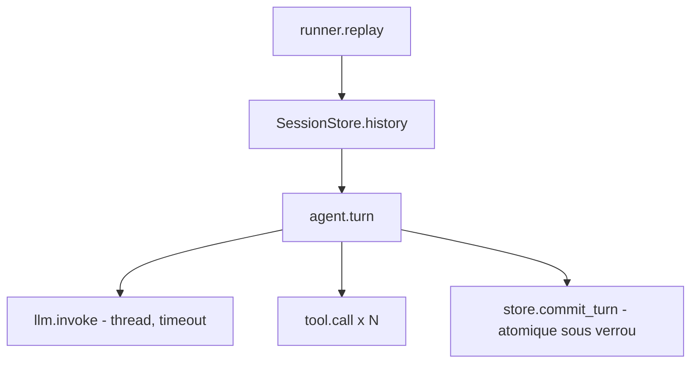

# Fiche projet — mARDIK (agent de support client)

> Chemin : `01_vitrine/mARDIK` · Stack : Python 3.11 (uv), LangChain 0.3 + `langchain-azure-ai` (Kimi-K2.6), OpenTelemetry 1.27 (OTLP/gRPC → Jaeger), structlog, pytest, ruff, mypy · Taille : ~50 fichiers, ~2,1k LOC (≈ 650 LOC de `src/`, le reste en tests et docs)

## 1. Objectif et contexte
Agent conversationnel de support client : il répond aux questions sur les commandes et le centre d'aide en appelant deux outils métier, avec une mémoire de session. Le sujet est un brief d'ingénieur en trois volets : tests de rejeu de sessions enregistrées, instrumentation (traces, métriques, logs) et diagnostic d'incidents récurrents. Statut : **partiel côté produit, abouti côté méthode**. L'adaptateur LLM → `Reply` n'est pas écrit ([README, Known issues](../mARDIK/README.md:76)) et les outils sont des données figées. En revanche la chaîne tests, observabilité et correction d'incidents est complète et documentée.

## 2. Architecture agentique
- Type : agent unique, **un seul appel LLM par tour**, sans boucle ReAct. Les outils sont exécutés après la réponse du modèle et leurs sorties sont concaténées, sans seconde passe LLM.
- Boucle et orchestration : `Agent.run_turn` lit l'historique, appelle le LLM (thread de travail, délai borné), dispatche les `tool_calls` dans l'ordre, puis commit le tour ([agent.py:98](../mARDIK/src/mardik/agent.py:98)). Pas de routage ni de superviseur.
- Outils : `lookup_order(order_id)` et `knowledge_base(topic)`, simples fonctions `str -> str` enregistrées dans un dict ([tools.py:26](../mARDIK/src/mardik/tools.py:26)). Le contrat se limite au nom et aux kwargs. Pas de schéma, pas de validation d'arguments.
- État et mémoire : `SessionStore` en mémoire (historique par `session_id` + compteur de tours), partagé entre threads ([session.py:10](../mARDIK/src/mardik/session.py:10)). Pas de persistance ni de TTL.
- Injection : le LLM est un `Protocol` ([agent.py:36](../mARDIK/src/mardik/agent.py:36)), la télémétrie est injectable, et `build_agent` assemble le tout ([app.py:14](../mARDIK/src/mardik/app.py:14)).

## 3. Prompts et gestion du contexte
**Aucun prompt système** : `messages` est la liste brute `[historique…, message utilisateur]` ([agent.py:107](../mARDIK/src/mardik/agent.py:107)). Pas de définition des outils transmise au modèle, pas de sortie structurée, pas de validation Pydantic, pas de garde-fou ni de troncature de l'historique. La seule gestion de longueur concerne les payloads d'outils sur les spans, limités à 512 caractères ([agent.py:16](../mARDIK/src/mardik/agent.py:16)). Cette section est la plus faible du projet : le comportement du vrai modèle n'est ni spécifié ni testé.

## 4. Fiabilité
- **Déterminisme vs LLM** : tout est en code, sauf la décision de quel outil appeler, confiée au LLM. L'ordre de sortie est déterministe : texte LLM puis sorties d'outils dans l'ordre d'appel ([agent.py:110](../mARDIK/src/mardik/agent.py:110)).
- **Erreurs** : timeout dur sur l'appel LLM avec exception de domaine `LLMTimeoutError` ([agent.py:62](../mARDIK/src/mardik/agent.py:62), [errors.py:10](../mARDIK/src/mardik/errors.py:10)). Un tour qui échoue n'écrit rien dans le store. Il n'y a **ni retry, ni mode dégradé, ni capture des erreurs d'outil** : un outil inconnu lève un `KeyError` qui remonte au client ([agent.py:89](../mARDIK/src/mardik/agent.py:89)).
- **Évaluations** : rejeu de 4 sessions enregistrées avec bloc `expected` ([return_refund.json](../mARDIK/sessions/return_refund.json)). Aucune évaluation sémantique (LLM-as-judge, groundedness), reconnue dans le README.
- **Tests** : 75 tests (unitaires + intégration). Le LLM est remplacé par des doubles scriptés ([conftest.py:16](../mARDIK/tests/conftest.py:16)), alors que store, outils et télémétrie sont réels. Les exporteurs OTel sont en mémoire.
- **Observabilité** : traces `agent.turn > llm.invoke / tool.call`, trois métriques, logs JSON corrélés par `trace_id` (détail en section 7).

## 5. Industrialisation
CI GitHub Actions : `ruff format --check`, `ruff check`, `mypy src`, puis `pytest` complet (unitaire + rejeux) ([ci.yml:19](../mARDIK/.github/workflows/ci.yml:19)). Le Makefile reproduit les mêmes étapes via `make check`. Jaeger all-in-one en docker-compose avec healthcheck ([docker-compose.yml:1](../mARDIK/docker-compose.yml:1)). Configuration 12-factor : `Settings` figé lu depuis l'environnement ([config.py:9](../mARDIK/src/mardik/config.py:9)) et `.env.example` documenté. Pas de Dockerfile applicatif, pas de déploiement, pas de versioning de prompts, pas de canary. Le `.env` local est ignoré par git mais contient des variables d'un autre projet (Postgres, Twilio, OVH), un résidu de copie.

## 6. Documentation et méthode
README orienté usage avec section « Known issues » honnête. Document de synthèse [INCIDENTS_ET_OBSERVABILITE.md](../mARDIK/docs/INCIDENTS_ET_OBSERVABILITE.md) : un tableau livrable/preuve, puis pour chaque incident symptôme, diagnostic, cause racine, correctif et test de non-régression ([§3, l.142](../mARDIK/docs/INCIDENTS_ET_OBSERVABILITE.md:142)). L'historique git est propre : une PR par correctif, des tests écrits d'abord, et des messages qui indiquent combien de tests échouent sur le code non corrigé. Pas de CLAUDE.md ni d'ADR.

## 7. ✅ Bonnes pratiques à reprendre
1. **Test de mutation manuel pour prouver les filets de sécurité** — chaque bug d'origine est réintroduit isolément et la suite doit échouer (I1 : 5 échecs, I2 : 10, I3 : 2, I4 : 1). Cela a révélé que le verrou du compteur pouvait être retiré sans qu'aucun test ne casse — preuve : [INCIDENTS_ET_OBSERVABILITE.md:232](../mARDIK/docs/INCIDENTS_ET_OBSERVABILITE.md:232)
2. **Tour atomique : aucun effet de bord avant l'étape faillible** — le prompt est construit sans écrire dans le store, puis user + assistant sont commités ensemble sous verrou. Un timeout ne laisse plus de message orphelin que le retry dupliquerait — preuve : [agent.py:104](../mARDIK/src/mardik/agent.py:104), [session.py:32](../mARDIK/src/mardik/session.py:32)
3. **Rejeu de sessions réelles comme tests d'intégration bout en bout** — un JSON `{session_id, messages, expected}` : tout sauf le dernier message est chargé comme historique, le dernier est joué comme nouveau tour à travers la vraie pile. Seul le LLM est faux — preuve : [runner.py:24](../mARDIK/src/mardik/runner.py:24), [return_refund.json:4](../mARDIK/sessions/return_refund.json:4)
4. **Contrat de forme des enregistrements** — un test paramétré valide chaque session (id non vide, rôles alternés, dernier message `user`, ids uniques). Un enregistrement cassé fait échouer la CI au lieu de fausser un rejeu — preuve : [test_replay_return_refund.py:61](../mARDIK/tests/integration/test_replay_return_refund.py:61)
5. **Télémétrie injectable avec exporteurs en mémoire** — le bundle `Telemetry` est passé au constructeur, `build_telemetry` accepte des exporteurs, `NoOpTelemetry` sert de substitut. Les tests lisent spans, métriques et logs réels sans réseau — preuve : [telemetry.py:85](../mARDIK/src/mardik/telemetry.py:85), [telemetry.py:150](../mARDIK/src/mardik/telemetry.py:150), [conftest.py:61](../mARDIK/tests/conftest.py:61)
6. **Corrélation log ↔ trace** — un processeur structlog ajoute `trace_id` et `span_id` du span actif. Des tests lisent les **vraies lignes JSON** sur stdout, y compris sous 24 tours concurrents — preuve : [telemetry.py:50](../mARDIK/src/mardik/telemetry.py:50), [test_observability.py:329](../mARDIK/tests/integration/test_observability.py:329)
7. **Propagation du contexte OTel vers le thread du LLM** — `contextvars.copy_context().run` évite que le span `llm.invoke` devienne une trace orpheline. Un test avec barrière sur 24 tours vérifie l'isolation des traces — preuve : [agent.py:63](../mARDIK/src/mardik/agent.py:63), [test_observability.py:304](../mARDIK/tests/integration/test_observability.py:304)
8. **Timeout dur avec abandon du thread bloqué et test qui échoue au lieu de bloquer** — `future.result(timeout=…)` puis `shutdown(wait=not hung, cancel_futures=hung)`. Le faux LLM se débloque seul après 2 s, donc une régression fait échouer la CI sans la bloquer — preuve : [agent.py:70](../mARDIK/src/mardik/agent.py:70), [test_replay_incidents.py:227](../mARDIK/tests/integration/test_replay_incidents.py:227)
9. **Garde contre la cardinalité des métriques** — `session_id` est sur les spans et les logs, jamais en attribut de métrique. C'est testé pour qu'une régression ne passe pas inaperçue — preuve : [telemetry.py:11](../mARDIK/src/mardik/telemetry.py:11), [test_telemetry.py:67](../mARDIK/tests/unit/test_telemetry.py:67)
10. **`track_turn` : observer sans avaler** — un context manager mesure la latence, incrémente `errors_total{error.type}`, journalise `turn.failed` et relance toujours l'exception. Les échecs sont ainsi visibles sur les trois signaux — preuve : [telemetry.py:114](../mARDIK/src/mardik/telemetry.py:114)
11. **Test de charge sur la même session** — 24 tours simultanés sur un seul `session_id`, bloqués par une `Barrier` pour forcer le chevauchement. Les tests de charge précédents donnaient à chaque tour sa propre session et ne voyaient pas la course — preuve : [test_replay_concurrent_session.py:59](../mARDIK/tests/integration/test_replay_concurrent_session.py:59), [test_replay_concurrent_session.py:30](../mARDIK/tests/integration/test_replay_concurrent_session.py:30)
12. **Flush explicite à l'arrêt, vérifié** — `shutdown()` est idempotent et appelé en `finally` par le CLI. Un test vérifie que l'export par lots vide tous les spans concurrents — preuve : [app.py:42](../mARDIK/src/mardik/app.py:42), [test_observability.py:379](../mARDIK/tests/integration/test_observability.py:379)
13. **CI = suite complète, identique au Makefile** — avant la PR #2, la CI ne lançait que `tests/unit` et les rejeux ne protégeaient pas `main`. Format, lint, mypy et pytest complet sont maintenant exécutés — preuve : [ci.yml:19](../mARDIK/.github/workflows/ci.yml:19), [Makefile:25](../mARDIK/Makefile:25)
14. **Import paresseux du SDK Azure** — `langchain_azure_ai` n'est importé que dans `get_llm`, donc la suite tourne hors ligne sans le SDK ni clé — preuve : [llm.py:16](../mARDIK/src/mardik/llm.py:16), [app.py:21](../mARDIK/src/mardik/app.py:21)

## 8. ❌ Anti-patterns / limites observées
1. **Pas de vraie boucle agentique** — les `tool_calls` sont exécutés une fois et leurs sorties brutes sont concaténées. Le modèle ne voit jamais les résultats d'outils pour formuler la réponse, ce qui rend la valeur d'un LLM douteuse et les réponses peu naturelles — preuve : [agent.py:110](../mARDIK/src/mardik/agent.py:110)
2. **Production non branchée : `get_llm` renvoie un `AIMessage`, pas un `Reply`** — l'adaptateur (contenu, `tool_calls`, `usage_metadata`) n'existe pas. La suite complète ne teste jamais le chemin réel, uniquement des faux — preuve : [llm.py:18](../mARDIK/src/mardik/llm.py:18), [README.md:78](../mARDIK/README.md:78)
3. **Aucun prompt système ni schéma d'outils transmis au modèle** — le comportement réel (choix d'outil, langue, refus) ne dépend d'aucune consigne versionnée ni évaluée — preuve : [agent.py:107](../mARDIK/src/mardik/agent.py:107)
4. **Erreurs d'outil non gérées** — un nom d'outil halluciné lève `KeyError` hors du dict, et des arguments invalides lèvent `TypeError`. Le tour entier échoue sans mode dégradé. Le test se contente d'entériner ce `KeyError` — preuve : [agent.py:89](../mARDIK/src/mardik/agent.py:89), [test_observability.py:251](../mARDIK/tests/integration/test_observability.py:251)
5. **`SessionStore` partiellement verrouillé** — seul `commit_turn` prend le verrou. `append`, `load_history`, `history` et `turns` accèdent aux dicts sans lock, et `append` n'est plus utilisé par l'agent. Il n'y a ni persistance, ni TTL, ni éviction : fuite mémoire croissante — preuve : [session.py:22](../mARDIK/src/mardik/session.py:22), [session.py:29](../mARDIK/src/mardik/session.py:29)
6. **Pas de sérialisation des tours d'une même session** — deux tours concurrents lisent le même historique et produisent deux réponses entrelacées. Le test concurrent n'asserte que le comptage et les paires, pas la cohérence sémantique — preuve : [agent.py:107](../mARDIK/src/mardik/agent.py:107), [test_replay_concurrent_session.py:81](../mARDIK/tests/integration/test_replay_concurrent_session.py:81)
7. **`time.sleep(0.0005)` en code de production pour simuler un « back-office »** — ce délai artificiel élargit la fenêtre de course pour les tests. C'est du code de test dans `src/` — preuve : [session.py:43](../mARDIK/src/mardik/session.py:43)
8. **Aucune évaluation de qualité** — les faux LLM recherchent `#(\d+)` par regex. Les tests prouvent la plomberie, pas la pertinence. La mention « rejeu de sessions réelles » est trompeuse : seul le dernier tour est rejoué, et les réponses assistant passées sont figées — preuve : [conftest.py:22](../mARDIK/tests/conftest.py:22), [runner.py:28](../mARDIK/src/mardik/runner.py:28)
9. **Thread bloqué abandonné** — après un timeout, le thread du SDK continue de tourner en arrière-plan, et le pool est recréé à chaque appel (un `ThreadPoolExecutor` par tour). Ce n'est pas annulable proprement et cela peut s'accumuler sous charge — preuve : [agent.py:66](../mARDIK/src/mardik/agent.py:66), [agent.py:75](../mARDIK/src/mardik/agent.py:75)
10. **Fuite potentielle de données client dans les traces** — `tool.input` et `tool.output` sont exportés vers l'OTLP, tronqués mais non masqués. Il n'y a pas de politique PII — preuve : [agent.py:86](../mARDIK/src/mardik/agent.py:86)
11. **Dépendance de test au chemin et au répertoire courant** — `sessions_dir()` vaut `sessions` par défaut, relatif au CWD. Les tests doivent monkeypatcher une variable d'environnement — preuve : [runner.py:14](../mARDIK/src/mardik/runner.py:14), [test_replay_concurrent_session.py:42](../mARDIK/tests/integration/test_replay_concurrent_session.py:42)
12. **Hygiène du dépôt** — `.env` hérité d'un autre projet (Postgres, Twilio, OVH), ignoré par git mais présent. Les caches `.mypy_cache`, `.ruff_cache` et `.pytest_cache` traînent dans l'arborescence — preuve : [.env.example:1](../mARDIK/.env.example:1) (le vrai `.env` ne ressemble pas à ce gabarit)

## 9. Idées originales / signatures du projet
- **« Lire les trois signaux comme un opérateur »** : chaque incident est rejoué puis vérifié sur trace, métriques et log à la fois. Le tableau de la section 2.4 de la doc le formalise ([INCIDENTS_ET_OBSERVABILITE.md:75](../mARDIK/docs/INCIDENTS_ET_OBSERVABILITE.md:75)).
- **Session enregistrée avec bloc `expected` auto-descriptif** : le JSON porte lui-même l'outil, l'argument et la sous-chaîne attendus, et les tests l'utilisent comme source de vérité plutôt que des constantes dupliquées ([size_exchange.json:4](../mARDIK/sessions/size_exchange.json:4)).
- **Méthode d'incident en cinq temps** (rejouer, test rouge, lire les signaux, correction minimale, garder le test) appliquée à quatre incidents ([INCIDENTS_ET_OBSERVABILITE.md:144](../mARDIK/docs/INCIDENTS_ET_OBSERVABILITE.md:144)).
- **Chaque correctif a un historique git lisible** (une PR par incident, constat « 7 of 11 tests fail against main »), ce qui fait du dépôt un portfolio de démarche de debug plus qu'un produit.
