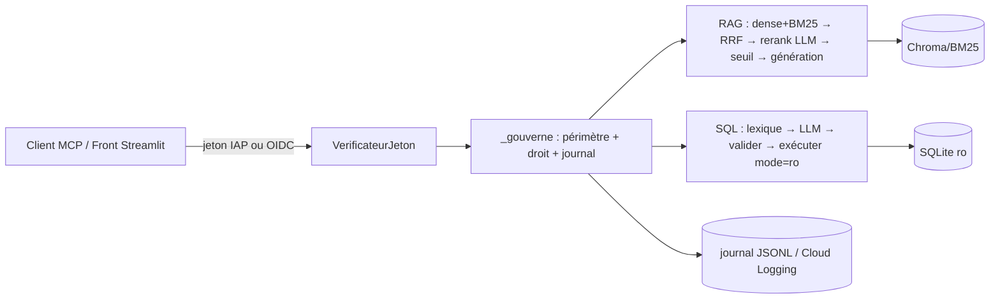

# Fiche projet — Sorabel Data Gateway

> Chemin : `01_vitrine/Sorabel - l'agent augmenté par la donnée, exposé via MCP` · Stack : Python 3.12, FastMCP (`mcp>=1.20,<2`), Chroma + BM25 (RRF), SQLite, Pydantic, PyJWT, Streamlit, Firestore, Azure AI Foundry (GPT-5.4-mini via client `OpenAI` v1), Docker, Cloud Build / Cloud Run · Taille : ~1 530 fichiers hors .venv/.git/.claude, 96 .py (~11,5 k LOC dont ~6 k de tests), 453 tests

## 1. Objectif et contexte
Passerelle de données pour un distributeur B2B de matériel électrique (fictif) : un **serveur MCP unique** expose à des clients internes (front Streamlit, clients MCP tiers) un RAG hybride sur ~400 documents (fiches, notices, notes, procédures SAV) et un Text-to-SQL en lecture seule sur une base de ventes, le tout gouverné par une matrice d'accès par profil (`support`, `dev`, `commercial`, `admin`) et journalisé. Les six phases applicatives et la mise en production GCP (OAuth 2.1, IAP, Firestore, CI/CD) sont livrées ; un socle « multi-enseigne » (déclinaison Kiabi fictive) a été ajouté. **Reste ouvert : l'évaluation E6** (aucun script de mesure, `eval/run_eval.py` absent).

## 2. Architecture agentique
- Type : **serveur MCP outillé (pas d'agent autonome)** — le LLM client choisit le tool ; côté serveur, deux pipelines déterministes avec appels LLM ponctuels (rerank listwise, génération de réponse, génération SQL).
- Boucle d'exécution et orchestration : aucune boucle agentique côté serveur. Chaque tool est enveloppé par le décorateur `_gouverne` : résolution du périmètre → contrôle `peut_appeler` → exécution → journalisation. RAG : dense (Chroma) + BM25 → fusion RRF → bonus de référence → rerank LLM → seuil de refus → génération. SQL : lexique sensible (avant LLM) → génération → validation (3 contrôles) → exécution `mode=ro` + `LIMIT` + timeout.
- Outils / MCP : 8 tools (`answer_question`, `search_docs`, `get_document`, `list_sources`, `ask_database`, `get_schema`, `check_stock`, `order_status`). Contrat de retour homogène : un dict avec `statut` ∈ {`ok`, `hors_corpus`, `hors_schema`, `non_autorise`, `refuse_ecriture`} ; les refus sont des retours normaux, pas des exceptions. Docstrings = descriptions MCP, avec règles de désambiguïsation entre tools (« N'utilisez PAS ce tool pour… »).
- État et mémoire : pas de mémoire conversationnelle. État persistant = index Chroma + BM25 (reconstruits au build Docker), documents canoniques JSON, `gouvernance.db` (matrice), identités SQLite (local) ou Firestore (prod), journal JSONL ou stdout/Cloud Logging. Configuration d'enseigne figée à l'import (une enseigne par processus).

## 3. Prompts et gestion du contexte
- Prompts courts en constantes Python, interpolés avec la config d'enseigne (`presentation`, `nom_base`) et **gelés par des tests d'instantané** (`tests/instantanes/sorabel/prompt_rag.txt`, `prompt_sql.txt`).
- RAG : consigne « UNIQUEMENT à partir des extraits » + interdiction explicite de citer ; les citations sont reconstruites en code depuis les métadonnées des chunks passés au prompt.
- Rerank : barème explicite à 3 niveaux (1,0 / 0,5 / 0,0), sortie JSON `{"scores":[{"i","s"}]}` extraite tolérante (`find("{")`/`rfind("}")`), 3 tentatives, extraits tronqués à 700 caractères pour borner l'entrée.
- SQL : schéma commenté **filtré par profil** (colonnes interdites absentes du prompt), 2 exemples few-shot, jeton sentinelle `AUCUNE_REQUETE` pour le hors-schéma.
- Pas de sortie structurée native (ni `response_format`, ni Pydantic sur la sortie LLM) ; Pydantic sert à valider la matrice d'accès au démarrage. Pas de délimitation anti-injection des extraits documentaires (séparateur `---` seulement).

## 4. Fiabilité
- Déterminisme vs LLM : refus hors corpus, citations, contrôle d'accès, lecture seule, `LIMIT`, timeout, détection de questions sensibles, formats `REF-XXXX` / `CMD-AAAA-NNNN` : tout en code. Le LLM ne fait que noter la pertinence, rédiger, et traduire en SQL.
- Gestion d'erreurs : distinction explicite panne / refus (`RerankIndisponible` levée plutôt que des notes nulles qui simuleraient un `hors_corpus`) ; résolveur d'identité en échec → `non_autorise` (fail-closed). En revanche, les exceptions levées *dans* un tool (SQLite, rerank, LLM) ne sont ni rattrapées ni journalisées par `_gouverne`. Pas de timeout explicite côté client LLM.
- Évaluations : jeux `eval/questions_rag.jsonl` (30), `questions_rag_kiabi.jsonl` (39), `questions_sql.jsonl` (24), typés `reference_exacte` / langage naturel ; **aucun runner**. Seuil Kiabi calibré par une mesure manuelle documentée (`docs/calibrage-kiabi.md`) ; seuil Sorabel (0,3) posé par raisonnement sur le barème.
- Tests : 453 tests pytest, LLM remplacé par `monkeypatch` de `completer`, `Perimetre` duck-typé doublé ; tests de sécurité ciblés (joker `SELECT *`, `PRAGMA` déguisé, commentaires, schéma MCP sans `perimetre`), tests d'architecture par AST (le front n'importe pas le pipeline), tests du Dockerfile et du Makefile, instantanés de non-régression multi-enseigne.
- Observabilité : une ligne JSON par appel de tool (profil, tool, autorisé, statut, entrées, SQL, n_lignes, durée, motif) — jamais le contenu des résultats ; logs d'infrastructure (JWKS) séparés sur stderr. Pas de traces/métriques LLM (tokens, latence par étape).

## 5. Industrialisation
- Dockerfile multi-étapes : l'étape `index` lit le corpus et construit Chroma/BM25 avec la clé d'embeddings montée en **secret BuildKit** ; l'image servie ne contient ni corpus brut ni autre enseigne.
- `cloudbuild.yaml` : tests (barrière) → build → push → déploiement de deux services Cloud Run (`sorabel-mcp`, `sorabel-front`) depuis la même image, secrets via Secret Manager, `--async` justifié pour l'amorçage.
- Config par variables d'environnement documentées (`SORABEL_TRANSPORT`, `SORABEL_DEPOT`, `SORABEL_JOURNAL`…), `.env` ignoré par git, `mcp` borné à `<2` avec justification dans `pyproject.toml`.
- Pas de versioning explicite des prompts ni de canary/rollback (tag `:latest` + `SHORT_SHA`). Ni linter ni formateur.

## 6. Documentation et méthode
- `CLAUDE.md` court et normatif (« contraintes non négociables », pièges Windows/Streamlit déjà payés), qui renvoie à `docs/DOSSIER_TECHNIQUE.md` (722 l. : contrats, traçabilité E1–E6, limites connues, incidents de premier déploiement).
- `docs/conception.md` (1 459 l.) : décisions et alternatives écartées par chantier, partant d'un « état du corpus constaté, non supposé ».
- `docs/superpowers/specs` + `plans` datés par phase (méthode spec → plan → exécution), `BRIEF.md` dont les tests d'acceptance font office de spécification.
- Commentaires orientés *pourquoi* systématiques et historiques des choix abandonnés dans le code même (rerankers successifs).

## 7. ✅ Bonnes pratiques à reprendre

1. **Point de passage unique de gouvernance par décorateur** — `_gouverne` résout le périmètre à chaque appel, refuse et journalise *avant* d'exécuter, et traite un résolveur d'identité en erreur en fail-closed ; les 8 tools sont toujours enregistrés pour que même un refus laisse une trace. — preuve : [`mcp_server/tools.py:61`](<../Sorabel - l'agent augmenté par la donnée, exposé via MCP/mcp_server/tools.py:61>), [`tests/test_mcp_tools.py:150`](<../Sorabel - l'agent augmenté par la donnée, exposé via MCP/tests/test_mcp_tools.py:150>)

2. **Paramètre injecté masqué du schéma MCP** — la signature exposée au client est réécrite pour retirer `perimetre` (sans `functools.wraps`, avec `eval_str=True`) : le LLM client ne peut ni voir ni forger son propre périmètre ; un test le vérifie. — preuve : [`mcp_server/tools.py:106`](<../Sorabel - l'agent augmenté par la donnée, exposé via MCP/mcp_server/tools.py:106>), [`tests/test_mcp_tools.py:175`](<../Sorabel - l'agent augmenté par la donnée, exposé via MCP/tests/test_mcp_tools.py:175>)

3. **Citations construites par le code, jamais par le LLM** — le prompt interdit au modèle de citer ; les sources sont dérivées des métadonnées des chunks réellement passés au prompt, dédoublonnées par document. Élimine les citations hallucinées. — preuve : [`sorabel_rag/generation.py:59`](<../Sorabel - l'agent augmenté par la donnée, exposé via MCP/sorabel_rag/generation.py:59>)

4. **Refus hors corpus déterministe, sans appel de génération** — sous le seuil, on retourne `{"statut": "hors_corpus"}` sans appeler le LLM ; le seuil lit la note brute du reranker, séparée du bonus de référence utilisé pour le classement (tri sur un couple, pas une somme). — preuve : [`sorabel_rag/generation.py:84`](<../Sorabel - l'agent augmenté par la donnée, exposé via MCP/sorabel_rag/generation.py:84>), [`sorabel_rag/recherche.py:294`](<../Sorabel - l'agent augmenté par la donnée, exposé via MCP/sorabel_rag/recherche.py:294>)

5. **Une panne n'est jamais déguisée en refus** — après 3 tentatives de rerank inexploitables, on lève `RerankIndisponible` plutôt que de renvoyer des notes nulles qui produiraient un faux `hors_corpus`. — preuve : [`sorabel_rag/recherche.py:329`](<../Sorabel - l'agent augmenté par la donnée, exposé via MCP/sorabel_rag/recherche.py:329>)

6. **Text-to-SQL en défense en profondeur** — connexion SQLite `mode=ro` (barrière appliquée par le moteur), liste blanche SELECT/WITH + mots-clés interdits, périmètre tables/colonnes, refus du joker `SELECT *` sur table sensible, `LIMIT` par défaut avec drapeau `tronque`, timeout par `set_progress_handler`. Le SQL exécuté ou rejeté est toujours renvoyé. — preuve : [`sorabel_sql/execution.py:33`](<../Sorabel - l'agent augmenté par la donnée, exposé via MCP/sorabel_sql/execution.py:33>), [`sorabel_sql/validation.py:83`](<../Sorabel - l'agent augmenté par la donnée, exposé via MCP/sorabel_sql/validation.py:83>)

7. **Refus d'intention sensible avant tout appel LLM, réglé sur l'asymétrie des risques** — un lexique volontairement large (« marge », « prix d'achat »…) refuse la question pour les profils restreints *avant* de payer un appel et de risquer une fuite ; les profils autorisés n'y sont pas soumis. Le schéma envoyé au LLM est lui-même filtré par profil. — preuve : [`sorabel_sql/generation.py:40`](<../Sorabel - l'agent augmenté par la donnée, exposé via MCP/sorabel_sql/generation.py:40>), [`sorabel_sql/lexique_sensible.py:1`](<../Sorabel - l'agent augmenté par la donnée, exposé via MCP/sorabel_sql/lexique_sensible.py:1>)

8. **Invariant de sécurité vérifié au chargement par Pydantic** — si la matrice en base oublie d'exclure une colonne sensible pour un profil restreint, ou contient un code de tool inconnu, le serveur refuse de démarrer au lieu d'échouer à l'appel. — preuve : [`gouvernance/modeles.py:38`](<../Sorabel - l'agent augmenté par la donnée, exposé via MCP/gouvernance/modeles.py:38>)

9. **Contrat duck-typé entre gouvernance et pipelines** — `sorabel_rag` et `sorabel_sql` ne dépendent pas de `gouvernance` : ils reçoivent un objet à 4 méthodes, facilement doublé en test ; le filtre de collection est appliqué *dans* le retrieval (filtre Chroma, ids autorisés pour BM25), pas en post-filtrage. — preuve : [`gouvernance/perimetre.py:34`](<../Sorabel - l'agent augmenté par la donnée, exposé via MCP/gouvernance/perimetre.py:34>), [`sorabel_rag/recherche.py:221`](<../Sorabel - l'agent augmenté par la donnée, exposé via MCP/sorabel_rag/recherche.py:221>)

10. **Descriptions de tools écrites pour le LLM client** — chaque docstring dit quand l'utiliser, quand ne pas l'utiliser (renvoi vers le tool voisin) et liste les statuts possibles ; elles sont paramétrées par enseigne pour ne pas tromper le client sur le corpus interrogé. — preuve : [`mcp_server/tools.py:128`](<../Sorabel - l'agent augmenté par la donnée, exposé via MCP/mcp_server/tools.py:128>), [`mcp_server/tools.py:31`](<../Sorabel - l'agent augmenté par la donnée, exposé via MCP/mcp_server/tools.py:31>)

11. **Tests d'architecture et d'instantané** — un test AST interdit au front d'importer `sorabel_rag`/`sorabel_sql`/`sorabel_llm`/`mcp_server` (aucun contournement de la gouvernance) ; des instantanés capturés avant le refactoring multi-enseigne gèlent prompts, schéma et chemins (« on corrige la config, jamais l'instantané »). — preuve : [`tests/test_front_coherence.py:46`](<../Sorabel - l'agent augmenté par la donnée, exposé via MCP/tests/test_front_coherence.py:46>), [`tests/test_enseigne_sorabel_inchangee.py:33`](<../Sorabel - l'agent augmenté par la donnée, exposé via MCP/tests/test_enseigne_sorabel_inchangee.py:33>)

12. **Journal d'audit qui ne devient pas une fuite** — une ligne JSON par appel (autorisé ou refusé) avec SQL et volume, mais jamais le contenu des résultats ; bascule stdout pour Cloud Logging ; les erreurs d'infrastructure (JWKS) vont sur un logger séparé pour ne pas polluer l'audit. — preuve : [`gouvernance/journal.py:1`](<../Sorabel - l'agent augmenté par la donnée, exposé via MCP/gouvernance/journal.py:1>), [`mcp_server/authentification.py:30`](<../Sorabel - l'agent augmenté par la donnée, exposé via MCP/mcp_server/authentification.py:30>)

13. **Resource Server OAuth durci** — audience vérifiée par émetteur (pas de confusion d'audience), algorithmes en tuple immuable (pas de confusion RS256/HS256), claims `exp/iss/aud/sub` exigés, configuration JWKS incomplète = refus de démarrer. — preuve : [`mcp_server/authentification.py:20`](<../Sorabel - l'agent augmenté par la donnée, exposé via MCP/mcp_server/authentification.py:20>)

14. **Build d'index avec secret BuildKit et image sans corpus** — la clé d'embeddings n'existe dans aucune couche (`--mount=type=secret`), l'image finale ne copie que les index et canoniques de l'enseigne servie. — preuve : [`Dockerfile:40`](<../Sorabel - l'agent augmenté par la donnée, exposé via MCP/Dockerfile:40>)

15. **Limites connues et incidents de déploiement consignés** — le dossier technique liste ce qui manque (E6) et chaque incident du premier provisionnement GCP avec sa cause et son correctif, à destination d'un repreneur. — preuve : [`docs/DOSSIER_TECHNIQUE.md:610`](<../Sorabel - l'agent augmenté par la donnée, exposé via MCP/docs/DOSSIER_TECHNIQUE.md:610>)

## 8. ❌ Anti-patterns / limites observées

1. **Validation SQL par regex contournable (jointure par virgule, identifiant entre guillemets)** — `MOTIF_TABLE` ne capture que le premier nom après `FROM`/`JOIN` et exige un identifiant non quoté ; `SELECT v.marge_ht FROM produits p, ventes v` et `SELECT marge_ht FROM "ventes"` passent la validation (vérifié en exécutant `valider()` avec un périmètre support). — Conséquence : les barrières « tables du profil » et « colonnes sensibles » (E5) sont contournables par un SQL généré ; seul le lexique amont protège, et uniquement si la question contient le mot. Un parseur SQL (sqlglot) ou l'autorizer SQLite (`set_authorizer`) aurait fermé la brèche. — preuve : [`sorabel_sql/validation.py:20`](<../Sorabel - l'agent augmenté par la donnée, exposé via MCP/sorabel_sql/validation.py:20>), [`sorabel_sql/validation.py:108`](<../Sorabel - l'agent augmenté par la donnée, exposé via MCP/sorabel_sql/validation.py:108>)

2. **Exceptions des tools hors journal d'audit** — `_gouverne` n'enveloppe pas `func(...)` dans un `try` : une `sqlite3.OperationalError` sur SQL généré invalide, un `TimeoutError`, un `RerankIndisponible` ou une erreur Azure remontent sans ligne de journal. — Conséquence : la promesse « tout appel est journalisé » est fausse pour les pannes, précisément les appels qu'on veut auditer ; le client reçoit une erreur MCP brute au lieu d'un statut. — preuve : [`mcp_server/tools.py:96`](<../Sorabel - l'agent augmenté par la donnée, exposé via MCP/mcp_server/tools.py:96>), [`sorabel_sql/tools.py:46`](<../Sorabel - l'agent augmenté par la donnée, exposé via MCP/sorabel_sql/tools.py:46>)

3. **Évaluation E6 jamais exécutée** — les jeux de questions existent et `rechercher()` garde les trois configurations exprès pour la comparaison, mais aucun runner ne calcule Recall@5/MRR/Hit@1. — Conséquence : le gain de l'hybride + rerank, exigence du brief, n'est pas démontré ; le seuil de refus Sorabel (0,3) est déduit du barème, non mesuré. — preuve : [`docs/DOSSIER_TECHNIQUE.md:614`](<../Sorabel - l'agent augmenté par la donnée, exposé via MCP/docs/DOSSIER_TECHNIQUE.md:614>), [`sorabel_rag/recherche.py:54`](<../Sorabel - l'agent augmenté par la donnée, exposé via MCP/sorabel_rag/recherche.py:54>)

4. **Dossier de conception désynchronisé du code** — le tableau des décisions annonce embeddings locaux et cross-encoder local, alors que le code utilise Azure et un rerank LLM listwise (dont l'historique n'est documenté que dans un commentaire). — Conséquence : le document que `CLAUDE.md` désigne comme source des décisions induit en erreur un repreneur ou un agent de code. — preuve : [`docs/conception.md:600`](<../Sorabel - l'agent augmenté par la donnée, exposé via MCP/docs/conception.md:600>), [`sorabel_rag/recherche.py:41`](<../Sorabel - l'agent augmenté par la donnée, exposé via MCP/sorabel_rag/recherche.py:41>)

5. **Sorties LLM non structurées, parsées à la main** — le rerank extrait le JSON entre la première `{` et la dernière `}` et retente jusqu'à 3 fois ; la génération SQL dépend d'un `strip()` et d'un jeton sentinelle. — Conséquence : coût et latence multipliés sur échec, fragilité face à un changement de modèle ; `response_format`/JSON schema aurait supprimé la boucle. — preuve : [`sorabel_rag/recherche.py:321`](<../Sorabel - l'agent augmenté par la donnée, exposé via MCP/sorabel_rag/recherche.py:321>), [`sorabel_sql/generation.py:61`](<../Sorabel - l'agent augmenté par la donnée, exposé via MCP/sorabel_sql/generation.py:61>)

6. **Client LLM sans timeout ni budget explicite** — `completer()` appelle `chat.completions.create` sans `timeout` ni `max_tokens`, et le rerank enchaîne jusqu'à 3 appels. — Conséquence : un tool MCP peut rester bloqué sur les délais par défaut du SDK, sans borne de coût par requête. — preuve : [`sorabel_llm/client.py:63`](<../Sorabel - l'agent augmenté par la donnée, exposé via MCP/sorabel_llm/client.py:63>)

7. **Extraits documentaires injectés sans isolation** — les chunks (y compris notes internes) sont concaténés avec un simple séparateur `---` dans le message utilisateur, sans balisage ni consigne de traiter le contenu comme donnée. — Conséquence : surface d'injection indirecte si le corpus devient éditable ; faible ici (corpus figé) mais non anticipée. — preuve : [`sorabel_rag/generation.py:49`](<../Sorabel - l'agent augmenté par la donnée, exposé via MCP/sorabel_rag/generation.py:49>)

8. **Configuration figée à l'import, en variables globales** — enseigne, prompts, seuil, chemins de base et libellés sont calculés au chargement des modules (`LIBELLE_ENSEIGNE`, `PROMPT_SYSTEME`, `CHEMIN_DB`…). — Conséquence : impossible de servir deux enseignes dans un processus ; les tests doivent fixer `SORABEL_ENSEIGNE` avant tout import, ce qui couple fortement tests et ordre d'import. — preuve : [`sorabel_rag/generation.py:29`](<../Sorabel - l'agent augmenté par la donnée, exposé via MCP/sorabel_rag/generation.py:29>), [`tests/conftest.py:11`](<../Sorabel - l'agent augmenté par la donnée, exposé via MCP/tests/conftest.py:11>)

9. **Tools SQL à requête fixe qui ignorent le périmètre** — `check_stock` et `order_status` reçoivent `perimetre` mais ne le transmettent pas : seul `peut_appeler` les protège, pas `tables_autorisees`. — Conséquence : un profil à qui l'on retirerait la table `stocks` mais pas le tool garderait l'accès ; la cohérence matrice/tool repose sur la saisie manuelle. — preuve : [`mcp_server/tools.py:196`](<../Sorabel - l'agent augmenté par la donnée, exposé via MCP/mcp_server/tools.py:196>)

## 9. Idées originales / signatures du projet
- **Rerank par LLM listwise à barème explicite, choisi pour rendre un seuil de refus calibrable** : l'historique (cross-encoder CPU trop lent, Cohere en 429, mMiniLM aux scores non comparables entre questions) est conservé dans le code ; un barème à 3 niveaux donne 0 partout hors corpus, d'où un seuil franc.
- **« Filtre déguisé en bonus »** : une référence produit détectée dans la question ajoute +1,0 à un score RRF de l'ordre de 0,016, ce qui fait passer le document sujet en tête sans exclure les autres ; le seuil de refus lit pourtant la note brute non bonifiée.
- **Double mode de gouvernance selon le transport** : en stdio, un processus = un profil et les tools hors périmètre n'existent pas ; en HTTP, tous les tools existent et le profil est relu dans le jeton à chaque appel — seuls deux points de code dépendent du transport.
- **Socle multi-enseigne par fichier TOML** avec validation stricte des clés (`CLES_FRONT`), dérivation des couleurs d'accent, seuil de refus calibré par enseigne (`docs/calibrage-kiabi.md`, 0,75 pour Kiabi), et non-régression de Sorabel garantie « à l'octet » par instantanés.
- **Front volontairement sans droit** : il ne lit que la matrice pour l'affichage et passe toujours par un serveur MCP (HTTP en prod, stdio en local), avec garde-fous contre le mode local sur Cloud Run (`K_SERVICE`) et hors boucle locale.
