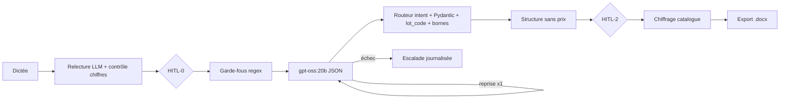

# Fiche projet — the-project (Assistant devis BTP vocal)

> Chemin : `01_vitrine/the-project` · Stack : Python 3.14, FastAPI, Pydantic v2, SQLite (catalogue), front HTML mono-fichier, Ollama + `gpt-oss:20b` (structuration et relecture de dictée), Mistral OCR (gabarit), uv, Docker, GitHub Actions · Taille : ~186 fichiers, ~5,2k LOC dans `app/`, ~19k lignes Python+HTML au total, 26 fichiers de tests (~457 tests)

## 1. Objectif et contexte
Application B2B pour artisans du bâtiment (peinture, sols, plomberie, électricité) : l'artisan dicte son chantier, un LLM structure la demande en JSON (lots, dimensions), un moteur Python déterministe produit un devis exportable en `.docx` **sans que le modèle n'émette jamais un prix**. Projet de soutenance AI Engineer (RNCP), un seul utilisateur (l'artisan), V1 = `gpt-oss:20b` brut « bien prompté », V2 = fine-tuning LoRA (Unsloth) pas encore réalisé. Statut : V1 fonctionnelle en local (parcours de bout en bout 24/24 étapes), déploiement GCP Cloud Run décidé mais pas encore câblé (URL du modèle encore en dur), dataset et fine-tuning à écrire.

## 2. Architecture agentique
- Type : **pipeline orchestré à la main** (pas de framework d'agents, constat assumé dans [D-15](../the-project/docs/DECISIONS.md:94)), agent unique à sortie structurée, avec points HITL. Aucun tool-calling : le modèle ne reçoit que du texte et rend du JSON.
- Boucle d'exécution : `traiter_message` ([pipeline.py:334](../the-project/app/pipeline.py:334)) → validation d'entrée → soupape « demande d'un humain » (HITL-4) → détection d'injection (encadrement) → détection hors périmètre (court-circuit si rien d'autre) → `_tour_modele` (1 appel + 1 reprise max) → `_router` sur `intent` → moteur `app.devis`. Le code décide de tout ; le modèle ne fait que choisir un `intent` dans une liste fermée.
- Points humains : HITL-0 relecture de dictée ([pipeline.py:471](../the-project/app/pipeline.py:471)), HITL-1 plafond de 3 tours de clarification puis hypothèses explicites ([pipeline.py:40](../the-project/app/pipeline.py:40)), HITL-2 validation de la structure **avant** tout chiffrage ([pipeline.py:448](../the-project/app/pipeline.py:448)), arbitrage des quantités hors bornes et des contradictions entre dictées.
- Outils / MCP / A2A : aucun outil exposé au LLM. Services externes cantonnés : OCR Mistral pour le gabarit de devis (jamais via le LLM), annuaire SIRET. Un second appel LLM séparé (relecture de dictée, `app/transcription.py`) qui n'importe rien de `app.llm`.
- État et mémoire : `Session` dataclass ([pipeline.py:103](../the-project/app/pipeline.py:103)) — historique glissant de 10 messages, devis, lignes en attente, corrections, escalades ; persistance fichiers JSON versionnés (format v5, migration à la relecture) avec écriture atomique `.tmp` + `replace` ([persistance.py:316](../the-project/app/persistance.py:316)) ; pas de base de données tant que les déclencheurs de [D-17] ne sont pas atteints.

## 3. Prompts et gestion du contexte
- Prompt système unique en f-string ([llm.py:29](../the-project/app/llm.py:29)) : rôle, **règle absolue** « jamais de prix ni de référence », liste fermée des `lot_code` injectée depuis le référentiel, domaines à mention, schéma d'enveloppe `{intent, payload, mention}`, une forme de payload par intent, un exemple. Température 0,2 (0,0 pour la relecture).
- Sortie structurée sans contrainte de décodage : extraction par regex du premier `{…}` ([llm.py:70](../the-project/app/llm.py:70)), puis validation Pydantic **par intent** dans le routeur (`PayloadDevis`, `PayloadClarification`…) et contrôle d'appartenance du `lot_code` au référentiel ([pipeline.py:217](../the-project/app/pipeline.py:217)).
- Garde-fou structurel : le schéma n'a **aucun champ prix** — le modèle ne peut pas exprimer ce qu'il ne doit pas inventer ([schema.py:1](../the-project/app/schema.py:1)).
- Injection : entrée détectée par regex, **encadrée** comme donnée (pas supprimée) et journalisée ([garde_fous.py:154](../the-project/app/garde_fous.py:154)).
- Longueur : entrée bornée à 2000 caractères, historique tronqué à 10 messages ([pipeline.py:429](../the-project/app/pipeline.py:429)).

## 4. Fiabilité
- Déterminisme vs LLM : le LLM structure (intent, lots, dimensions) ; le code fait catalogue, rendements, taux de chute, conditionnement, TVA, totaux, acompte, mentions réglementaires ([devis.py:1](../the-project/app/devis.py:1)). Les mentions sont ajoutées par le code même si le modèle les oublie ([pipeline.py:262](../the-project/app/pipeline.py:262)).
- Erreurs / mode dégradé : deux exceptions distinctes `SortieModeleInvalide` (reprise utile) et `ModeleInjoignable` (escalade immédiate, pas de reprise) ([llm.py:58](../the-project/app/llm.py:58)) ; budget de 2 appels par message possédé par le seul pipeline ([pipeline.py:34](../the-project/app/pipeline.py:34)) ; reprise avec message d'erreur de schéma réinjecté ; escalade avec motif stable. Relecture de dictée qui ne lève jamais et retombe sur le texte brut. OCR qui retombe sur un gabarit par défaut.
- Évaluations : 8 métriques avec seuils déclarés dans le code ([observabilite.py:40](../the-project/app/observabilite.py:40)), celles non mesurables en production étiquetées « non mesurée » plutôt qu'approchées. Mesure de référence réelle : 71,4 % de JSON valide (15/21 appels) contre 98 % visés ([CONCLUSION_POC.md:88](../the-project/docs/modele/CONCLUSION_POC.md:88)). Jeu de test manuel de 150-200 exemples prévu mais **pas encore écrit** ; validateur de dataset avec détection de fuite bloquante et gabarit d'exemples fautifs.
- Tests : pytest avec fausse fonction modèle injectée par `monkeypatch` ([test_pipeline.py:37](../the-project/tests/test_pipeline.py:37)), tests nominal + dégradé (budget d'appels, contradiction, bornes, hypothèses), tests d'architecture (la relecture n'importe pas `app.llm`), tests de sécurité route par route ; parcours bout en bout séparé contre serveur et Ollama réels (`tools/parcours_bout_en_bout.py`).
- Observabilité : journal JSONL d'événements (`appel_modele`, `tour`, `escalade`, `injection_neutralisee`, `correction_artisan`) jamais bloquant ([observabilite.py:65](../the-project/app/observabilite.py:65)), agrégé en tableau de bord `/metriques` (taux JSON, p95, volumes, modèles vus).

## 5. Industrialisation
- CI en trois chaînes à questions distinctes : `tests.yml` (pytest avec `BTP_DONNEES` jetable, contrôle d'accessibilité des docs, `node --check` sur le JS extrait du front), `livraison.yml` (build, démarrage réel, sonde santé, vérification que la route catalogue répond **401**, base embarquée non vide, publication GHCR seulement sur push), `modele.yml` (validation dataset + préparation, hebdomadaire et sur changement de `dataset/**`).
- Docker multi-étapes, `uv sync --frozen`, base catalogue construite au build hors réseau ([Dockerfile:40](../the-project/Dockerfile:40)), utilisateur non root, volume `/donnees`, HEALTHCHECK sur la seule route ouverte.
- Config et secrets : variables `BTP_*`, phrase de passe stockée en empreinte scrypt, clé de session aléatoire par défaut, en-têtes de sécurité CSP, auth par liste blanche en middleware.
- Versioning modèle/prompt : nom du modèle journalisé à chaque appel, mais ni le prompt ni sa version ne sont tracés. Chaîne MLOps déclarée dans `mlops/pipeline.toml` avec trois états (`réussi` / `échoué` / `ignoré`).

## 6. Documentation et méthode
`CLAUDE.md` très directif (principes non négociables, frontière modèle/code, questions ouvertes à ne pas trancher, « pas de linter, ne pas en inventer »). `docs/DECISIONS.md` = **seul** fichier d'historique (ADR D-01…D-22, décisions remplacées, questions ouvertes) ; `docs/` décrit uniquement l'état courant. `STORIES.md` porte une ligne de traçabilité « état constaté » par story. Docstrings qui citent systématiquement la section de conception (`DISPOSITIF_AGENT.md §1.3`) qu'ils implémentent. Méthode de dev assistée : skills `brainstorming` / `writing-plans` / `subagent-driven-development`, sous-agent `executant-local` sur gpt-oss-120b local avec outillage réduit pour tenir dans 131k tokens, journal SDD avec revues par diff (`.superpowers/sdd/`).

## 7. ✅ Bonnes pratiques à reprendre
1. **Frontière « le modèle décrit, le code calcule » rendue structurelle** — le schéma de sortie n'a aucun champ prix/référence, donc l'hallucination de prix est impossible par construction, pas seulement interdite par le prompt — preuve : [`schema.py:1`](../the-project/app/schema.py:1), [`devis.py:117`](../the-project/app/devis.py:117), [`DECISIONS.md:16`](../the-project/docs/DECISIONS.md:16)
2. **Validation humaine du stable avant le volatil (HITL-2)** — les lignes existent d'abord sans prix (`chiffrer_maintenant=False`), le chiffrage n'a lieu qu'après validation de la structure ; aucun montant ne peut fuiter avant — preuve : [`pipeline.py:448`](../the-project/app/pipeline.py:448), [`devis.py:143`](../the-project/app/devis.py:143)
3. **Budget de reprise possédé par un seul niveau, avec typologie d'échec** — `app.llm` n'a pas de boucle ; le pipeline borne à 2 appels, reprend sur JSON/schéma invalide mais escalade immédiatement si le modèle est injoignable ; test dédié — preuve : [`pipeline.py:34`](../the-project/app/pipeline.py:34), [`llm.py:62`](../the-project/app/llm.py:62), [`test_pipeline.py:75`](../the-project/tests/test_pipeline.py:75)
4. **Contrôle déterministe d'un LLM « cosmétique »** — la reformulation de dictée est jetée si le multiensemble des nombres/unités change (« 22 m² » → « 2 m² » n'atteint pas l'écran) — preuve : [`transcription.py:84`](../the-project/app/transcription.py:84), [`transcription.py:119`](../the-project/app/transcription.py:119)
5. **Plausibilité métier par bornes qui demandent confirmation au lieu de rejeter** — bornes par unité puis par lot ; une contradiction entre deux dictées n'est ni additionnée ni tranchée seule — preuve : [`referentiel.py:94`](../the-project/app/referentiel.py:94), [`pipeline.py:231`](../the-project/app/pipeline.py:231)
6. **Garde-fous déterministes avant l'appel modèle** — soupape humaine, injection encadrée et journalisée, hors périmètre court-circuité sans coût d'appel ; regex assumées comme « lisibles, testables, sans réseau » — preuve : [`pipeline.py:355`](../the-project/app/pipeline.py:355), [`garde_fous.py:14`](../the-project/app/garde_fous.py:14)
7. **Métriques déclarées avec seuils, honnêtes sur ce qui n'est pas mesuré** — 8 seuils en code, statut « non mesuré » plutôt qu'un chiffre flatteur ; journal qui ne casse jamais un tour — preuve : [`observabilite.py:40`](../the-project/app/observabilite.py:40), [`observabilite.py:65`](../the-project/app/observabilite.py:65)
8. **Corrections humaines capturées en triplets d'entraînement** — chaque correction porte `entree` / `sortie_modele` / `corrige` et une `origine` qui dit si le signal vise le modèle ou les bornes ; export append-only qui refuse toute destination synchronisée/réseau — preuve : [`pipeline.py:62`](../the-project/app/pipeline.py:62), [`boucle_qualite.py:41`](../the-project/app/boucle_qualite.py:41)
9. **Validateur de dataset auto-testé par un gabarit d'exemples fautifs** — chaque défaut porte son motif attendu ; si un détecteur cesse de détecter, la CI rougit ; détection de fuite train/test bloquante sur le texte normalisé — preuve : [`valider_dataset.py:266`](../the-project/tools/mlops/valider_dataset.py:266), [`valider_dataset.py:197`](../the-project/tools/mlops/valider_dataset.py:197)
10. **Pipeline MLOps à trois états** — « pas encore lancé » n'est jamais « réussi » ; l'entraînement absent ne produit aucun artefact factice — preuve : [`executer.py:36`](../the-project/tools/mlops/executer.py:36)
11. **CI de livraison qui éprouve l'image, pas seulement le build** — démarrage, sonde santé, et assertion qu'une route protégée répond 401 (sinon l'image livrerait un produit ouvert) — preuve : [`livraison.yml:53`](../the-project/.github/workflows/livraison.yml:53)
12. **Tests unitaires à modèle simulé + parcours bout en bout réel séparé** — pytest injecte une fausse fonction modèle ; un script distinct ne neutralise rien (serveur, Ollama, `.docx`) et a servi à relever la baseline 71,4 % — preuve : [`test_pipeline.py:37`](../the-project/tests/test_pipeline.py:37), [`CONCLUSION_POC.md:88`](../the-project/docs/modele/CONCLUSION_POC.md:88)
13. **Auth par liste blanche en middleware, testée route par route** — tout endpoint ajouté est protégé par défaut ; les tests passent par une vraie session — preuve : [`main.py:115`](../the-project/app/main.py:115), [`test_auth.py:31`](../the-project/tests/test_auth.py:31)
14. **Journal de décisions unique et docs « état courant »** — une décision s'écrit dans `DECISIONS.md` et dans le doc d'état dans le même commit ; les constats d'écart (orchestration à la main) y sont assumés — preuve : [`CLAUDE.md:32`](../the-project/CLAUDE.md:32), [`DECISIONS.md:94`](../the-project/docs/DECISIONS.md:94)

## 8. ❌ Anti-patterns / limites observées
1. **La reprise perd la demande d'origine** — en cas de JSON invalide, l'historique n'est pas enrichi et le second appel ne reçoit que « Ta réponse n'était pas un JSON valide… », sans la dictée initiale ni la réponse fautive ; de plus c'est ce message de reprise qui est stocké comme tour `user` — conséquence : la reprise est quasi vouée à produire une réponse hors sujet, et `_derniere_dictee` (source des triplets d'entraînement) peut renvoyer le message technique au lieu de la dictée — preuve : [`pipeline.py:421`](../the-project/app/pipeline.py:421), [`pipeline.py:427`](../the-project/app/pipeline.py:427)
2. **Historique assistant stocké en repr Python** — `str(sortie)` écrit `{'intent': 'devis', …}` (guillemets simples, `None`) dans le contexte renvoyé au modèle — conséquence : on montre au modèle un exemple de sortie non-JSON à chaque tour, alors que la métrique nº 1 est le taux de JSON valide — preuve : [`pipeline.py:428`](../the-project/app/pipeline.py:428)
3. **URL du modèle en dur sur localhost, contraire à la consigne** — `OLLAMA_URL` codé en dur dans deux modules alors que `CLAUDE.md` exige un client configurable et que le Dockerfile documente une variable `BTP_LLM_URL` qui n'existe nulle part — conséquence : l'image livrée ne peut joindre aucun modèle ; l'écart est connu mais la doc se contredit — preuve : [`llm.py:21`](../the-project/app/llm.py:21), [`Dockerfile:12`](../the-project/Dockerfile:12), [`CLAUDE.md:201`](../the-project/CLAUDE.md:201)
4. **Aucune contrainte de décodage, extraction par regex gloutonne** — ni `format`/JSON schema Ollama ni sortie contrainte ; `re.search(r"\{.*\}")` prend du premier `{` au dernier `}` — conséquence : baseline à 71,4 % de JSON valide, et tout le gain est attendu du fine-tuning alors qu'un levier gratuit n'est pas exploré — preuve : [`llm.py:70`](../the-project/app/llm.py:70)
5. **Enveloppe Pydantic non utilisée au runtime** — `SortieModele` (avec `payload: dict`) ne sert qu'au validateur de dataset ; le pipeline lit `sortie.get("intent")` à la main — conséquence : deux chemins de validation qui peuvent diverger entre dataset et production — preuve : [`schema.py:47`](../the-project/app/schema.py:47), [`pipeline.py:193`](../the-project/app/pipeline.py:193)
6. **Métrique « prix inventés » structurellement toujours conforme** — l'événement `prix_invente` n'est émis nulle part dans le code — conséquence : le tableau de bord affiche 0 « conforme » sans rien mesurer, ce qui contredit le principe « on ne mesure que ce qu'on observe » du même module — preuve : [`observabilite.py:118`](../the-project/app/observabilite.py:118)
7. **Prompt non versionné ni tracé** — le journal enregistre le nom du modèle mais pas d'empreinte du prompt système, alors que le protocole de preuve exige « même prompt » entre brut et fine-tuné — conséquence : une mesure ne peut pas être rattachée au prompt qui l'a produite — preuve : [`pipeline.py:405`](../the-project/app/pipeline.py:405), [`llm.py:29`](../the-project/app/llm.py:29)
8. **Évaluation encore sans jeu de test** — le jeu manuel de 150-200 exemples n'existe pas (dataset = 4 exemples de gabarit + 6 fautifs), la baseline repose sur 21 appels — conséquence : métriques 2 à 6 non mesurables, 71,4 % n'est qu'une indication — preuve : [`DECISIONS.md:39`](../the-project/docs/DECISIONS.md:39), [`observabilite.py:42`](../the-project/app/observabilite.py:42)
9. **Encadrement anti-injection à délimiteur fixe** — la dictée suspecte est entourée de `[fin de la dictée]`, chaîne connue qu'un attaquant peut reproduire, et seules les formulations attrapées par regex sont encadrées — conséquence : protection de surface, à compléter par le schéma fermé (qui reste la vraie défense) — preuve : [`garde_fous.py:154`](../the-project/app/garde_fous.py:154)
10. **Montants en float** — prix, TVA et totaux calculés en `float` avec `round` — conséquence : écarts d'arrondi possibles sur un document à valeur contractuelle (Decimal attendu) — preuve : [`devis.py:131`](../the-project/app/devis.py:131)
11. **Doc CI périmée** — `modele.yml` annonce l'entraînement sur la DGX Spark, que [D-20] déclare indisponible — conséquence : contradiction entre CI et journal de décisions malgré la règle « même commit » — preuve : [`modele.yml:4`](../the-project/.github/workflows/modele.yml:4)

## 9. Idées originales / signatures du projet
- **« Un champ absent vaut mieux qu'une consigne »** : l'interdiction d'halluciner un prix est obtenue par l'absence de champ dans le schéma, puis le prix est injecté a posteriori seulement après validation humaine de la structure (stable avant volatil).
- **Le LLM « cosmétique » sous contrat numérique** : la relecture de dictée est autorisée à tout reformuler sauf les nombres et unités, vérifiés par empreinte de multiensemble ; la proposition est jetée sinon.
- **Contradiction orale traitée comme un cas métier** : « 22 m² » puis « en fait 25 » ne s'additionnent pas, l'agent redemande en citant les deux valeurs, et l'arbitrage devient un triplet d'entraînement.
- **Le plafond de clarification** : au 4e tour de questions, l'agent arrête et annonce des hypothèses par défaut explicites (TVA 10 %, 2,50 m sous plafond…).
- **Garde-fou de destination des données** : l'export du signal qualité lit `/proc/mounts` et refuse rclone/OneDrive/NFS, parce que le dépôt lui-même est synchronisé.
- **Gabarit OCR qui ne retient aucune chaîne du document déposé** (seulement des identifiants de blocs internes) pour ne jamais importer des données personnelles d'un tiers ([gabarit.py:15](../the-project/app/gabarit.py:15)).
- **Docstrings qui portent le « pourquoi » et la référence de conception** de chaque règle, et un sous-agent d'implémentation sur modèle local avec un outillage réduit pour tenir dans 131k tokens de contexte.
