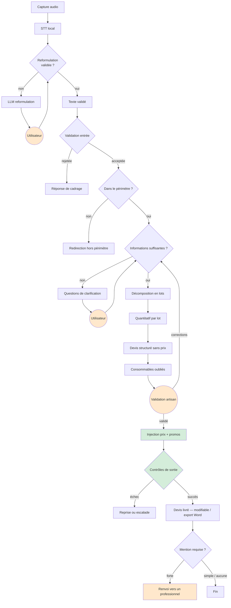
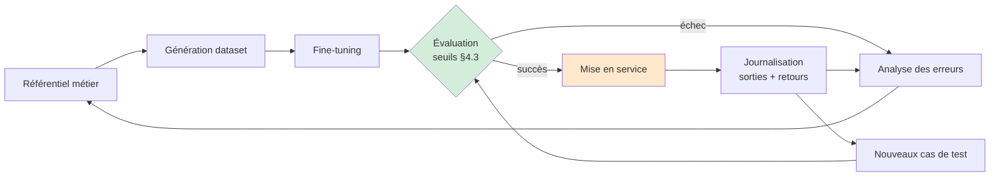

# Répercussion du pivot B2B vocal BTP dans la documentation — Plan d'implémentation

> **For agentic workers:** REQUIRED SUB-SKILL: Use superpowers:subagent-driven-development (recommended) or superpowers:executing-plans to implement this plan task-by-task. Steps use checkbox (`- [ ]`) syntax for tracking.

**Goal:** Répercuter le pivot validé dans `docs/superpowers/specs/2026-08-16-pivot-btp-vocal-design.md` (Application B2B vocale pour prestataires BTP) dans les quatre documents de conception qui décrivent encore l'ancien produit (Assistant Bricolage fine-tuné, client final, devis interactif à deux), puis dans Notion.

**Architecture:** Dépôt de documentation pure (`CLAUDE.md` : "aucun code, pas de build/lint/test"). Chaque tâche remplace intégralement le contenu d'un fichier Markdown existant par une version qui reflète le cadrage du pivot, en conservant tout ce que le spec dit inchangé (matériel/modèle, schéma JSON, garde-fous structurels, RNCP E5). Il n'y a pas de suite de tests : chaque tâche se termine par une étape de **vérification par lecture et `grep`** (absence de termes de l'ancien cadrage, présence des décisions actées, cohérence terminologique entre fichiers) qui joue le rôle du cycle de test du gabarit standard.

**Tech Stack:** Markdown, git. Aucun langage de programmation.

## Global Constraints

- Toute la documentation reste **en français** (`CLAUDE.md`).
- `docs/` fait autorité, `archive/` non — ne pas toucher `archive/`.
- Ne jamais inventer de commande de build/lint/test : les étapes de vérification de ce plan sont des lectures et des `grep`, pas des suites de tests.
- `docs/LIVRABLES.md` n'est pas le projet — ne pas dénaturer le cadrage du pivot pour cocher une case RNCP (rappel du document lui-même, à respecter dans sa réécriture).
- `docs/SOURCES_DONNEES.md` reste hors scope de ce plan : périmé en tant qu'architecture mais conservé tel quel pour sa structure de dump catalogue et sa contrainte légale — le spec du pivot ne le mentionne pas et la checklist « Reste à faire à la reprise » ne le cite pas.
- `CLAUDE.md` reste hors scope de ce plan : la checklist du spec approuvé (section « Reste à faire à la reprise ») ne le cite pas. **Point de vigilance signalé mais non traité ici** : `CLAUDE.md` contient encore la description de l'ancienne scène finale à deux (« La scène finale réunit le client et *son* artisan... à distance en simultané ») et le chantier pilote « peinture et sols uniquement », qui seront rendus obsolètes par la Tâche 1 de ce plan. À traiter dans un plan séparé si l'utilisateur le souhaite.
- La routine de veille élargie (STT, fiscalité, agents IA, fine-tuning) reste hors scope de ce plan : c'est une pratique récurrente à reprendre, pas une tâche avec un livrable testable — troisième item de la checklist du spec, laissé pour une reprise séparée.
- Chaque tâche de réécriture de fichier dépend des décisions actées dans `docs/superpowers/specs/2026-08-16-pivot-btp-vocal-design.md` (déjà validé par l'utilisateur) — ne pas rouvrir ces décisions, seulement les reporter fidèlement.

---

### Task 1 : Réécrire `docs/CADRAGE_MODELE.md`

**Files:**
- Modify (remplacement intégral) : `docs/CADRAGE_MODELE.md`

**Interfaces:**
- Consumes : les décisions actées du spec (`docs/superpowers/specs/2026-08-16-pivot-btp-vocal-design.md`, Sections 1-3, 5-6 et tableau final) — pipeline STT→reformulation→fine-tuné→code, 4 corps de métier, référentiel comblé par le LLM, facture/signature/relances hors produit.
- Produces : le document de référence du produit actuel, que consomment les Tâches 2 (`DISPOSITIF_AGENT.md` s'appuie sur lui, cf. son en-tête « S'appuie sur les décisions actées dans `CADRAGE_MODELE.md` »), 3 (`PLANNING.md` §Août renvoie à son §6) et 4 (`LIVRABLES.md` renvoie à son §6 pour la source du référentiel).

- [ ] **Step 1 : Remplacer intégralement `docs/CADRAGE_MODELE.md`**

Écrire exactement ce contenu (remplace tout le fichier existant) :

```markdown
# Cadrage du modèle — Application B2B vocale pour prestataires BTP

> Session de brainstorming du 28/07/2026 (pivot RenoAssistant → Assistant Bricolage)
> Pivot du 16/08/2026 (Assistant Bricolage → B2B BTP vocal) — voir
> `docs/superpowers/specs/2026-08-16-pivot-btp-vocal-design.md` pour le détail du raisonnement
> Objectif : cadrer le projet de soutenance

---

## 1. Le produit

**Deux pivots, en bref.** *RenoAssistant* (matching promos SMS, intégration Twilio + pgvector)
→ *Assistant Bricolage fine-tuné* (client final, devis interactif client + artisan, peinture et
sols uniquement) → **Application B2B vocale pour prestataires BTP** (cadrage actuel). Le premier
pivot est documenté dans `archive/renoassistant/`, le second dans
`docs/superpowers/specs/2026-08-16-pivot-btp-vocal-design.md`.

**Le produit actuel.** Une application web B2B pour prestataires de services (priorité BTP).
L'artisan décrit son chantier **à la voix** ; le pipeline produit un devis structuré, qu'il
valide et corrige seul ; le devis est ensuite modifiable dans l'interface et exportable en Word.
Le produit s'arrête là — facture, signature électronique et relances client sont **hors produit,
point final**, pas seulement hors périmètre des 4 mois.

Ce que le pivot vers le B2B vocal change par rapport à l'Assistant Bricolage :

| | Assistant Bricolage | B2B vocal BTP |
|---|---|---|
| Utilisateur principal | Client final | Artisan / prestataire |
| Entrée | Texte | Voix (STT local) |
| Chantier pilote | Peinture et sols uniquement | Peinture, sols, plomberie, électricité |
| Validation du devis | Client + artisan, à deux, en simultané | Artisan seul |
| Fin de parcours | Devis interactif arbitré à deux | Devis modifiable / export Word, côté artisan |
| Référentiel métier | Sourcé systématiquement (une valeur = une source) | Comblé par le LLM (décision assumée, cf. §6) |

**Principes conservés de l'ancien cadrage** (inchangés par ce pivot) :
- Le modèle ne calcule jamais les montants — code déterministe pour les prix et totaux
- Schéma de sortie unique par `intent`
- 100 % local pour le modèle fine-tuné (les données métier ne sortent jamais de la machine)
- Le professionnel fait autorité, ses corrections sont journalisées comme signal qualité

**Principe nouveau, introduit par ce pivot** : le signal qualité est capturé à **deux points** du
pipeline — correction de transcription (reformulation) et correction de devis (artisan) — pas un
seul comme dans l'ancien cadrage.

Ce pivot résout toujours le blocage légal identifié dans `docs/SOURCES_DONNEES.md` (même
dossier) : l'hébergement du modèle reste 100 % local.

---

## 2. Principe d'architecture

**Le modèle ne calcule jamais. Il décrit.**

```
Capture audio (plusieurs enregistrements — mesures, notes de chantier)
  ↓
STT local (type Whisper, tourne sur la DGX Spark — l'audio ne sort jamais de la machine)
  ↓
LLM — correction/reformulation (modèle prompté, pas fine-tuné — collabore avec
  l'utilisateur pour valider le texte)
  ↓ (texte validé par l'utilisateur)
LLM fine-tuné → JSON structuré (intention, lots, quantités, réfs)
  ↓
Code Python déterministe → requêtes référentiel/catalogue, calculs, devis final
  ↓
Artisan valide/corrige (voix ou texte) — chaque correction journalisée comme signal qualité
  ↓
Devis modifiable / export Word — le produit s'arrête ici (facture, signature,
  relances hors produit)
```

Corollaire, inchangé depuis l'ancien cadrage : le devis est généré **sans prix**. Le modèle
produit la structure et les quantités (stable, ne périme pas) ; le catalogue injecte les prix et
promos a posteriori (volatil). Résultat : zéro hallucination possible sur les prix.

### Ce que le fine-tuning achète réellement

| Fine-tuning | RAG / code |
|---|---|
| Format de sortie, fiabilité du JSON | Catalogue produits, prix, promos |
| Vocabulaire et ton métier | Calculs, totaux |
| Classification d'intention | Stock, disponibilité |
| Gestes techniques stables | Données temps réel |

Un modèle généraliste sort du JSON valide ~70 % du temps. Fine-tuné sur un schéma unique : ~98 %.
**C'est la métrique nº 1 du projet** — voir §7 pour ce que cette métrique démontre désormais.

### Orchestration

Un framework d'agents (**LangChain** ou équivalent) pilote l'enchaînement — capture, appel STT,
appel LLM de reformulation, appel LLM fine-tuné, appels d'outils vers le référentiel/catalogue.
C'est une architecture réelle, pas un simple sujet de veille : elle est cohérente avec le
`ModelFallbackMiddleware` déjà exploré dans `docs/NOTES.md` comme piste de robustesse face à
l'hébergement mono-machine.

### API Pappers

Auto-remplit les informations légales du prestataire à l'inscription (SIRET, forme juridique,
adresse) à partir de son numéro SIRET — alimente les mentions obligatoires du devis (§6). Service
externe intégré, documenté comme tel ; il **ne revendique pas de compétence IA** (C8 reste porté
par l'OCR, cf. `docs/LIVRABLES.md`).

### Point ouvert, non bloquant

Un seul modèle chargé qui fait les deux rôles (reformulation promptée + génération JSON
fine-tunée), ou deux modèles séparés — à trancher plus tard sur la base de mesures mémoire
réelles sur la DGX Spark (voir §8).

---

## 3. Choix du matériel et du modèle

### Contrainte machine — NVIDIA DGX Spark

- 128 Go de mémoire unifiée LPDDR5X
- **Bande passante : 273 Go/s** ← le vrai goulot d'étranglement

### Le constat décisif

La vitesse de génération ne dépend pas du nombre total de paramètres, mais des
**paramètres actifs** :

> decode ≈ bande passante / paramètres *actifs*

Benchmarks mesurés (decode = vitesse ressentie) :

| Modèle | Quantization | Decode tok/s |
|---|---|---|
| Llama 3.1 70B — **dense** | FP8 | **2,7** |
| Llama 3.1 8B — dense | FP8, batch 1 | 20,5 |
| gpt-oss-120b — **MoE** | MXFP4 | **52,9** |
| gpt-oss-20b — **MoE** | MXFP4 | **79,7** |

Un MoE de 120B va **20× plus vite** qu'un dense de 70B. D'où l'abandon de l'idée initiale d'un
modèle dense de 40B (~10-12 tok/s estimés).

**Règle retenue : MoE + quantization FP4.** La capacité mémoire héberge tous les experts, la
bande passante n'en paie qu'une fraction.

### Modèles retenus

| Modèle | Total / actifs | Licence | Decode | LoRA VRAM |
|---|---|---|---|---|
| **gpt-oss-20b** | 21B / ~3,6B | Apache 2.0 | 79,7 tok/s | 14 Go |
| **gpt-oss-120b** | 117B / ~5B | Apache 2.0 | 52,9 tok/s | 65 Go |

Alternatives écartées pour l'instant : Qwen3-30B-A3B (Apache 2.0, non mesuré sur Spark), Gemma 4
26B A4B (**licence à vérifier** — sources contradictoires, Apache 2.0 annoncé mais les Gemma sont
historiquement sous licence propre).

### Stratégie en deux temps

1. **gpt-oss-20b** — LoRA en 14 Go, itérations rapides. C'est là que se valide le dataset.
2. **gpt-oss-120b** — une fois le dataset stabilisé. Modèle de démo + slide de comparaison.

Point remarquable : le LoRA du 120B tient en 65 Go via Unsloth, sur une machine qui en a 128.
Entraînement, merge MXFP4 natif et service, tout sur le même bureau, sans cloud.

---

## 4. Périmètre fonctionnel

### Les trois fonctions

L'agent fait trois choses, dans l'ordre :

| | Fonction | Ce qu'elle fait | Qui intervient |
|---|---|---|---|
| 1 | **Interroger** | Capture le chantier à la voix, passe d'une intention floue à un projet cadré (surface, budget, existant, contraintes) | Artisan, sur chantier |
| 2 | **Calculer** | Traduit le projet en matériaux et quantités, y compris ce qu'on oublie toujours | Personne — le modèle travaille |
| 3 | **Arbitrer** | Chiffre, puis l'artisan valide et corrige seul jusqu'à l'accord | Artisan |

Le produit se résume en une phrase : **l'artisan pilote tout le parcours**, du chantier capté à
la voix jusqu'au devis exporté. Le client ne participe qu'en amont, pour ses coordonnées — il n'a
plus de rôle actif à démontrer.

La troisième fonction n'est pas un aboutissement passif. Le devis n'est pas un document livré
d'un bloc, c'est un objet que l'artisan corrige ligne à ligne et que l'agent tient à jour.

### Le point de validation — l'artisan seul

L'artisan ouvre le devis, discute avec l'agent (à la voix ou au clavier), et valide ligne à
ligne. Ses corrections sont des **corrections techniques**, appliquées sans discussion et
**journalisées comme signal qualité**.

**Règle retenue, inchangée : l'artisan fait autorité, toujours.** Chaque correction d'artisan est
une donnée d'expert, gratuite et qualifiée. Elle alimente directement la boucle qualité (voir
`docs/DISPOSITIF_AGENT.md` §5).

Ce point de validation n'est plus une scène à deux acteurs synchronisés : il n'y a qu'un
interlocuteur, l'artisan, ce qui simplifie l'interface à construire (voir `PLANNING.md` §Novembre)
sans rien retirer à la valeur du signal qualité capturé.

### Détail interne — 6 capacités

Les trois fonctions se décomposent en six capacités, qui sont le vrai découpage du dataset et de
l'évaluation. Elles n'ont pas à être présentées séparément : elles se déduisent. Ce découpage est
**inchangé par le pivot** (le spec du pivot ne touche pas au schéma JSON ni au dataset dans sa
forme).

| Fonction | Capacités |
|---|---|
| Interroger | Clarification, Décomposition en lots |
| Calculer | Quantitatif, Consommables oubliés |
| Arbitrer | Devis structuré sans prix, Injection prix + promos |

| # | Fonction | Justification |
|---|---|---|
| 1 | **Clarification** — poser les bonnes questions avant de répondre | Sépare le jouet du produit |
| 2 | **Décomposition en lots** — projet → gros œuvre, plomberie, finitions | 100 % dépendant du fine-tuning |
| 3 | **Quantitatif** — poser les calculs (m², rendements, chutes) | Cœur technique |
| 4 | **Devis structuré sans prix** — JSON : lots, lignes, quantités, réfs | Livrable central |
| 5 | **Consommables oubliés** — colle, joints, vis, EPI | Fonction « wow », expertise métier pure |
| 6 | **Injection prix + promos** sur le devis | Payoff business (côté code) |

Parcours de démo : un chantier continu multi-corps de métier — l'artisan décrit à la voix
peinture, sols, plomberie et électricité en une captation suivie → le pipeline interroge →
décompose → quantifie → produit le devis → rattrape les oublis → chiffre au prix promo →
**l'artisan valide et corrige volontairement une erreur provoquée**, démontrant le signal qualité
en direct (détail du parcours : `docs/superpowers/specs/2026-08-16-pivot-btp-vocal-design.md`
Section 4).

### Chantiers pilotes — quatre corps de métier

**Décision (pivot, Section 3 du spec) : le référentiel et la démo couvrent quatre corps de
métier, à profondeur uniforme.**

| Corps de métier | Rôle | Profondeur |
|---|---|---|
| Peinture | Cœur historique | Large, comblée par le LLM (pas de sourcing systématique) |
| Sols | Cœur historique | Large, comblée par le LLM |
| Plomberie | Démontre `mention forte` | Large aussi |
| Électricité | Démontre `mention forte` | Large aussi |

**Décision assumée et sa conséquence, nommée explicitement.** Le référentiel n'est plus sourcé
systématiquement (une ligne = une valeur = une source, comme dans l'ancien cadrage) — le LLM
comble les valeurs métier pour les quatre corps de métier, y compris peinture et sols qui
portaient auparavant l'argument central du pivot précédent (« le modèle généraliste produit du
plausible, pas du juste »). Détail de la production des données : §6.

**Conséquence pour la soutenance :** l'argument de différenciation du fine-tuning se déplace de
*« exactitude des valeurs métier »* vers *« fiabilité du format JSON »* et *« qualité de
structuration vocal → devis »*. Argument toujours défendable, mais différent — à énoncer comme
tel (voir §7).

Ce que ce choix achète : de la profondeur et du réalisme sur quatre corps de métier au lieu d'un
seul, et des cas `mention forte` réels (plomberie, électricité) plutôt qu'hypothétiques —
important pour §5.

### Canal de démo — web uniquement

**Décision, inchangée : une seule interface, web.** Le point de validation à un seul acteur (§4)
y est naturel. Le SMS reste une *capacité du modèle* — les exemples courts restent au dataset —
mais n'est pas démontré : la plomberie Twilio ne prouve rien sur le fine-tuning.

### Second cercle (si le temps le permet)

- Question technique de mise en œuvre
- Ajustement à un budget contraint (arbitrages de gamme)
- Recommandation produit simple
- Adaptation du format au canal (SMS vs web)
- Scraping ou MCP pour la recherche produit / liste de matériaux — piste notée par le pivot pour
  retrouver un sourcing plus rigoureux du référentiel sans repasser par la collecte manuelle
  (spec, Section 3)

### Écarté

**Hors produit, point final (pas seulement hors périmètre 4 mois) :** facture, signature
électronique, relances client. Le produit s'arrête au devis structuré, modifiable et exportable ;
au-delà, le client se débrouille. Décision assumée : ça simplifie l'architecture (§2) et recentre
l'argument de différenciation sur le devis par la voix.

**Hors périmètre, reconduit de l'ancien cadrage, sans lien avec le pivot :** diagnostic de
pathologie du bâtiment, comparaison multi-critères, substitutions, estimation de main d'œuvre,
alertes promo proactives, export liste de courses.

---

## 5. Posture sur le conseil réglementé

**Décision, inchangée : modèle le moins restrictif possible. Mention, jamais refus.**

Ligne directrice : le modèle **informe toujours**, mais ne **certifie jamais**. Il explique
comment ça marche, il ne valide pas l'installation. C'est la posture d'un professionnel qui
conseille sans engager sa responsabilité à la place de l'artisan — argumentable devant un jury,
contrairement à un refus sec.

| Niveau | Domaines | Comportement |
|---|---|---|
| Rien | Peinture, carrelage, pose de meuble | Réponse seule |
| Mention simple | Perçage porteur, étanchéité, découpe | Réponse + point de vigilance |
| Mention forte | Gaz, tableau électrique, structure | Réponse + « faire valider par un pro » |

Avec les corps de métier plomberie et électricité désormais dans le périmètre pilote (§4), les
cas de `mention forte` cessent d'être des cas rares : ils sont réels et fréquents dans le
parcours de démo. C'est une raison de plus pour ne rien laisser au hasard sur le point suivant.

**Risque technique à anticiper :** gpt-oss embarque des refus de sécurité entraînés en amont. Si
le dataset ne traite pas explicitement les cas sensibles, le modèle refusera de façon
imprévisible — typiquement pendant la démo. Ces cas doivent figurer au dataset avec le
comportement voulu.

---

## 6. Structure du dataset

### Schéma de sortie unique

Décision structurante, inchangée : les 6 fonctions partagent une seule enveloppe. Le modèle
signale lui-même sa tâche via `intent`, le code route derrière.

```json
{
  "intent": "clarification | lots | quantitatif | devis | consommables | reponse",
  "payload": { },
  "mention": null | "simple" | "forte"
}
```

Un format à apprendre, un parseur à écrire, une métrique à mesurer.

`reponse` couvre les réponses directes hors devis (question technique, conseil court). Sans lui,
les 350 exemples courts du dataset n'auraient pas d'intention.

### Format d'un exemple

gpt-oss étant un modèle de raisonnement, chaque exemple a trois parties :

```
user      : "Je refais le salon, 22 m² au sol, murs à repeindre, budget 1500 €"

reasoning : Sol 22 m² → stratifié, chutes +8 % (pose droite) → 23,8 m².
            Murs : périmètre ~19 m × 2,50 m = 47,5 m², moins ouvertures
            ≈ 42 m². Peinture 10 m²/L par couche, 2 couches → 8,4 L, plus
            sous-couche 1 couche → 4,2 L. Lots : préparation des supports,
            peinture, sol. Consommables : bandes, enduit de rebouchage,
            sous-couche, barres de seuil, cale de dilatation.

final     : { "intent": "devis", "payload": {...}, "mention": null }
```

Le bloc `reasoning` est le cœur du travail : il porte l'expertise métier (rendements, taux de
chute, ordre des lots). Sans lui, on n'entraîne qu'un formateur de JSON.

**Précision liée au pivot :** le champ `user` de chaque exemple simule un texte **déjà validé**
par l'utilisateur via l'étape de reformulation (§2) — pas un texte vocal brut. Le dataset n'a donc
pas à simuler de bruit de transcription ; le LLM de reformulation nettoie avant que le modèle
fine-tuné ne reçoive le texte.

### Répartition cible (~2000 exemples)

**Structure inchangée par le pivot** — répartition par capacité, indépendante du corps de métier :

| Fonction | Volume | Raisonné |
|---|---|---|
| Devis complet | 500 | oui |
| Quantitatif | 400 | oui |
| Décomposition en lots | 300 | oui |
| Consommables oubliés | 250 | oui |
| Clarification | 200 | non (court) |
| Réponses directes / SMS | 350 | non (court) |

≈ 72 % de raisonné — proche de la recommandation Unsloth (75 % minimum pour préserver la capacité
de raisonnement de gpt-oss).

Les **mentions ne sont pas une catégorie** : elles se répartissent à travers toutes les autres
(~15 % simple, ~5 % forte). La présence de plomberie et d'électricité (§4) rend les exemples
`mention forte` réels à générer, pas hypothétiques.

### Production des données et référentiel métier — décision assumée du pivot

**Ancien principe (Assistant Bricolage), abandonné pour le référentiel d'entraînement :** une
chaîne « documentation fabricants → référentiel de faits validé → génération des exemples », où
chaque valeur portait sa source.

**Nouveau principe (pivot, décision assumée) : le LLM comble les valeurs métier du référentiel**
pour les quatre corps de métier, y compris peinture et sols. Pas de sourcing systématique
ligne à ligne. Ce choix élargit la profondeur du référentiel à quatre corps de métier sans faire
exploser le temps de collecte manuelle (voir `PLANNING.md` §Août).

**Ce que ce choix ne supprime pas : le scraping des fiches techniques fabricants continue**, mais
change de rôle. Il ne nourrit plus directement le référentiel d'entraînement ; il devient un
exercice de collecte de données à part entière, qui sert le livrable E1 (`docs/LIVRABLES.md`,
compétence C1 — collecte multi-sources). Deux usages distincts du scraping, assumés comme tels :
collecte structurée pour C1 d'un côté, référentiel d'entraînement comblé par le LLM de l'autre.

**Garde-fou conservé, non négociable : le jeu de test (150-200 exemples) reste écrit et corrigé à
la main, jamais généré.** Il porte plus de poids que dans l'ancien cadrage puisque le référentiel
d'entraînement n'est plus sourcé — c'est la seule mesure qui reste honnête devant le jury.

#### Contenu réglementaire du référentiel

Le référentiel ne porte pas que des rendements. Il porte aussi les règles qui rendent un devis
crédible — reprises d'une session de recherche antérieure (ex-`HANDOFF.md`). Ce contenu est
**inchangé par le pivot**.

**TVA à trois taux** — le point technique central du secteur :

| Taux | Cas |
|---|---|
| 20 % | Neuf, logement < 2 ans, agrandissement, gros équipements |
| 10 % | Amélioration, entretien, aménagement — logement achevé > 2 ans |
| 5,5 % | Rénovation énergétique et travaux induits — logement > 2 ans |

Pièges à encoder volontairement : les fournitures **posées par l'entreprise** suivent le taux
réduit, celles achetées séparément par le client sont à 20 % ; certains gros équipements restent
à 20 % même posés. Un devis réel mélange plusieurs taux → **la ventilation TVA par taux est un
champ à part entière**. *(Détail réglementaire à revérifier avant de figer le référentiel.)*

**Mentions obligatoires d'un devis BTP** : n° de devis, dates d'émission et de validité,
coordonnées émetteur (SIRET, RCS, APE/NAF, TVA intracom. — auto-remplies via l'API Pappers, §2),
**assurance décennale** (assureur, n° de contrat, couverture géographique), client, adresse de
chantier (parfois ≠ adresse client), détail par poste, ventilation TVA, acompte (souvent 30 %),
délai d'exécution, mention « Bon pour accord ».

**Cas limite à ne pas oublier** : auto-entrepreneur → mention « TVA non applicable, art. 293 B du
CGI », et aucune ligne de TVA.

**Unités du secteur** : m², ml, m³, u, h, j, forfait, ens., kg.

**Frontière maintenue.** Le modèle *qualifie* le taux de TVA applicable et *restitue* la
structure du devis commercial. Il ne calcule aucun montant : la ventilation, les totaux et
l'acompte sont du code. Le SIRET et la décennale appartiennent à l'artisan (auto-remplis via
l'API Pappers), ils ne sont jamais produits par le modèle.

**Reprise du devis de l'artisan.** À l'inscription, l'artisan dépose un devis existant pour que
l'agent reprenne sa mise en page. La conversion image/PDF → Markdown passe par une **API OCR
externe**, jamais par le modèle — gpt-oss est purement textuel et un VLM serait un second projet.
Le gabarit obtenu est stocké en mémoire utilisateur (voir `docs/DISPOSITIF_AGENT.md` §2).

**Jeu de test : 150-200 exemples écrits ou corrigés à la main.** Jamais vus à l'entraînement,
jamais générés. Seule mesure honnête — et plus centrale qu'avant (voir plus haut).

---

## 7. Métriques

### Ce que la métrique nº 1 démontre désormais

Le pivot déplace ce que le taux de JSON valide est censé prouver. Dans l'ancien cadrage, le
référentiel sourcé permettait d'argumenter aussi sur l'exactitude des valeurs métier. Le
référentiel étant désormais comblé par le LLM (§4, §6), cet argument n'est plus disponible tel
quel : la métrique nº 1 porte maintenant l'intégralité de l'argument de différenciation du
fine-tuning, recentré sur **la fiabilité du format** et **la qualité de structuration
vocal → devis**. Argument toujours défendable, mais à énoncer comme tel devant le jury — pas à
laisser dériver silencieusement vers l'ancien argument.

### Protocole de preuve — décidé, inchangé dans sa forme

**gpt-oss-20b brut contre gpt-oss-20b fine-tuné.** Même modèle de base, même jeu de test gelé,
même prompt système. La seule variable est le fine-tuning — donc tout écart mesuré lui est
imputable. C'est la seule comparaison défendable devant un jury.

Deux garde-fous :

- Le modèle brut reçoit un **prompt sérieux** (schéma décrit, exemple few-shot). Comparer à une
  baseline mal promptée gonfle artificiellement le résultat et se détecte en cinq minutes de
  questions.
- Le jeu de test est **gelé avant l'entraînement** et jamais élargi en cours de route.

Le **gpt-oss-120b fine-tuné** reste au programme, mais comme **modèle de démo**, pas comme
preuve. Il répond à « est-ce que ça passe à l'échelle », pas à « est-ce que le fine-tuning sert ».
S'il manque du temps, il saute sans compromettre la démonstration.

| Métrique | Pourquoi |
|---|---|
| **Taux de JSON valide** | Métrique nº 1 — porte maintenant l'intégralité de l'argument de différenciation (voir plus haut) |
| Exactitude des quantités vs. golden set | Cœur technique |
| Exhaustivité des consommables | Fonction différenciante |
| Justesse du niveau de mention | Sécurité — d'autant plus mesurable que plomberie/électricité rendent les cas `mention forte` réels (§5) |
| Decode tok/s | Contrainte machine |
| Comparatif 20b vs 120b | Slide de soutenance |

---

## 8. Points ouverts

- [x] ~~Protocole de preuve~~ — 20b brut vs 20b fine-tuné (§7)
- [x] ~~Chantiers pilotes~~ — peinture, sols, plomberie, électricité, comblés par le LLM (§4, §6)
- [x] ~~Canal de démo~~ — web uniquement, interface unique artisan (§4)
- [x] ~~Planning des 4 mois~~ — voir `PLANNING.md`
- [ ] Un seul modèle chargé pour reformulation + génération JSON, ou deux modèles séparés — à
      trancher sur mesures mémoire réelles sur la DGX Spark (§2)
- [ ] Modèle de reformulation : quel modèle prompté pour l'étape STT → texte validé — non tranché,
      non bloquant (§2)
- [ ] Stack technique de la couche application (GCP, PostHog vs Piano Analytics, Supabase, Gladia
      vs Whisper local pour le STT) — catalogué dans `docs/NOTES.md`, en attente d'une séance de
      grill-me dédiée
- [ ] Valider les seuils d'acceptation de `docs/DISPOSITIF_AGENT.md` §4
- [ ] Trancher les quatre points de `docs/LIVRABLES.md` avec l'encadrant — dont le « système big
      data » et le standard d'accessibilité
- [ ] Liste des fabricants et des fiches techniques à extraire pour les quatre corps de métier
      (peinture, sols, plomberie, électricité) — collecte qui sert désormais C1, indépendamment
      du référentiel d'entraînement (§6)
- [ ] Revérifier les règles de TVA avant de figer le référentiel
- [ ] Format du référentiel métier
- [ ] Schéma JSON détaillé de chaque `payload` (au moment d'écrire le code)
- [ ] Pipeline de génération synthétique
- [ ] Vérifier la licence réelle de Gemma 4 26B A4B
- [ ] Structure du dump catalogue LM (réutiliser celle de `docs/SOURCES_DONNEES.md`)
- [ ] Décider si le second cercle entre dans le périmètre

---

## Sources

- [LMSYS — DGX Spark In-Depth Review](https://www.lmsys.org/blog/2025-10-13-nvidia-dgx-spark/)
- [JetsonHacks — llama.cpp on DGX Spark Benchmarks](https://jetsonhacks.com/wp-content/uploads/2025/10/spark-llamacpp-bench.html)
- [llama.cpp Discussion #16578 — Performance on DGX Spark](https://github.com/ggml-org/llama.cpp/discussions/16578)
- [Unsloth — Tutorial: How to Fine-tune gpt-oss](https://unsloth.ai/docs/models/gpt-oss-how-to-run-and-fine-tune/tutorial-how-to-fine-tune-gpt-oss)
- [Which Open-Source Model Should You Fine-Tune in 2026](https://www.ertas.ai/blog/best-open-source-model-fine-tune-2026)
```

- [ ] **Step 2 : Vérifier l'absence de traces de l'ancien cadrage**

Run:
```bash
grep -n "scène finale à deux\|deux fenêtres\|deux sessions\|présence, conflits\|20-30 matériaux qui couvrent le parcours peinture et sols\|Documentation fabricants  →  référentiel de faits validé" docs/CADRAGE_MODELE.md
```
Expected: aucune sortie (aucun de ces fragments de l'ancien produit ne doit subsister).

- [ ] **Step 3 : Vérifier la présence des décisions actées**

Run:
```bash
grep -n "quatre corps de métier\|comblé par le LLM\|hors produit, point final\|fiabilité du format" docs/CADRAGE_MODELE.md
```
Expected: au moins une occurrence de chacun des quatre fragments.

- [ ] **Step 4 : Commit**

```bash
git add docs/CADRAGE_MODELE.md
git commit -m "docs: réécrit CADRAGE_MODELE.md pour le pivot B2B vocal BTP"
```

---

### Task 2 : Réécrire `docs/DISPOSITIF_AGENT.md`

**Files:**
- Modify (remplacement intégral) : `docs/DISPOSITIF_AGENT.md`

**Interfaces:**
- Consumes : `docs/CADRAGE_MODELE.md` réécrit à la Tâche 1 (le fichier s'appuie explicitement sur lui en en-tête) ; spec Sections 1-2 (pipeline en deux points de signal qualité) et Section 4 (un seul point de validation, artisan seul).
- Produces : le document de référence du workflow/mémoire/garde-fous, consommé par `PLANNING.md` (§Octobre renvoie à ses seuils §4.3) et `docs/LIVRABLES.md` (E4 s'appuie sur son §1-§2 pour C14/C15).

- [ ] **Step 1 : Remplacer intégralement `docs/DISPOSITIF_AGENT.md`**

Écrire exactement ce contenu (remplace tout le fichier existant) :

```markdown
# Dispositif de l'agent — workflow, mémoire, garde-fous, évaluation

> Livrable de conception. Aucun code — modélisation uniquement.
> S'appuie sur les décisions actées dans `CADRAGE_MODELE.md`.

---

## 0. Rôle de l'agent

**Ce qu'il est.** Un assistant de préparation de chantier pour prestataires BTP. Il aide un
artisan à passer d'un chantier décrit **à la voix** à un devis matériaux structuré et chiffré,
qu'il valide et corrige seul.

**Ce qu'il n'est pas.** Ni un bureau d'études, ni un diagnostiqueur, ni un professionnel
certifié à la place de l'artisan. Il **informe toujours, ne certifie jamais**.

Cette frontière n'est pas une précaution rédactionnelle : elle est encodée dans le périmètre de
rôle (§3.3) et vérifiée par l'évaluation (§4).

---

## 1. Flux de travail

### 1.1 Vue d'ensemble



En vert : les étapes exécutées par du **code déterministe**, jamais par le modèle. En orange :
les **points d'intervention humaine** — désormais deux nouveaux venus en amont (capture audio,
reformulation) en plus des points déjà connus.

### 1.2 Étapes détaillées

| # | Étape | Acteur | Entrée | Sortie |
|---|---|---|---|---|
| 0a | Capture audio | Utilisateur | Voix | Enregistrement(s) |
| 0b | STT | Code (modèle local type Whisper) | Audio | Texte brut transcrit |
| 0c | Reformulation | **Modèle prompté** | Texte brut | Texte reformulé, à valider |
| 1 | Validation de l'entrée | Code | Texte validé | Texte assaini ou rejet |
| 2 | Classification d'intention | **Modèle fine-tuné** | Texte + état projet | `intent` |
| 3 | Clarification | **Modèle fine-tuné** | État partiel | Questions ciblées |
| 4 | Décomposition en lots | **Modèle fine-tuné** | Projet complété | Lots ordonnés + prérequis |
| 5 | Quantitatif | **Modèle fine-tuné** | Lots + dimensions | Formules + opérandes |
| 6 | Évaluation des formules | Code | Formules | Quantités numériques |
| 7 | Devis sans prix | **Modèle fine-tuné** | Lots + quantités | Lignes + catégories catalogue |
| 8 | Consommables | **Modèle fine-tuné** | Devis | Lignes complémentaires |
| 9 | Résolution catalogue | Code | Catégories + critères | Références produits réelles |
| 10 | Injection prix + promos | Code | Références | Devis chiffré |
| 11 | Contrôles de sortie | Code | Devis complet | Validé ou rejeté |

**Les étapes 0b, 6, 9, 10 et 11 ne passent jamais par un modèle génératif** (0b utilise un modèle
de transcription, pas un LLM). C'est la frontière structurante du projet : le modèle décrit, le
code calcule et vérifie.

### 1.3 Points de décision

| Décision | Porté par | Critère | Sinon |
|---|---|---|---|
| Transcription fidèle ? | Utilisateur, via reformulation | Relecture du texte reformulé | Nouvel enregistrement ou correction manuelle |
| Entrée recevable ? | Code | Longueur, langue, injection | Réponse de cadrage |
| Dans le périmètre ? | Modèle + code | Sujet BTP / aménagement | Redirection explicite |
| Infos suffisantes ? | Modèle | Champs obligatoires du projet | Boucle de clarification |
| Domaine réglementé ? | Modèle | Gaz, électricité, structure | Mention forte |
| Sortie conforme ? | Code | Schéma + bornes + catalogue | Reprise (1 fois) puis escalade |
| Confiance suffisante ? | Code | Nb de reprises, champs nuls | Escalade humaine |

### 1.4 Points d'intervention humaine

Cinq, de nature différente — un nouveau venu par rapport à l'ancien cadrage (HITL-0, lié à la
voix) :

**HITL-0 — Validation de la transcription (systématique, nouveau).** L'utilisateur relit et
corrige le texte reformulé par le LLM de reformulation avant qu'il n'entre dans le pipeline
fine-tuné. C'est le **premier des deux points de capture du signal qualité** introduits par ce
pivot (le second est HITL-2). Une correction de transcription est journalisée au même titre
qu'une correction de devis (§4.2).

**HITL-1 — Clarification (systématique).** L'utilisateur répond aux questions manquantes. C'est
la boucle normale, pas une exception. Plafonnée à **3 tours** : au-delà, l'agent propose des
hypothèses par défaut explicites plutôt que d'interroger indéfiniment.

**HITL-2 — Validation du devis avant chiffrage (systématique, un seul intervenant).** La
structure et les quantités sont confirmées avant que les prix soient injectés. Position
délibérée : on fait valider ce qui est stable, avant d'y accrocher ce qui est volatil.

Contrairement à l'ancien cadrage, ce point ne réunit plus deux humains : **l'artisan valide
seul.** Le client n'a plus de rôle actif à cette étape — sa participation s'arrête à ses
coordonnées, saisies en amont.

**Règle : l'artisan fait autorité, toujours.** Sa correction est appliquée sans discussion et
**journalisée comme signal qualité** — le **second des deux points de capture** introduits par ce
pivot. Elle alimente directement la boucle qualité (§5.2). Un professionnel qui corrige le modèle
en production est une source de données d'expert, gratuite et qualifiée.

**HITL-3 — Renvoi vers un professionnel (conditionnel).** Déclenché par une mention forte.
L'agent ne bloque pas et ne tronque pas sa réponse : il répond complètement puis signale.
Cohérent avec la posture actée au cadrage — d'autant plus fréquent que plomberie et électricité
sont désormais dans le périmètre pilote (`CADRAGE_MODELE.md` §5).

**HITL-4 — Escalade vers un conseiller (exception).** Déclenchée par échec répété des contrôles
de sortie, périmètre ambigu, ou demande explicite. C'est la soupape : un agent qui n'a pas de
sortie de secours produit des réponses dégradées plutôt que d'admettre sa limite.

---

## 2. Mémoire

### 2.1 Principe

La conversation est **transitoire**, l'état du projet est **structuré et persistant**. On ne
rejoue pas l'historique pour reconstituer l'état : on tient une fiche projet que chaque tour met
à jour.

Conséquence : le contexte envoyé au modèle reste court et stable, quelle que soit la longueur de
la conversation. C'est aussi ce qui rend le comportement reproductible — donc évaluable.

### 2.2 Les quatre mémoires

| Mémoire | Contenu | Forme | Durée | Portée |
|---|---|---|---|---|
| **Tour** | Derniers échanges bruts (transcriptions + texte) | Texte | 3-5 tours glissants | Session |
| **Projet** | Chantier, corps de métier, budget, lots validés, devis en cours | Structuré (fiche) | Jusqu'à complétion + 30 j | Utilisateur |
| **Utilisateur** | Profil artisan (SIRET, gabarit de devis), préférences, chantiers passés | Structuré | Consentement explicite, révocable | Utilisateur |
| **Métier** | Rendements, taux de chute, ordre des lots | Référentiel versionné | Permanente | Globale |

### 2.3 La fiche projet

C'est l'objet central. Elle porte, pour chaque champ, **sa valeur, son origine et sa
confiance** :

- valeur fournie par l'artisan (à la voix ou au clavier) → certaine
- valeur déduite par le modèle → à confirmer
- valeur par défaut appliquée → signalée dans le devis

Cette distinction permet à l'agent de savoir quoi redemander, et à l'artisan de voir sur quoi
repose son chiffrage. Un devis fondé sur trois hypothèses par défaut n'a pas le même statut qu'un
devis entièrement renseigné.

**Un seul utilisateur de statut fort, le client réduit aux coordonnées.** Contrairement à
l'ancien cadrage, la fiche ne porte plus deux intervenants de statuts différents à HITL-2 : c'est
l'artisan qui valide, seul.

| Origine | Statut | Peut être écrasée par |
|---|---|---|
| Artisan | Fait technique | Rien (sauf l'artisan lui-même) |
| Modèle | À confirmer | L'artisan |
| Défaut | Signalée dans le devis | L'artisan |

Chaque modification est **horodatée et attribuée**. Ce n'est pas de la traçabilité décorative :
sans l'auteur, une correction d'artisan est indiscernable d'une valeur par défaut acceptée sans
relecture, et le signal qualité de §5.2 devient inexploitable.

**Gabarit de devis de l'artisan.** Stocké en mémoire utilisateur : mise en page reprise de son
devis existant (converti par une API OCR externe), SIRET, RCS, APE/NAF, TVA intracom. (auto-
remplis via l'API Pappers), assurance décennale, conditions habituelles. Renseigné une fois à
l'inscription, jamais produit par le modèle.

### 2.4 Ce qu'on ne retient pas — délibérément

**Les prix.** Volatils par conception. Ils ne sont jamais mémorisés ni dans le modèle ni dans la
fiche projet : ils sont réinjectés à chaque affichage depuis le catalogue. Un devis rouvert trois
semaines plus tard se rechiffre automatiquement.

**Les données personnelles au-delà du nécessaire.** Le client n'apparaît en mémoire agent que par
ses coordonnées, saisies pour le devis — pas de profil, pas d'historique client. La surface d'un
chantier suffit à quantifier ; savoir à qui il appartient au-delà des coordonnées n'apporte rien
au raisonnement.

**Les sorties du modèle non validées.** Ce qui échoue aux contrôles n'entre pas dans la fiche
projet — mais est journalisé pour la boucle qualité (§5).

**L'audio brut, au-delà de la session.** L'enregistrement sert à la transcription (HITL-0) puis
n'est pas conservé au-delà de la session — seul le texte validé entre en mémoire projet, cohérent
avec le principe 100 % local (`CADRAGE_MODELE.md` §1).

### 2.5 Cycle de vie

| Événement | Effet |
|---|---|
| Fin de session | Mémoire de tour purgée (y compris l'audio brut) |
| Devis validé | Fiche projet figée, versionnée |
| 30 j sans activité | Fiche projet archivée puis supprimée |
| Retrait du consentement | Mémoire utilisateur supprimée, fiches anonymisées |
| Nouvelle version du référentiel | Fiches non figées recalculées |

---

## 3. Garde-fous

Quatre couches, de la plus faible à la plus forte :

```
prompt système  <  fine-tuning  <  validation par le code  <  intervention humaine
     (oriente)      (fiabilise)      (seule garantie dure)      (dernier recours)
```

Le fine-tuning **réduit** la fréquence des sorties non conformes ; il ne la ramène jamais à zéro.
Seule la validation par le code constitue une garantie. Tout garde-fou critique doit donc exister
côté code, jamais uniquement dans le prompt.

### 3.1 Validation des entrées

| Contrôle | Rejet ou traitement |
|---|---|
| Qualité de transcription insuffisante | Renvoi vers HITL-0 (nouvel enregistrement ou correction manuelle) |
| Longueur, encodage, langue | Rejet avec message de cadrage |
| Tentative d'injection de prompt | Neutralisation, journalisation |
| Sujet hors BTP / aménagement | Redirection explicite |
| Données personnelles non sollicitées | Non stockées, non répétées en sortie |
| Valeurs physiquement improbables | Demande de confirmation |

Sur l'avant-dernier point : un chantier de 400 m² n'est pas impossible, il est improbable.
L'agent ne rejette pas, il demande confirmation — la différence entre un garde-fou et une
entrave.

### 3.2 Contraintes de sortie

| Contrôle | Seuil | Action si échec |
|---|---|---|
| Conformité au schéma JSON | strict | Reprise, puis escalade |
| Quantités dans des bornes plausibles | par matériau | Reprise |
| Catégorie catalogue existante | strict | Reprise |
| Référence produit inventée | **interdit** | Rejet — impossible par conception |
| Prix produit par le modèle | **interdit** | Rejet — impossible par conception |
| Mention présente quand requise | strict | Ajout forcé par le code |
| Cohérence des lots (ordre, prérequis) | pas de cycle | Reprise |

Les deux interdits absolus sont garantis **structurellement**, pas par vigilance : le schéma de
sortie ne comporte aucun champ prix ni aucun champ référence. Le modèle ne peut pas halluciner ce
qu'il n'a pas la possibilité d'exprimer.

### 3.3 Périmètre de rôle

**L'agent traite :** décomposition de projet, quantitatif matériaux (peinture, sols, plomberie,
électricité), devis structuré, consommables et outillage, conseil de mise en œuvre, orientation
catalogue.

**L'agent ne traite pas :** diagnostic de pathologie du bâti, estimation de main d'œuvre,
dimensionnement structurel, conseil médical, juridique ou financier, validation de conformité
réglementaire, facture, signature électronique, relances client (hors produit, cf.
`CADRAGE_MODELE.md` §4).

**Comportement sur les sujets réglementés** (gaz, tableau électrique, structure porteuse) :

| Niveau | Domaines | Comportement |
|---|---|---|
| Aucun | Peinture, carrelage, pose de meuble | Réponse seule |
| Simple | Perçage porteur, étanchéité, découpe | Réponse + point de vigilance |
| Forte | Gaz, tableau électrique, structure | Réponse + renvoi vers un professionnel |

L'agent **répond toujours**. Il ne tronque pas, ne refuse pas, ne moralise pas. Il ajoute une
mention. C'est une posture assumée et défendable — contrairement à un refus, elle est
argumentable devant un jury.

**Risque technique associé.** Le modèle de base embarque des refus de sécurité pré-entraînés.
Sans exemples explicites de ce comportement dans le dataset, il refusera de façon imprévisible —
typiquement pendant la démonstration. Les cas sensibles doivent donc figurer au dataset avec le
comportement voulu.

---

## 4. Plan d'évaluation

### 4.1 Principe

**Le protocole est arrêté avant le premier entraînement.** Décidé après coup, il ne prouve rien :
on choisit toujours, inconsciemment, les métriques que l'on passe.

Le jeu de test est **écrit à la main, gelé, et jamais utilisé à l'entraînement**. C'est la seule
mesure honnête — plus encore depuis que le référentiel d'entraînement est comblé par le LLM
(`CADRAGE_MODELE.md` §6).

### 4.2 Jeu de test

**150 à 200 cas**, rédigés ou corrigés manuellement, avec réponse attendue.

| Famille | Part | Ce qu'elle vérifie |
|---|---|---|
| Nominal | 40 % | Le parcours normal, toutes fonctions |
| Incomplet | 20 % | Déclenchement de la clarification |
| Limite | 15 % | Valeurs extrêmes, chantiers atypiques |
| Réglementé | 15 % | Niveau de mention correct — plomberie/électricité y contribuent réellement |
| Hors périmètre | 10 % | Détection et redirection |

Le jeu de test **ne rétrécit jamais**. Chaque défaut constaté en production y entre comme cas de
non-régression (§5).

### 4.3 Métriques et seuils

| # | Métrique | Mesure | Seuil | Baseline attendue |
|---|---|---|---|---|
| 1 | **Taux de JSON valide** | Conformité au schéma | **≥ 98 %** | ~70 % |
| 2 | Exactitude des quantités | Écart ≤ 5 % vs. attendu | ≥ 90 % | — |
| 3 | Complétude des lots | Lots présents et ordonnés | ≥ 85 % | — |
| 4 | Rappel des consommables | Consommables attendus retrouvés | ≥ 80 % | — |
| 5 | **Justesse de la mention** | Niveau correct | **≥ 95 %** | — |
| 6 | Détection hors périmètre | Redirection correcte | ≥ 95 % | — |
| 7 | Prix ou référence inventés | Occurrences | **0** | 0 (structurel) |
| 8 | Latence d'un devis | p95 | < 30 s | — |

La **métrique nº 1 est la mesure directe de l'apport du fine-tuning** ; le pivot ne change pas le
tableau, mais change ce qu'elle démontre — voir `CADRAGE_MODELE.md` §7 pour l'argumentaire à tenir
en soutenance.

Les métriques 5 et 7 relèvent de la sécurité : leurs seuils ne sont pas négociables à la baisse.

### 4.4 Protocole de comparaison

Trois configurations, **même jeu de test, mêmes conditions** :

| Configuration | Rôle | Statut |
|---|---|---|
| gpt-oss-20b brut + prompt élaboré | Baseline honnête | **La preuve** |
| gpt-oss-20b fine-tuné | Mesure de l'apport du fine-tuning | **La preuve** |
| gpt-oss-120b fine-tuné | Mesure de l'apport de la taille | Démo, optionnel |

**Décision : la preuve repose sur le seul couple 20b brut / 20b fine-tuné.** Même modèle de base,
même jeu de test, même prompt système — la seule variable est le fine-tuning, donc tout écart lui
est imputable.

Le 120b répond à une autre question (« est-ce que ça passe à l'échelle ») et sert de modèle de
démonstration. S'il manque du temps, il saute sans affaiblir la démonstration.

Comparer le modèle fine-tuné à un modèle brut *mal promptté* serait une victoire truquée. La
baseline doit être le meilleur résultat atteignable sans fine-tuning.

### 4.5 Modes d'évaluation

| Mode | Portée | Coût |
|---|---|---|
| Automatique | Métriques 1, 6, 7, 8 — vérifiables par le code | Nul, à chaque run |
| LLM-juge | Métriques 3, 4 — jugement sur barème | Faible, à chaque run |
| Revue humaine | Échantillon de 30 cas, dont tous les réglementés | Élevé, à chaque version |

Le LLM-juge est calibré sur un sous-ensemble noté à la main : sans cette calibration, on mesure
l'accord avec un juge dont on ignore la fiabilité.

---

## 5. Boucle qualité

### 5.1 Le cycle



### 5.2 Ce qui alimente la boucle

| Source | Signal | Destination |
|---|---|---|
| Contrôles de sortie en échec | Sortie non conforme | Cas de non-régression + analyse |
| Escalades humaines | Limite de l'agent atteinte | Périmètre ou dataset |
| **Corrections de transcription (HITL-0)** | **Erreur de reformulation** | **Modèle de reformulation, en priorité** |
| **Corrections d'artisan (HITL-2)** | **Erreur métier attestée par un professionnel** | **Référentiel en priorité** |
| Dérive du catalogue | Catégorie disparue | Résolution catalogue |
| Correction du référentiel | Valeur métier erronée | Régénération du dataset |

Deux points de capture du signal qualité, pas un seul : c'est le principe nouveau introduit par
le pivot (`CADRAGE_MODELE.md` §1).

### 5.3 Règles de la boucle

**Une valeur métier fausse se corrige dans le référentiel, jamais dans les exemples.** Puis on
régénère. C'est ce qui justifie l'existence du référentiel comme livrable distinct : corriger
2000 exemples un par un est impossible, corriger une ligne de référentiel est trivial.

**Le jeu de test ne rétrécit jamais.** Tout défaut constaté y entre définitivement.

**Une correction d'artisan est un signal fort, pas un vote.** Elle ne modifie pas le référentiel
automatiquement — elle ouvre une revue. Deux artisans peuvent se contredire, et un usage local
n'est pas une prescription fabricant. Ce qui tranche reste la documentation technique ou, à
défaut puisque le référentiel n'est plus systématiquement sourcé (`CADRAGE_MODELE.md` §6), un
arbitrage humain explicite.

**Aucune mise en service sans franchissement des seuils.** L'évaluation est une barrière, pas un
rapport d'information.

**Quatre artefacts sont versionnés conjointement** : référentiel, dataset, modèle, jeu de test.
Un résultat n'est interprétable que si l'on sait quelle version de chacun l'a produit.

### 5.4 Rythme

| Déclencheur | Action |
|---|---|
| Modification du référentiel | Régénération partielle + évaluation complète |
| +50 cas de non-régression | Nouveau cycle de fine-tuning |
| Trimestriel | Revue humaine du référentiel |
| Changement de version du catalogue | Vérification de la résolution catalogue |

---

## 6. Points ouverts

- [x] ~~Canal de la démonstration~~ — web uniquement, interface unique artisan
      (`CADRAGE_MODELE.md` §4)
- [x] ~~Rôle du client à la validation~~ — coordonnées uniquement, HITL-2 devient un point à un
      seul intervenant (§1.4)
- [ ] **Validation des seuils du §4.3** par l'encadrant — ils conditionnent la barrière de mise
      en service
- [ ] Barème détaillé du LLM-juge pour les métriques 3 et 4
- [ ] Bornes de plausibilité par matériau (garde-fou §3.2)
- [ ] Champs obligatoires de la fiche projet, par corps de métier
- [ ] Modalité concrète de l'escalade HITL-4 (vers qui, par quel canal)
- [ ] Modèle de reformulation (HITL-0) : quel modèle prompté, quelle latence — non tranché,
      cf. `CADRAGE_MODELE.md` §8
```

- [ ] **Step 2 : Vérifier l'absence de traces de l'ancien cadrage**

Run:
```bash
grep -n "réunit deux humains\|Deux utilisateurs de statut inégal\|chacun de son côté, en simultané\|Une préférence du client" docs/DISPOSITIF_AGENT.md
```
Expected: aucune sortie.

- [ ] **Step 3 : Vérifier la présence des décisions actées**

Run:
```bash
grep -n "HITL-0\|artisan valide seul\|deux points de capture" docs/DISPOSITIF_AGENT.md
```
Expected: au moins une occurrence de chacun des trois fragments.

- [ ] **Step 4 : Commit**

```bash
git add docs/DISPOSITIF_AGENT.md
git commit -m "docs: réécrit DISPOSITIF_AGENT.md pour le pivot B2B vocal BTP"
```

---

### Task 3 : Réécrire `PLANNING.md`

**Files:**
- Modify (remplacement intégral) : `PLANNING.md`

**Interfaces:**
- Consumes : `docs/CADRAGE_MODELE.md` et `docs/DISPOSITIF_AGENT.md` réécrits (Tâches 1-2) ; spec Section 5 (impact mois par mois, déjà entièrement décidé).
- Produces : le calendrier de référence, consommé par `docs/LIVRABLES.md` (« Ce que cette grille change au planning »).

- [ ] **Step 1 : Remplacer intégralement `PLANNING.md`**

Écrire exactement ce contenu (remplace tout le fichier existant) :

```markdown
# Planning — 4 mois (août → novembre 2026)

> Point de départ : 29/07/2026. Cadrage figé (pivot B2B vocal BTP du 16/08/2026 inclus), aucun
> code écrit.
> Règle qui tient tout le reste : **plus rien n'entre dans le périmètre.**
> Tout ajout se paie sur le mois en cours, jamais sur une marge imaginaire.

## Vue d'ensemble

| Mois | Jalon | Critère de sortie — vérifiable |
|---|---|---|
| **Août** | Référentiel métier v1 | 4 corps de métier (peinture, sols, plomberie, électricité), comblé par le LLM, relu et validé |
| **Septembre** | Dataset v1 + jeu de test gelé | ~2000 exemples, 150-200 tests écrits main |
| **Octobre** | 20b entraîné et mesuré | La preuve chiffrée existe |
| **Novembre** | 120b + démo + soutenance | Parcours chantier voix→devis joué de bout en bout |

---

## Août — le référentiel

Le mois change de nature avec le pivot, mais pas de plafond : le référentiel n'est plus une
collecte systématiquement sourcée (§6 de `docs/CADRAGE_MODELE.md`), c'est un référentiel comblé
par le LLM sur quatre corps de métier, relu et validé plutôt que collecté ligne à ligne.

1. Constituer le référentiel comblé par le LLM pour les quatre corps de métier (peinture, sols,
   plomberie, électricité) : rendements, taux de chute par type de pose, temps de séchage,
   consommables associés.
2. En parallèle, maintenir le scraping des fiches techniques fabricants comme exercice de
   collecte distinct (sert C1, `docs/LIVRABLES.md` — n'alimente plus directement le référentiel
   d'entraînement, cf. `docs/CADRAGE_MODELE.md` §6).
3. Relire et valider le référentiel comblé par le LLM — c'est le nouveau contrôle qualité de ce
   mois, à la place du sourcing ligne à ligne.
4. Figer le format du référentiel et sa version.
5. En parallèle, faire valider les seuils du §4 de `docs/DISPOSITIF_AGENT.md`.

**Sortie :** référentiel v1 versionné, quatre corps de métier. Le plafond de 2-3 semaines tient
toujours — décision assumée du pivot, à surveiller en pratique une fois le travail commencé
(spec, Section 5).

## Septembre — les données

Inchangé dans sa forme. Porte plus loin qu'avant : le référentiel non sourcé systématiquement
rend le jeu de test manuel encore plus central.

1. Écrire le schéma JSON détaillé de chaque `payload`.
2. Écrire **à la main** 150-200 exemples de test, répartis selon les cinq familles du §4.2 du
   dispositif. **Les geler.** Ils ne bougent plus.
3. Construire le pipeline de génération synthétique, adossé au référentiel comblé par le LLM.
4. Générer ~2000 exemples, dont ~72 % avec `reasoning`, `mention` répartie en transverse
   (~15 % simple, ~5 % forte) — les cas plomberie/électricité rendent les exemples `mention
   forte` réels, pas hypothétiques.
5. Relire un échantillon à la main. C'est le seul contrôle honnête.

**Sortie :** dataset v1 + jeu de test gelé, dans deux fichiers distincts qui ne se croisent
jamais.

## Octobre — la preuve

Inchangé pour l'essentiel. Le code déterministe à écrire perd la brique facture (retirée du
produit, `docs/CADRAGE_MODELE.md` §4) — légèrement allégé.

1. Mesurer le **20b brut** sur le jeu de test, avec un prompt système sérieux (schéma décrit +
   exemple few-shot). C'est la baseline ; la sous-prompter invaliderait tout.
2. LoRA sur le 20b via Unsloth. Itérer : c'est là que le dataset se corrige.
3. Remesurer. Les 8 métriques du §4.3 du dispositif, la n° 1 étant le taux de JSON valide — voir
   `docs/CADRAGE_MODELE.md` §7 pour ce qu'elle démontre désormais.
4. Écrire le code déterministe : requêtes référentiel/catalogue, calculs, devis, injection des
   prix. Le modèle ne calcule rien. Pas de brique facture.

**Sortie :** un tableau brut vs fine-tuné. Si l'écart n'est pas là, il reste un mois — c'est
précisément pour ça que ce jalon est en octobre et pas en novembre.

## Novembre — la démo

Simplifié par le pivot : l'interface à deux sessions simultanées disparaît. Une seule interface
(artisan, capture vocale + validation + export) à faire tenir.

1. LoRA sur le **120b** (65 Go, Unsloth). Démo, pas preuve.
2. Interface web, **une seule session** : capture vocale, reformulation, validation artisan,
   export Word.
3. Répéter le parcours chantier continu multi-corps de métier (peinture, sols, plomberie,
   électricité) en entier, plusieurs fois, avec une **correction artisan provoquée
   volontairement** sur un des corps de métier (démontre le signal qualité en direct) — y compris
   les cas `mention forte`, gpt-oss ayant des refus pré-entraînés qui ressortent en démo.
4. Supports de soutenance, avec l'argumentaire recentré sur fiabilité du format et qualité de
   structuration vocal → devis (`docs/CADRAGE_MODELE.md` §7).

**Sortie :** parcours voix → devis joué sans filet, côté artisan uniquement.

---

## Marges et points de rupture

- **Le mois d'octobre est la vraie marge.** Si le référentiel glisse en septembre, le dataset
  glisse en octobre et il ne reste plus rien pour itérer.
- **Si le calendrier dérape**, ce qui saute dans l'ordre : le 120b, puis le second cercle. Le
  repli « interface à une seule fenêtre » de l'ancien cadrage n'existe plus — il n'y a plus de
  session client à replier, puisqu'il n'y en a qu'une. Au-delà du 120b et du second cercle,
  **rien** n'est négociable : ni le jeu de test, ni le référentiel, ni le devis vocal sur les
  quatre corps de métier.
- **Ce qui n'est pas dans ce planning n'est pas dans le projet.**
```

- [ ] **Step 2 : Vérifier l'absence de traces de l'ancien cadrage**

Run:
```bash
grep -n "deux sessions simultanées (client / artisan)\|interface à deux sessions\|20-30 matériaux, chaque valeur sourcée" PLANNING.md
```
Expected: aucune sortie.

- [ ] **Step 3 : Vérifier la présence des décisions actées**

Run:
```bash
grep -n "quatre corps de métier\|comblé par le LLM\|une seule session" PLANNING.md
```
Expected: au moins une occurrence de chacun des trois fragments.

- [ ] **Step 4 : Commit**

```bash
git add PLANNING.md
git commit -m "docs: réécrit PLANNING.md pour le pivot B2B vocal BTP"
```

---

### Task 4 : Réécrire `docs/LIVRABLES.md`

**Files:**
- Modify (remplacement intégral) : `docs/LIVRABLES.md`

**Interfaces:**
- Consumes : `docs/CADRAGE_MODELE.md`, `docs/DISPOSITIF_AGENT.md`, `PLANNING.md` réécrits (Tâches 1-3) ; spec Section 6 (impact RNCP, déjà entièrement décidé).
- Produces : la grille de contrôle finale de ce plan — aucune tâche ultérieure n'en dépend en dehors de la répercussion Notion (Tâche 5).

- [ ] **Step 1 : Remplacer intégralement `docs/LIVRABLES.md`**

Écrire exactement ce contenu (remplace tout le fichier existant) :

```markdown
# Couverture des livrables — grille de contrôle

> **Ce document n'est pas le projet.** Le projet est décrit dans
> `CADRAGE_MODELE.md` et `DISPOSITIF_AGENT.md`, et il vaut par lui-même.
> Ceci est une **grille de contrôle** : elle vérifie que l'application B2B vocale pour
> prestataires BTP, telle qu'elle est cadrée, produit bien les cinq livrables attendus — et
> signale les endroits où elle n'en produit aucun.
>
> Sens de lecture : **on ne dénature pas le projet pour cocher une case.** Quand
> une compétence n'est pas couverte, il y a deux réponses possibles — une
> extension naturelle du projet, ou l'assumer comme un manque. Les deux sont
> écrites ci-dessous.
>
> Source : `reference/referentiel-rncp-ai-engineer.xlsx` (21 compétences,
> 5 livrables).

## Vue d'ensemble

| Livrable | Compétences | Format attendu | Couverture |
|---|---|---|---|
| **E1** — Données | C1-C5 | 2-5 p., 15 min | ⚠️ Le maillon faible — renforcé par le pivot (voir E1) |
| **E2** — Veille et benchmark | C6-C8 | 15-20 p., 15 min | 🟡 C6 recadré et outillé ; manque les séances et C7 |
| **E3** — Modèle IA | C9-C13 | 15-20 p., 20 min + démo | 🟢 Le cœur du projet — renforcé sur C9 par le pivot |
| **E4** — Application | C14-C19 | 15-20 p., 20 min | 🟡 Conçu, pas construit |
| **E5** — Exploitation | C20-C21 | 2-5 p., 10 min | 🔴 Absent |

Trois exigences sont **transverses** et reviennent dans la majorité des
compétences. Aucune n'est traitée aujourd'hui :

- **Accessibilité** — citée dans 8 compétences, sur les *documents* comme sur
  l'interface. Un standard à choisir une fois (RGAA ou WCAG) et à tenir partout.
- **OWASP top 10** — exigé sur les deux API (C9, C17).
- **Éco-conception / éco-responsabilité** — critère de choix des services (C7,
  C15) et des développements (C17).

---

## E1 — Extraction et stockage des données (C1-C5)

**Ce que le projet donne déjà.** `docs/SOURCES_DONNEES.md` porte la structure du dump catalogue
Leroy Merlin et la contrainte légale (structure réelle, valeurs simulées).

**Conséquence du pivot, renforcée et assumée.** Le référentiel métier n'est plus, pour
l'entraînement, une collecte sourcée ligne à ligne : le LLM le comble pour les quatre corps de
métier (`docs/CADRAGE_MODELE.md` §6). Cette décision retire au référentiel d'entraînement sa
capacité à porter, seul, l'argument « collecte multi-sources sourcée » de C1. **Décision : le
scraping des fiches techniques fabricants est maintenu comme exercice de collecte à part
entière**, même s'il ne sert plus directement à entraîner le modèle — deux usages distincts,
assumés comme tels : collecte structurée pour C1 d'un côté, référentiel d'entraînement comblé par
le LLM de l'autre (`PLANNING.md` §Août).

**Ce qui manque.** C1 exige un **mix** de sources : service web (API REST), fichier de données,
**scraping**, base de données, et **système big data**. Le script doit être fonctionnel et
versionné. S'y ajoutent la modélisation **Merise** (C4), le **registre des traitements de
données personnelles**, les procédures de tri RGPD, et une **API REST de mise à disposition** du
jeu de données (C5).

**L'extension naturelle, mise à jour pour le pivot :**

| Source exigée | Ce que le projet peut y mettre |
|---|---|
| Scraping | Fiches techniques des fabricants (peinture, sols, plomberie, électricité) — collecte pour C1, indépendante du référentiel d'entraînement comblé par le LLM |
| Fichier de données | Dump catalogue LM (structure réelle, valeurs simulées) |
| API REST | Un service externe — OCR des devis, ou API Pappers (infos légales prestataire) |
| Base de données | Le référentiel métier lui-même, une fois modélisé |
| Big data | Le point le plus artificiel — à arbitrer avec l'encadrant |

Le RGPD n'est pas un hors-sol ici : `docs/DISPOSITIF_AGENT.md` §2 décrit déjà quatre mémoires
avec des durées de rétention et un consentement révocable — désormais recentrées sur l'artisan,
le client n'étant plus retenu au-delà de ses coordonnées. Le registre des traitements en découle
presque directement.

**Décision à prendre.** Le « système big data » est la seule exigence qui n'a pas de place
évidente dans le projet. À poser à l'encadrant avant d'inventer un Spark décoratif.

---

## E2 — Veille et benchmark (C6-C8)

**Ce que le projet donne déjà.** `veille/` contient quatre livrables de veille sur l'IA et le
marché du travail — thématique précédente, écartée. `veille/DISPOSITIF.md` pose le dispositif
actuel : thématique **Unsloth et fine-tuning MoE**, rituel hebdomadaire, cinq flux dans
`veille/sources.opml`.

**Inchangé par le pivot en lui-même**, mais le champ de la veille s'élargit mécaniquement — STT,
fiscalité, comptabilité, API type Pappers, agents IA — reprise notée dans le spec du pivot
comme interrompue avant son cadrage, à relancer séparément de ce plan.

**Ce qui manque.**

- Le rituel est posé (`veille/DISPOSITIF.md`), **reste à produire la trace** : les comptes rendus
  dans `veille/seances/`. Le dispositif ne vaut que par eux.
- **C7 — le benchmark de services IA préexistants** n'existe nulle part. C'est pourtant la
  justification la plus utile du projet : pourquoi fine-tuner gpt-oss plutôt que d'appeler une
  API généraliste. Le benchmark doit lister les services **écartés et pourquoi**, et documenter
  la démarche éco-responsable de chacun.
- **C8 — paramétrer un service IA préexistant** : l'API OCR (`docs/CADRAGE_MODELE.md` §6) est
  exactement ça. Il faut la documenter comme telle (accès, configuration, monitorage,
  dépendances). **L'API Pappers n'est pas un service IA** et ne revendique pas C8 — elle est
  documentée comme service externe intégré (accès, configuration), sans effet sur la couverture
  (spec du pivot, Section 6).

**À faire.** Tenir les séances, écrire le benchmark C7 — qui est de toute façon un argument de
soutenance — et reprendre la routine de veille élargie.

---

## E3 — Le modèle IA (C9-C13)

**Le cœur du projet, renforcé par le pivot sur C9.** C'est ici que le fine-tuning, le dataset, le
référentiel métier et le protocole de preuve trouvent leur place.

| Compétence | État |
|---|---|
| C11 — Monitorage du modèle | 🟢 Les 8 métriques de `docs/DISPOSITIF_AGENT.md` §4. Manque le **vecteur de restitution temps réel** (dashboard) |
| C12 — Tests automatisés du modèle | 🟡 Le jeu de test gelé existe dans le planning. Manque leur **programmation** et la couverture |
| C9 — API exposant le modèle | 🟡 **Renforcé par le pivot** : le framework d'orchestration d'agents (`docs/CADRAGE_MODELE.md` §2 — LangChain ou équivalent, pilote STT → reformulation → fine-tuné → outils référentiel) fait maintenant partie de la réponse à C9, pas un sujet de veille à part. Reste à développer : authentification, OWASP, tests de tous les endpoints, OpenAPI |
| C13 — Chaîne de livraison continue MLOps | 🔴 Absent : déclencheurs, test des données, entraînement et validation dans la chaîne |

**Le point à comprendre.** C12 et C13 ne parlent pas de tester le *code* mais de **valider les
jeux de données, la préparation, l'entraînement et l'évaluation** — une approche MLOps. Le projet
a déjà la matière : le référentiel versionné, les bornes de plausibilité, les seuils
d'acceptation. Ce sont des règles de validation automatisables, pas des intentions.

C'est l'extension la plus rentable du projet : elle transforme le protocole de preuve
(`docs/CADRAGE_MODELE.md` §7) en chaîne exécutable.

---

## E4 — L'application (C14-C19)

**Ce que le projet donne déjà.** `docs/DISPOSITIF_AGENT.md` couvre largement C14 et C15 :
workflow, points d'intervention humaine, mémoire, garde-fous. Le diagramme de flux de données
exigé par C15 existe en partie dans `archive/renoassistant/DIAGRAMMES.md`, à refaire pour
l'architecture actuelle (pipeline vocal, interface unique artisan).

**Conséquence du pivot, sans inquiétude particulière.** Le retrait de la facture / signature /
relances (`docs/CADRAGE_MODELE.md` §4) et de la double session client + artisan réduit un peu la
matière disponible pour C15 (parcours, plus de rôle client actif) et C17 (développement, moins
d'écrans), mais le gain sur C1 et C9 (voir E1, E3) suffit à compenser — pas de manque à signaler
dans la grille pour cette raison (spec du pivot, Section 6).

**Ce qui manque.**

- **Formalisme.** C14 exige un formalisme nommé — Merise ou entités-relations pour les données,
  schéma fonctionnel ou **wireframes** pour les parcours. Les wireframes de l'interface web
  (capture vocale, reformulation, validation, export) n'existent pas.
- **Accessibilité dans les critères d'acceptation.** C14 demande que les objectifs
  d'accessibilité soient intégrés **aux critères d'acceptation des user stories**, adossés à
  WCAG ou RGAA. À faire au moment d'écrire les user stories, pas après — d'autant plus pertinent
  sur une interface vocale.
- **C16 — conduite agile.** Cycles, rituels, kanban, backlog, burndown. Le `PLANNING.md` est un
  calendrier, pas une conduite agile. À outiller.
- **C17 — développement.** L'interface web à une seule session (artisan) du pivot, plus OWASP,
  plus éco-conception, plus tests d'intégration.
- **C18 et C19 — intégration et livraison continues de l'application**, distinctes de la chaîne
  MLOps de C13. 🔴 Absent.
- **Preuve de concept en pré-production** (C15) avec une conclusion tranchée sur la poursuite du
  projet. Le protocole 20b brut vs fine-tuné *est* cette preuve de concept — il suffit de
  l'énoncer comme telle.

---

## E5 — Exploitation (C20-C21)

**🔴 Rien aujourd'hui — inchangé par le pivot.** C'est le livrable le plus court (2-5 pages) et le
plus facile à obtenir tard, mais il exige du **code qui tourne** : journalisation dans les
sources de l'application, seuils d'alerte configurés et fonctionnels, et un incident **réellement
reproduit et résolu**, documenté depuis un outil de suivi.

**Ce qu'il faut prévoir dès maintenant**, parce que ça ne se rattrape pas :

- Journaliser dès le premier jour de développement, pas à la fin — y compris les deux points de
  capture du signal qualité introduits par le pivot (correction de transcription, correction de
  devis, `docs/DISPOSITIF_AGENT.md` §5.2).
- Tenir un **outil de suivi des incidents** (issues Git suffit) pendant tout le projet. C21
  demande la trace de la procédure de débogage — elle ne se reconstitue pas de mémoire.
- La journalisation touche des données utilisateur : elle doit respecter les durées de rétention
  de `docs/DISPOSITIF_AGENT.md` §2.

---

## Ce que cette grille change au planning

Le `PLANNING.md` couvre E3 et une partie de E4. Il ne dit rien de E1, E2 et E5. Deux
conséquences :

1. **La constitution du référentiel comblé par le LLM et la collecte scraping d'août doivent
   être programmées, versionnées et documentées** — sinon le travail est fait mais le livrable
   E1 n'existe pas.
2. **Trois choses doivent démarrer maintenant et courir tout du long** : le rituel de veille
   hebdomadaire (élargi par le pivot), l'outil de suivi des incidents, et la journalisation
   (désormais sur deux points de capture du signal qualité). Aucune ne se rattrape en fin de
   parcours.

## Points à trancher avec l'encadrant

- [ ] Le « système big data » de C1 — quelle forme acceptable dans ce projet ?
- [ ] Le standard d'accessibilité retenu (RGAA ou WCAG), une fois pour tout
- [x] La thématique de veille C6 — **outil : Unsloth et fine-tuning MoE**
      (31/07/2026). À confirmer auprès de l'encadrant, mais le dispositif est
      posé et le rituel peut démarrer sans attendre.
- [ ] E4 et E5 exigent une application déployée : jusqu'où va l'exigence de
      déploiement réel ?
```

- [ ] **Step 2 : Vérifier l'absence de traces de l'ancien cadrage**

Run:
```bash
grep -n "Assistant Bricolage, tel qu'il est cadré\|le client final" docs/LIVRABLES.md
```
Expected: aucune sortie.

- [ ] **Step 3 : Vérifier la présence des décisions actées**

Run:
```bash
grep -n "collecte structurée pour C1\|Renforcé par le pivot\|n'est pas un service IA" docs/LIVRABLES.md
```
Expected: au moins une occurrence de chacun des trois fragments.

- [ ] **Step 4 : Commit**

```bash
git add docs/LIVRABLES.md
git commit -m "docs: réécrit LIVRABLES.md pour le pivot B2B vocal BTP"
```

---

### Task 5 : Répercuter le pivot dans Notion

**Files:** aucun fichier local — cette tâche modifie des pages Notion via les outils MCP `claude.ai Notion`.

**Interfaces:**
- Consumes : le contenu final des quatre fichiers réécrits aux Tâches 1-4 (source de vérité).
- Produces : rien de consommé par une tâche ultérieure — dernière tâche du plan.

- [ ] **Step 1 : Localiser les pages Notion à mettre à jour**

Chercher la page racine du projet et la page listant les livrables RNCP :

```
notion-search(query="the-projet AI Solution Engineer")
notion-search(query="Livrables RNCP référentiel de formation")
```
Noter les `page_id` retournés.

- [ ] **Step 2 : Lire l'état actuel des deux pages**

```
notion-fetch(id=<page_id racine>)
notion-fetch(id=<page_id Livrables RNCP>)
```
Ceci donne le contenu à comparer avec les quatre fichiers réécrits — ne pas supposer leur
contenu, le vérifier ici.

- [ ] **Step 3 : Mettre à jour la page racine du projet**

Utiliser `notion-update-page` (command `update_content` ou `replace_content` selon la structure
trouvée à l'étape 2) pour refléter, dans les sections concernées :
- Le produit est désormais l'application B2B vocale pour prestataires BTP (pas l'Assistant
  Bricolage client final) — reprendre la formulation du §1 de `docs/CADRAGE_MODELE.md`.
- Le pipeline capture audio → STT local → reformulation → LLM fine-tuné → code → validation
  artisan → export Word (§2 de `docs/CADRAGE_MODELE.md`).
- Les quatre corps de métier pilotes (§4 de `docs/CADRAGE_MODELE.md`).
- Le lien vers `docs/superpowers/specs/2026-08-16-pivot-btp-vocal-design.md` comme référence du
  pivot.

Ne pas paraphraser tout le document — reporter les points structurants qui changent, pas
recopier `docs/CADRAGE_MODELE.md` intégralement dans Notion.

- [ ] **Step 4 : Mettre à jour la page Livrables RNCP**

Utiliser `notion-update-page` pour refléter les changements de `docs/LIVRABLES.md` :
- E1 renforcé (scraping maintenu pour C1, indépendamment du référentiel d'entraînement)
- E3 renforcé sur C9 (orchestration d'agents)
- E4 sans inquiétude particulière malgré le retrait facture/signature/relances

Si la page Notion est structurée en base de données (compétences C1-C21 en lignes), mettre à
jour les lignes C1 et C9 en priorité via `notion-update-page` ou l'outil de requête de base
adapté — vérifier la structure trouvée à l'étape 2 avant d'écrire.

- [ ] **Step 5 : Vérification**

Relire les deux pages mises à jour :
```
notion-fetch(id=<page_id racine>)
notion-fetch(id=<page_id Livrables RNCP>)
```
Confirmer que le contenu relu correspond aux points listés aux Steps 3 et 4 — pas de relecture
mot à mot nécessaire, seulement que les décisions du pivot y apparaissent.

- [ ] **Step 6 : Rendre compte à l'utilisateur**

Pas de commit git pour cette tâche (Notion n'est pas versionné dans ce dépôt). Terminer en
indiquant à l'utilisateur les deux liens Notion mis à jour.

---

## Self-Review

**1. Couverture du spec.** Les six décisions structurantes du spec sont couvertes :
- Section 1 (principes conservés/nouveaux) → Tâche 1 §1, Tâche 2 §0/§1.4
- Section 2 (architecture, orchestration, API Pappers) → Tâche 1 §2
- Section 3 (référentiel comblé par le LLM, 4 corps de métier, dataset inchangé) → Tâche 1 §4/§6
- Section 4 (parcours démo, écarté explicite) → Tâche 1 §4, Tâche 2 §1.4
- Section 5 (impact PLANNING.md) → Tâche 3
- Section 6 (impact LIVRABLES.md) → Tâche 4
- « Reste à faire à la reprise » : réécriture des 4 docs → Tâches 1-4 ; répercussion Notion →
  Tâche 5 ; reprise de la veille → explicitement hors scope (Global Constraints), à traiter
  séparément.

**2. Scan de placeholders.** Aucun TBD/TODO ; chaque tâche contient le contenu intégral à écrire,
sauf la Tâche 5 dont la nature (mise à jour d'un système externe déjà peuplé) exige de lire l'état
courant avant d'écrire — documenté explicitement comme telle, pas comme un manque.

**3. Cohérence des références croisées.** Vérifié que les quatre fichiers se référencent
correctement entre eux après réécriture : `docs/DISPOSITIF_AGENT.md` renvoie à
`docs/CADRAGE_MODELE.md` §1/§4/§6/§8 (noms de sections identiques dans les deux fichiers
réécrits) ; `PLANNING.md` renvoie à `docs/DISPOSITIF_AGENT.md` §4.2/§4.3 et à
`docs/CADRAGE_MODELE.md` §4/§6/§7 ; `docs/LIVRABLES.md` renvoie aux trois autres. Aucune
incohérence de nommage de section détectée.

**Point signalé, non traité par ce plan (voir Global Constraints) :** `CLAUDE.md` contiendra, une
fois ce plan exécuté, une description du produit contredite par les quatre fichiers qu'il
gouverne. À traiter dans un plan séparé si l'utilisateur le souhaite.

---

## Execution Handoff

**Plan complete and saved to `docs/superpowers/plans/2026-08-28-pivot-btp-vocal-docs.md`. Two execution options:**

**1. Subagent-Driven (recommended)** - I dispatch a fresh subagent per task, review between tasks, fast iteration

**2. Inline Execution** - Execute tasks in this session using executing-plans, batch execution with checkpoints

**Which approach?**
